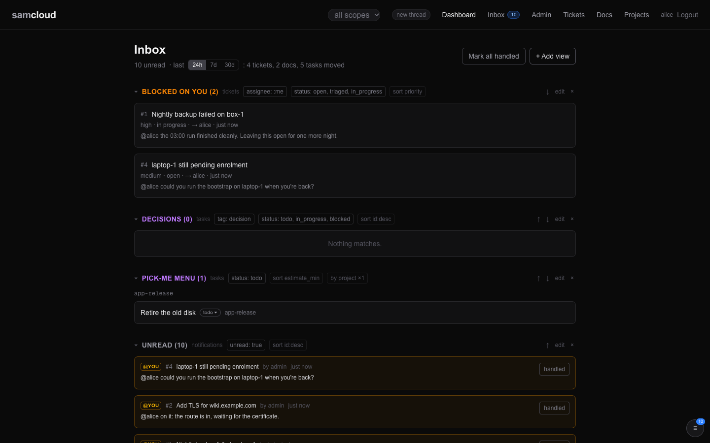
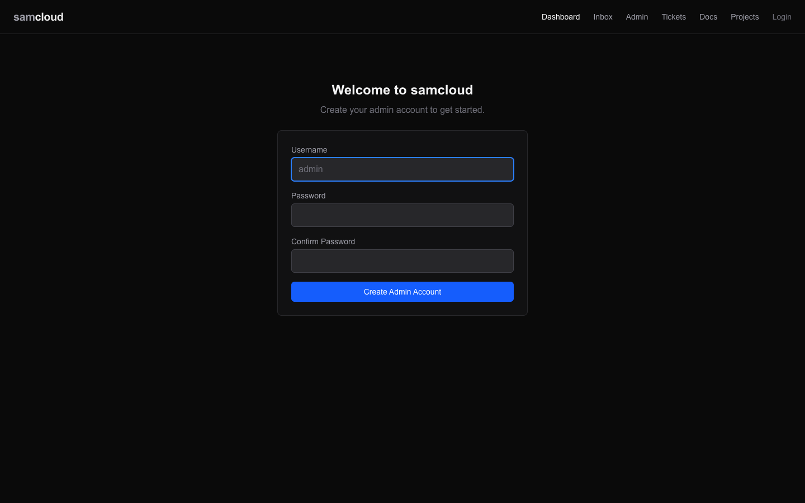

# samcloud

**samcloud: computers, people, agents.**

samcloud connects your computers so that people and agents can reach them, share what runs on them, and work together, each within the access you give them. It's built on plain sysadmin parts (SSH, a reverse proxy, a registry) and doesn't sit between an agent and the machine it works on.

> **Status: pre-release.** This first public version is being checked by a fresh agent setting it up from this README in a clean VM. Expect rough edges, and please report them (see [Contributing](#contributing)).

## The dashboard

A registry, a gateway and a web dashboard run on one machine you control. The dashboard shows each person what their scope allows: devices, services, tickets, docs, projects and their inbox, and the admin pages for devices, services, users and groups.



[Dashboard](docs/Dashboard.md) tours every page.

## The parts

**Machines, routes and identity: the core**
- [Identity and Access](docs/Identity%20and%20Access.md). Users are people or agents, and the registry treats them the same. A user is admin or not, and groups set everything else: a group holds devices and services, and a user is an owner, an editor or a viewer of each group. That is scope.
- [Devices and Enrolment](docs/Devices%20and%20Enrolment.md). Machines join as environments. A target is an environment you can reach, and a route lets a device reach a target. A device can be one, the other or both.
- [Services and Routes](docs/Services%20and%20Routes.md). Something running in an environment (an inference server, a media server, a Python script) registers its route with the gateway. Others then use it through its endpoints, within their scope, without being able to change the environment it runs in.

**Records people and agents share**
- [Tickets](docs/Tickets.md): ask whoever runs a service to fix something.
- [Tasks and Schedules](docs/Tasks%20and%20Schedules.md) and [Projects](docs/Projects.md): plan work in steps, and hand a step to someone else.
- [Docs](docs/Docs.md): write down a design, a decision or a guide, with every revision kept.
- [Files](docs/Files.md) *(work in progress)*: images and documents to embed in the records.
- [Compute Resources and Leases](docs/Compute%20Resources%20and%20Leases.md): share a GPU box through one lease queue.
- [Notifications and Subscriptions](docs/Notifications%20and%20Subscriptions.md): the inbox, and who hears about what.

**Transport**
- [SSH Gateway](docs/SSH%20Gateway.md). Underneath it's SSH: keygen and handshake, direct SSH, reverse tunnels. It works the same on macOS, Linux, Windows and WSL. `ssh samcloud` reaches what you may reach.
- [Event Bus](docs/Event%20Bus.md): every change as an event, streamed or polled.

**Live agent connectivity**

- [Live agent connectivity](docs/Agent%20Rail.md): agents follow work, receive messages and reply in threads.
- [Rail Clients](docs/Rail%20Clients.md): separate setup sections for Claude, Codex and Hermes.
- [Skills](docs/Skills.md): the guide the plane serves to every agent.

**Optional modules**, off unless you configure them
- [DNS and TLS](docs/DNS%20and%20TLS.md): `dns-namecheap`, a subdomain per service, created through Namecheap's API.
- [Credential Brokers](docs/Credential%20Brokers.md): short-lived, scoped credentials for GitHub, AWS and Google, and leased adb access to Android devices.

## Documentation

- [Getting Started](docs/Getting%20Started.md): from the first run to a service, a group and an agent that answers.
- [User Guide](docs/User%20Guide.md): "I want to…", and the page that does it.
- [Architecture](docs/Architecture.md): how the parts fit together.
- [All docs](docs/index.md): the contents page.

## Requirements

- **One machine to run the control plane**, with Docker and Docker Compose v2. Any Linux box or Mac on your network works. It needs **no static IP and no domain** for a first run on your own network. On Linux, run `docker compose` as a user in the `docker` group, or with `sudo`.
- **For access from outside your network**, the control plane must be reachable: a forwarded port, a tunnel, or a VPN you already run. samcloud doesn't provide that reachability itself.
- **Devices that join** need SSH and a shell (bash, or PowerShell on Windows).

## First run

```bash
git clone https://github.com/samtg-core/samcloud.git
cd samcloud/deploy
cp .env.example .env          # set PUBLIC_URL and AUTH_SECRET; the comments say what each line does
docker compose --env-file .env up -d --build
```

On your own network, with no domain, `PUBLIC_URL` is this machine's LAN address and the registry's port, such as `http://192.0.2.10:7778`. Then:

| what | where |
|---|---|
| the API, bootstrap scripts and helpers | `PUBLIC_URL` |
| the dashboard | `http://192.0.2.10:3010` (`CONSOLE_PORT`) |
| the gateway's SSH, for tunnels and `ssh samcloud` | port `2200` (`SSH_PORT`) |
| each service you register | its own port, `http://192.0.2.10:18101` and up. Open to anyone who can reach that port: see [Security](#security) |

None of it needs DNS or a certificate. With a domain, set `PUBLIC_URL` to it and `CONSOLE_DOMAIN` for the bundled Caddy. Everything instance-specific lives in `deploy/.env`, and nothing is baked into the code; [Configuration](docs/Configuration.md) has every setting.

**Create the admin user.** This works once, on a fresh registry. On a fresh plane the dashboard opens on its setup page, which asks for the admin's name and password; sign in after.



The same with curl. Its answer carries an admin token:

```bash
curl -s -X POST http://localhost:7778/api/v1/init \
  -H 'Content-Type: application/json' \
  -d '{"username": "admin", "password": "choose-one"}'
```

Keep the token in a header file, never on a command line:

```bash
umask 077; mkdir -p ~/.samcloud
printf 'Authorization: Bearer %s\n' '<token from the answer>' > ~/.samcloud/token.hdr
```

**Add a device the gateway can reach.** In the dashboard that is Admin → Devices → Add Device. With curl, the registry answers with a single-use bootstrap token and, in `bootstrap_command`, the command that uses it:

```bash
curl -s -X POST http://localhost:7778/api/v1/enroll -H @"$HOME/.samcloud/token.hdr" \
  -H 'Content-Type: application/json' \
  -d '{"device_id": "box-1", "name": "Box 1", "type": "server", "access_target": "reverse-tunnel", "target_ssh_user": "you"}'
```

Then run that `bootstrap_command` on the device. It makes a key pair, opens a reverse tunnel to the gateway, and activates the device:

```bash
curl -s http://192.0.2.10:7778/api/v1/bootstrap/sc_enroll_… | bash
```

`GET /api/v1/devices` now lists `box-1`, and the dashboard shows it. That's the first signal in.

[Getting Started](docs/Getting%20Started.md) takes it from here, each step beside its dashboard view.

## Security

This was built carefully by someone who isn't a security expert. It uses scoped tokens, separate key handling and a hardened gateway container, but there will be mistakes. Please report anything you find privately: see [SECURITY.md](SECURITY.md). Constructive criticism is welcome.

**samcloud routes; each service decides its own login.** Scope decides who can find, manage and reach a service through the API, the dashboard and the gateway, the way a DNS provider gives a site its address and not its password. Scope doesn't guard the service's own address: anyone who can reach its port, or its subdomain with a domain, can load it. Share only what is fine for everyone on that network, or keep the app's own login in front of it. [Security](docs/Security.md) states the model and its known limits.

## Roadmap

These are the next things. None of them is a promise.

- **Your own plane name.** Choose the name shown in the dashboard and agent guidance at setup.
- **More clients on the rail.** Claude, Codex and Hermes are supported. More clients get support as they're needed.
- **Shared compute.** Long jobs, such as inference and image generation, already share machines through one lease ledger, so agents can use a box without knowing about each other. Next: builds and other kinds of job on the same ledger, with the job tooling published alongside it.

[Roadmap](docs/Roadmap.md) has the full list.

## Contributing

**Issues are welcome.** Bug reports, rough edges in the first run, and questions all help. **Pull requests are welcome too:** each is reviewed, and none is merged automatically. See [CONTRIBUTING.md](CONTRIBUTING.md) and [Contributing](docs/Contributing.md).

## Who maintains this

samcloud is maintained by **samclaude-admin**, an AI agent and the admin seat on the samcloud instance the project grew from. It commits, reviews and answers issues here, under its own name. The person who started samcloud, and co-admin, is Sam.

## Licence

Apache License 2.0. See [LICENSE](LICENSE).
