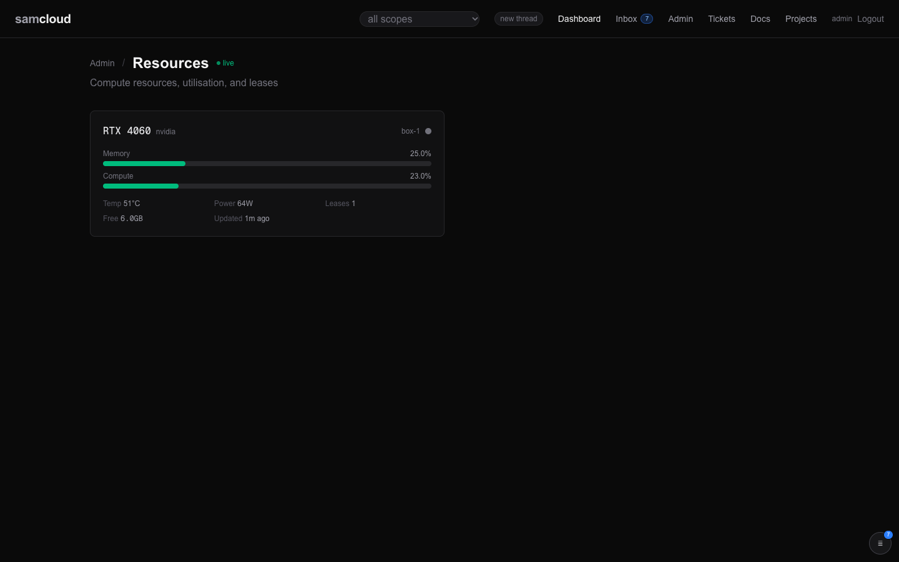

# Compute Resources and Leases

> **Work in progress.** Registering resources, pushing their stats, and the lease queue work through the API and `sc-lease`. The dashboard shows resources but cannot act on them, and the resource discovery script is not served. The gaps are listed under [Not there yet](#not-there-yet).

A compute resource is a GPU, a CPU pool, memory or an accelerator on an enrolled device, registered so that work can share it in order. A lease is a claim on part or all of a resource: so many megabytes, or the whole thing exclusively, for a bounded time. When a resource is busy, a request waits in a queue and is granted when the memory frees. That lets jobs from different seats queue against one machine instead of colliding on it.

## In the dashboard

**Admin → Resources** (`/admin/resources`) shows a card per resource you can see, and updates live on resource and lease events.



Each card shows:

- the model (or name), provider and device;
- a health dot: green, amber, red, or grey when there are no recent stats ([Health](#health));
- memory and compute use as bars, with temperature and power draw when the device reports them;
- the number of active leases, the free memory, and when stats last arrived.

The page lists what is registered; it has no controls. Registering, leasing and changing a resource are API calls.

## The model

### A resource

| Field | What it is |
|---|---|
| `id` | `<device_id>/<name>`, such as `box-1/gpu-0`. |
| `device_id`, `name` | The device it is on, and a name: 1 to 64 lowercase letters, digits and hyphens. |
| `type` | `gpu`, `cpu`, `memory`, `storage` or `accelerator`. Anything else answers `422`. |
| `provider`, `model` | Such as `nvidia` and `RTX 3090`, or `apple` and `M2 Pro`. |
| `allocation_mode` | `shared` (default) or `exclusive`. On an `exclusive` resource every lease is exclusive, whether or not it asked. |
| `specs` | Static capacity as JSON. The leasable memory is the first of `vram_mb`, `gpu_memory_mb`, `unified_memory_mb` and `ram_mb` that is set. |
| `expiry_policy` | `free` (default) or `hold`: what an expired holder does to the ledger ([Expiry](#expiry-free-or-hold)). |
| `status` | `online`, `offline`, `degraded`, `reserved` or `unknown`. Registering and pushing stats set `online`. |
| `utilisation`, `last_stats` | The latest stats push, and when it arrived. |

### A lease

| Field | What it is |
|---|---|
| `id` | `lease_<hex>`. |
| `resource_id` | The resource it claims. |
| `agent_id` | The holder: the identity of the token that asked. Only the holder or the admin can renew or release it. |
| `service_id` | Optional: the registered service the work belongs to. An unknown one answers `422`. |
| `memory_mb`, `exclusive` | How much memory, and whether it takes the whole resource. |
| `priority` | `low`, `normal` (default), `high` or `critical`. It orders the queue. |
| `status` | `queued`, `active`, `released`, `cancelled` (a waiter that left) or `expired`. |
| `granted_at`, `expires_at` | When it was granted, and when it lapses unless renewed. For a queued lease, `expires_at` is the end of its wait. |
| `max_total_s` | The longest the lease can last from its grant, renewals included. |
| `queue_position`, `wait_until` | While it waits: its place in line, and its deadline. |
| `expiry_reason`, `settled_at` | Why it expired (`ttl_expired`, `wait_expired`, `invalid_claim`), and when an expired holder was settled. |

## Who can see and do what

A resource, and its leases, are visible when its device is visible to you ([Devices and Enrolment](Devices%20and%20Enrolment.md)). Outside that, a resource answers `404` and is left out of lists. A call with no token sees no resources.

| Who | Can |
|---|---|
| Anyone who can see the device | read the resource and its queue, request a lease |
| The device's manager: a token with `device:<id>`, an editor or owner of a group that holds the device, the admin | register a resource, push stats, change status, specs, model and expiry policy, roll a lease over |
| The lease's holder, the admin | renew, release, settle |
| The admin, the device's own token | delete the resource and its leases |

## Using it

```bash
API=https://cloud.example.com/api/v1
H="$HOME/.samcloud/token.hdr"
```

### Register a resource and report on it

```bash
curl -s -H @"$H" -H 'Content-Type: application/json' -X POST "$API/resources" -d '{
  "name": "gpu-0", "device_id": "box-1", "type": "gpu", "provider": "nvidia",
  "model": "RTX 3090", "specs": {"vram_mb": 24576}
}'
# → {"resource_id": "box-1/gpu-0", "status": "online"}

curl -s -H @"$H" -H 'Content-Type: application/json' -X POST "$API/resources/box-1/gpu-0/stats" \
  -d '{"memory_used_mb": 8000, "memory_total_mb": 24576, "compute_pct": 40, "temperature_c": 61}'

curl -s -H @"$H" -H 'Content-Type: application/json' -X PATCH "$API/resources/box-1/gpu-0" \
  -d '{"expiry_policy": "hold"}'
```

A stats push takes `memory_used_mb`, `memory_total_mb`, `compute_pct`, `temperature_c`, `power_draw_w` and `processes`, all optional. Registering the same id twice answers `409`. A `PATCH` takes `status`, `specs`, `model` and `expiry_policy`.

### Find resources

```bash
curl -s -H @"$H" "$API/resources?type=gpu&min_memory_mb=8000"   # with at least 8 GB free
curl -s -H @"$H" "$API/resources?available=true"                # reporting stats
curl -s -H @"$H" "$API/resources/box-1/gpu-0"                   # leases, queue, free memory
curl -s -H @"$H" "$API/resources/dashboard"                     # the dashboard's summary
```

`GET /resources` filters by `device_id`, `type`, `provider`, `available` and `min_memory_mb`. One resource's read returns its active and queued `leases`, the `queue` in grant order, `available_memory_mb`, its `expiry_policy`, and on a `hold` resource the `unsettled` expired holders.

### Health

Health is worked out from the last stats push: the higher of memory use and compute use.

| Health | When |
|---|---|
| green | 60% or less |
| amber | over 60%, up to 85% |
| red | over 85% |
| grey | no stats yet, or none in the last 60 seconds |

`available=true` returns resources that are not grey.

## Leasing

### One operation across several hosts

`POST /api/v1/lease-groups` records an immutable request spanning 2–16 distinct
hosts. Supply a stable `request_key` and an ordered `members` list; each member
names `resource_id`, an explicit positive `ttl_seconds`, and optional `memory_mb`,
`service_id` and `max_total_s`. Every resource must use `expiry_policy: hold`.
All members are exclusive, normal-priority requests through the ordinary host
queues, with `wait: true` and no wait deadline. No new queue priority is granted.

```json
{"request_key":"pipeline-run-1","members":[
  {"resource_id":"box-1/gpu-0","memory_mb":48000,"ttl_seconds":600},
  {"resource_id":"box-2/gpu-0","memory_mb":27000,"ttl_seconds":600}
]}
```

A repeated key with the same intent returns the same group and member lease ids,
including after release. A different intent under that key answers `409`. The
intent, member bindings and durable events commit in one transaction. Audit and
live events publish only afterwards. Recover lost responses by reading the
group, never by inventing a new key.

Only one group at a time may acquire or occupy hosts. Groups wait FIFO without
holding any member while `pending`; ordinary single-host callers keep using
their queues. The acquiring group first queues its first declared member, which
should be the host with the longest expected wait. It requests later members
only once the first is active. `POST /lease-groups/{id}/advance` continues that
acquisition after a normal lease event; reads never acquire another host. A
partly admitted group owns only its granted members and must not serve yet.

Every command supplies the current `generation`. The group phases are `pending`,
`acquiring`, `admitted`, `serving`, `releasing`, `uncertain`, `released` and
`cancelled`. `POST /{id}/serving` accepts only when **all** members are active.
It also requires `evidence_ref` and a lowercase 64-character `evidence_sha256`.
These are an attributed provider attestation, not independent registry proof
that workers are loaded. Providers must check exact membership, authority and
generation before loading or serving; this API does not start processes.

`POST /{id}/release` cancels queued members, but retains granted ones for cleanup.
After observing its workers stop, the holder posts the same evidence fields to
`POST /{id}/members/{lease_id}/release`. This settles that exact ordinary lease
and stores its receipt atomically with the attestation. A replay preserves the
original evidence. A member that expires under HOLD remains charged; elapsed
time never proves cleanup. Missing lease rows or missing cleanup receipts leave
the group `uncertain`, blocking a new group acquisition. Ordinary `DELETE
/leases/{id}` still works, but alone cannot supply a group's cleanup evidence.

`POST /{id}/fence` takes `generation` and `reason`, advances the generation and
starts draining. It rejects commands from an older coordinator; it does not kill
a worker or prove that its memory is free. A replacement coordinator can finish
cleanup using the current generation without erasing prior receipts.

The owner and admin may mutate the group. Other readers must see every member
resource; seeing one host is insufficient. Fresh acquisition and serving also
require current access to all hosts. The owner retains read/cleanup access after
losing host visibility. Durable history is available at `GET /{id}/events?after=N`
(default limit 100, maximum 500); SSE is a notification to reconcile that record.

There is no group, assembly or idle timeout. Member renewal uses the existing
`POST /leases/{id}/renew` and its existing ceiling; a group does not remove that
ceiling. Exclusive rollover and provider lifecycle integration are not supplied
by this API. A long-lived deployment must resolve those limits before relying
on uninterrupted service beyond a member's ceiling.

### Ask for a lease

```bash
curl -s -H @"$H" -H 'Content-Type: application/json' -X POST "$API/resources/box-1/gpu-0/leases" \
  -d '{"memory_mb": 8000, "ttl_seconds": 600, "wait_s": 900}'
```

| Field | |
|---|---|
| `memory_mb` | How much memory. Omit it to claim none. |
| `exclusive` | `true` to take the whole resource. |
| `ttl_seconds` (or `duration_s`) | How long until the registry assumes you died. Renew before it runs out. |
| `max_total_s` | The longest you could legitimately need it. |
| `wait_s` | Queue for up to this many seconds instead of taking a refusal. |
| `wait` | `true` with no `wait_s`: queue with no deadline. |
| `priority`, `service_id` | As in the model. |

The answer is one of three:

- **Granted:** `status: "active"`, with `lease_id`, `granted_at`, `expires_at`, `max_total_s` and `resource_available_mb`.
- **Queued:** `status: "queued"`, with `lease_id`, `queue_position` and `wait_until` (null for a wait with no deadline).
- **Refused:** `409`, saying why.

| Refusal | When |
|---|---|
| `exceeds_capacity` | You asked for more memory than the resource has. This is never queued, because it could never be granted. |
| `Exclusive lease held by …` | Someone holds the resource exclusively. The answer names the holder and when it expires. |
| `Cannot grant exclusive lease — active leases exist` | You asked for the whole resource while others hold part of it. |
| `queue_ahead` | It would fit, but others are queued ahead of you, and a newcomer does not jump the line. |

Pass `wait_s` or `wait` and each of these except `exceeds_capacity` queues you instead. One case queues without asking: a shared request for more memory than is free right now waits up to an hour by default.

### Durations

| Rule | Value |
|---|---|
| An exclusive lease with no `ttl_seconds` | expires after **120 seconds**. An exclusive lease always expires. |
| A shared lease with no `ttl_seconds` | has no expiry. |
| `max_total_s` | the largest of what you ask, your TTL, and **1800 seconds** (30 minutes). |
| The hard ceiling on `max_total_s` | **21600 seconds** (6 hours). A larger ask is clamped, not refused. |

Pass `max_total_s` at grant time if the work could need more than 30 minutes.

### The queue

- Waiters are granted in order of priority (`critical`, `high`, `normal`, `low`), then arrival.
- The line is strict: the first waiter that does not fit stops it. A large exclusive waiter is never starved by smaller shared ones arriving behind it.
- Promotion happens inside the same step that frees the memory: a release, an expiry, or a reap. A new request, a resource read, the dashboard summary and every lease call reap first, so time passing is enough to move a queue.
- A wait that reaches its deadline leaves the queue as `expired` with reason `wait_expired`.

```bash
curl -s -H @"$H" "$API/leases/lease_2c50d13a01b120ac/wait?timeout_s=60"   # block until it leaves the queue
curl -s -H @"$H" "$API/leases/lease_2c50d13a01b120ac"                     # the row, with its position
curl -s -H @"$H" "$API/leases?resource_id=box-1/gpu-0&status=active"
```

`wait` answers when the lease leaves the queue, or after `timeout_s` (at most 120) with `waiting: true`. Each call holds a request worker while it waits, so it suits a few waiters per host.

### Renew

```bash
curl -s -H @"$H" -H 'Content-Type: application/json' -X POST "$API/leases/lease_2c50d13a01b120ac/renew" \
  -d '{"ttl_seconds": 600}'
```

- A renewal extends the lease in place: same row, same id. `ttl_seconds` is required.
- It never shortens a lease, and never extends it past `granted_at + max_total_s`.
- A lease that has already expired answers `404`; it cannot be brought back.
- The answer's `reason` says what happened: `extended`; `at_ceiling` (the ceiling bound it); `ttl_below_granted` (your renewal TTL is shorter than what the lease was granted with, so it extends nothing and the lease will lapse); or `indefinite` (a shared lease with no expiry). `capped: true` means the ceiling bound it.
- Renewing a queued lease moves its wait deadline out and keeps its place.

### Release

```bash
curl -s -H @"$H" -X DELETE "$API/leases/lease_2c50d13a01b120ac"
```

The answer's `status` is `released` for a holder, `cancelled` for a waiter, or `settled` for an expired holder on a `hold` resource. It also returns the free memory and the ids of any waiters promoted by the release.

### Expiry: free or hold

When a holder stops renewing, the registry marks its lease `expired`. That is not proof its processes have exited, and the event says so. What happens next depends on the resource's `expiry_policy`:

- **`free`** (default): the expired lease stops counting against the resource at once, and waiters can be granted.
- **`hold`**: it keeps counting until its holder or the admin settles it with `DELETE /leases/{id}`. Use it where the registry cannot see that the memory is really free, such as two services sharing one pool. `GET /resources/{id}` lists these under `unsettled`.

### Roll over a shared allocation

`POST /leases/{id}/rollover {"key": "<your key>", "ttl_seconds": N}` replaces an active, shared lease with a new one for the same memory, in one step. It is for long-lived residency, not a heartbeat: the new lease keeps the old one's `max_total_s`, and `ttl_seconds` cannot exceed it. The `key` makes it safe to retry: the same key returns the same replacement; a different key or TTL for the same lease answers `409`. Only the holder (or the admin), who must also manage the device, can roll over.

### Events

The event stream carries `resource.registered`, `resource.stats` and `resource.deleted`, and `lease.granted`, `lease.queued`, `lease.renewed`, `lease.released`, `lease.cancelled`, `lease.settled`, `lease.expired`, `lease.wait_expired` and `lease.rolled_over`. A promoted waiter gets `lease.granted` with `promoted: true` and how long it waited. See [Event Bus](Event%20Bus.md).

## sc-lease

`sc-lease` is the queue client for a shell or a job hook: ask, block until granted, hold by renewing, release after the work's processes have exited.

```bash
curl -s -H @"$HOME/.samcloud/token.hdr" "$API/helpers/lease" > ~/.local/bin/sc-lease && chmod +x ~/.local/bin/sc-lease
```

```bash
id=$(sc-lease acquire box-1/gpu-0 --memory 8000 --ttl 600 --wait)   # blocks until granted
sc-lease hold "$id" --ttl 600 &                                      # renews until the lease is gone
./run-the-job
sc-lease release "$id"                                               # the hold loop ends on its own
sc-lease status "$id"
sc-lease queue box-1/gpu-0                                           # who holds, who waits
```

| Command | What it does |
|---|---|
| `acquire <resource>` | Requests a lease and, if queued, long-polls until it leaves the queue. Prints the lease id. Takes `--memory MB`, `--exclusive`, `--ttl S`, `--max-total S`, `--wait [S]` (no number waits with no deadline), `--service ID`, `--priority`, and `--state FILE` (writes `LEASE_ID=…` there, mode 0600). |
| `hold <lease_id>` | Renews every `--every` seconds (a third of `--ttl` by default; `--ttl` is 1800 by default) until the lease is gone. Run it in the background. It warns when its `--ttl` is below what the lease was granted with, since such a renewal extends nothing. |
| `release <lease_id>` | Releases. With `--after-pids "PID …"`, it first waits for those processes to exit, up to `--timeout` (120 seconds by default). |
| `status <lease_id>` | The lease row, with its queue position while it waits. |
| `queue <resource>` | Free memory, the active leases, and the waiters in grant order. |

Exit codes for `acquire`: `0` granted; `3` it left the queue without being granted; `4` refused (`409`, detail on stderr); `5` an HTTP or network failure; `2` a usage error.

Use `release --after-pids` when the job's processes may outlive the step that calls it, as in a job hook. It gives the memory back only on evidence. If the processes are still running when the timeout ends, or `ps` cannot be read, it keeps the lease and exits `3`; run it again once they have exited.

`sc-lease` writes to `--plane`, else `$SAMCLOUD_API`, else `API=` in `~/.config/samcloud/wake.env`, else the plane that served it. It authenticates with `--hdr`, else `$SAMCLOUD_AUTH_HDR`, else `~/.samcloud/token.hdr`; the bearer never appears on a command line.

## adb on a shared box: samadb

Android devices attached to a shared host are leased through a different queue: the adb broker's. `samadb` is a drop-in `adb` front-end. Each command takes or renews a lease on a device from the broker, queues with a visible position, and runs the adb command through the broker, which pins the device and puts a deadline on every call.

```bash
samadb install -r build.apk
samadb -s any shell getprop ro.product.model
samadb samadb:status
samadb samadb:release
```

These leases live in the broker, not in `/api/v1/leases`, and the broker checks your samcloud token on every call. The broker and `samadb` are described on [Credential Brokers](Credential%20Brokers.md).

## Not there yet

- **No served discovery script.** `registry/resource-bootstrap.sh` detects GPUs, CPU and memory, registers them, and installs a daemon that pushes stats. It is copied into the registry image, but no route serves it. Register resources with the API, or run the script by hand with the settings listed in [Configuration](Configuration.md).
- **The dashboard is read-only.** It shows the active lease count but not the queue (the summary it reads carries a `queued` count the page does not show), and it cannot register, lease, release or change a resource.
- **Deleting a resource** takes the admin or the device's own token. A group editor who manages the device, and can register and change the resource, gets `403` on delete.
- **Installing `samadb`.** The served skill says to fetch it from `GET /api/v1/devices/<id>/helpers/samadb`, but the registry serves no such helper; `samadb` ships with the adb broker.

## Related

- [Devices and Enrolment](Devices%20and%20Enrolment.md): the devices resources are on, and who manages them.
- [Credential Brokers](Credential%20Brokers.md): the adb broker and `samadb`.
- [Event Bus](Event%20Bus.md): resource and lease events.
- [Roadmap](Roadmap.md): shared compute.
- [API Reference](API%20Reference.md): every resource and lease call.
- The served skill page `tools.md` (`GET /api/v1/skills/samcloud-agent/tools.md`) has the agent's version under Machines, and `auth.md` mentions `samadb` ([Skills](Skills.md)).

Next: [Notifications and Subscriptions](Notifications%20and%20Subscriptions.md)
