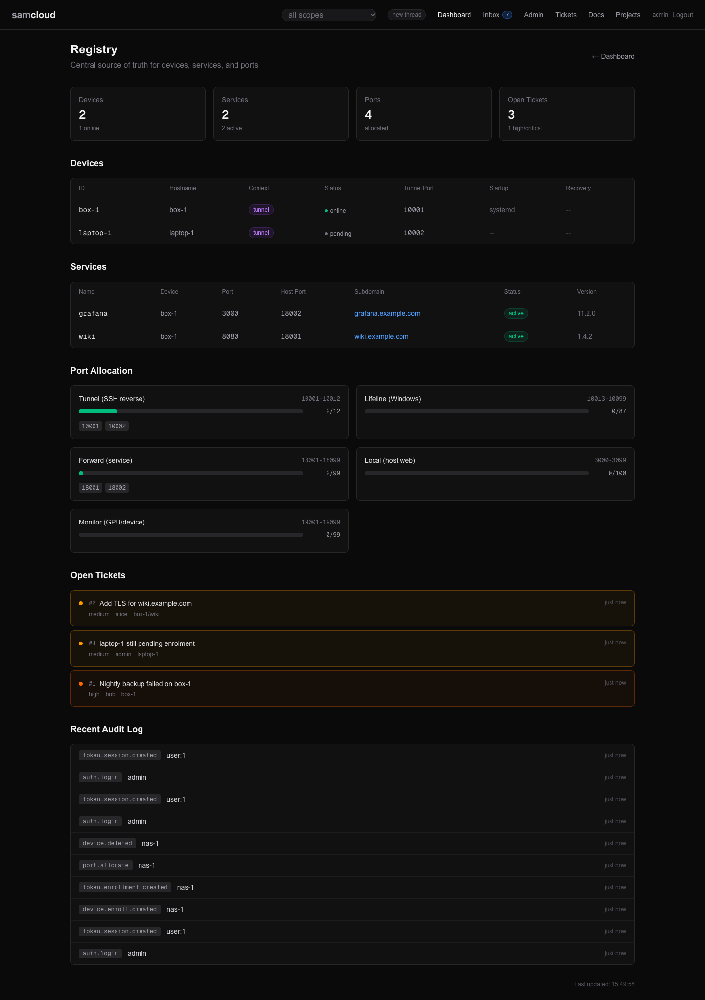

# DNS and TLS

How a service gets a name and a certificate. The registry publishes each route under a domain, the optional `dns-namecheap` module creates its DNS record, and the bundled Caddy terminates TLS and proxies to the service. A plane needs none of this for a first run on a LAN: with no domain, each service gets its own port instead.

## In the dashboard



The registry view lists every route you can see, with its subdomain, domain and target. A route's DNS record and its certificate are not shown there: check them with `dig` and in the Caddyfile, below.

## The service domain

A route or service is published under the **service domain** when its request names no `domain`:

| set | service domain | a service lands at |
|---|---|---|
| `SAMCLOUD_DOMAIN=example.org` | `example.org` | `https://app.example.org` |
| nothing, `PUBLIC_URL=https://cloud.example.org` | `PUBLIC_URL`'s host itself | `https://app.cloud.example.org` |
| nothing, `PUBLIC_URL=http://192.0.2.10:7778` | an IP address, which can't carry subdomains | `http://192.0.2.10:18101`, its own port from the route range, plain HTTP |

No parent domain is guessed, because which part of a name an instance controls can't be read from the name. An instance that publishes under a parent, such as a plane at `cloud.example.org` publishing under `example.org`, sets `SAMCLOUD_DOMAIN`. A request can still name another domain in its `domain` field.

Devices dial their tunnel at `PLANE_HOST`, which falls back to `PUBLIC_URL`'s host. [Configuration](Configuration.md#the-plane) lists all three settings.

## The dns-namecheap module

DNS records for service subdomains come from an optional module, `dns-namecheap`.

- **Off:** the registry still creates the Caddy route, and the route's answer carries `"dns": {"success": null, "skipped": true, …}` instead of a failure. Pointing the name at the host is the instance's own job: a wildcard record, a local resolver, or another DNS service.
- **On:** activating a route adds an A record for its subdomain, pointing at the host's public IP, and deleting the service removes it.
- **A route under an IP address** is reached by port, so there is no name to record; the answer says `skipped` whether the module is on or off.

`SAMCLOUD_MODULES` (comma-separated) switches modules on: `dns-namecheap` turns it on, and `none` turns every module off. Unset or empty, the module is on when Namecheap credentials are configured: `NAMECHEAP_API_KEY` and `NAMECHEAP_API_USER` in the environment, or `~/.config/samcloud/namecheap.env` inside the registry container. `GET /api/v1/` reports `modules.dns-namecheap`.

The module only touches the domain a call names. Its code is `registry/dns.py`.

### setHosts replaces every record

Namecheap's `setHosts` call replaces **all** records in a zone. So every change the module makes is a read-modify-write:

1. GET every existing record (`getHosts`).
2. Add, update or remove the one record.
3. SET the whole list back. The module POSTs it, since a zone with many records overflows a URL.
4. Read the zone again and check the record is in the state it meant.

Caddy's Namecheap plugin does the same read-modify-write on the same zone when it answers a DNS-01 challenge. When the two overlap, one can clobber the other's change. Step 4 catches that, and the module retries from a fresh read, up to three times. Each outcome is in the audit log (`record.added`, `record.updated`, `record.removed`, `record.clobbered`).

## Namecheap API recipes

For checking or repairing a zone by hand. The credentials sit in `~/.config/samcloud/namecheap.env`:

```bash
source ~/.config/samcloud/namecheap.env
# Sets NAMECHEAP_API_USER and NAMECHEAP_API_KEY
```

Namecheap only answers from an IP address you have allow-listed in its API settings, and every call names that IP as `ClientIp`.

### Get current records

```bash
source ~/.config/samcloud/namecheap.env
IP=$(curl -s ifconfig.me)
curl -s "https://api.namecheap.com/xml.response?\
ApiUser=${NAMECHEAP_API_USER}&ApiKey=${NAMECHEAP_API_KEY}&\
UserName=${NAMECHEAP_API_USER}&ClientIp=${IP}&\
Command=namecheap.domains.dns.getHosts&SLD=example&TLD=org"
```

### Add a new A record

> **`setHosts` replaces ALL records.** Include every existing record in the call, or they are deleted.

1. GET all current records.
2. Build a `setHosts` call with all existing records plus the new one.
3. Each record needs four parameters: `HostNameN`, `RecordTypeN`, `AddressN` and `TTLN`.

```bash
source ~/.config/samcloud/namecheap.env
IP=$(curl -s ifconfig.me)

# Include ALL existing records + the new one
curl -s "https://api.namecheap.com/xml.response?\
ApiUser=${NAMECHEAP_API_USER}&ApiKey=${NAMECHEAP_API_KEY}&\
UserName=${NAMECHEAP_API_USER}&ClientIp=${IP}&\
Command=namecheap.domains.dns.setHosts&SLD=example&TLD=org&\
HostName1=@&RecordType1=A&Address1=${IP}&TTL1=1800&\
HostName2=cloud&RecordType2=A&Address2=${IP}&TTL2=1800&\
...all existing records...&\
HostNameN=NEW_SUB&RecordTypeN=A&AddressN=${IP}&TTLN=1800"
```

The module writes its records with TTL 1800. The example zone below gives `tunnel` TTL 300, so a changed address reaches devices sooner.

### Verify

```bash
# Check the record
dig +short myservice.example.org

# If your local resolver is stale, ask a public one
dig +short myservice.example.org @8.8.8.8
```

## DDNS

A host on a residential connection usually has a dynamic public IP. `scripts/ddns-update.sh` updates every A record in the zone when the IP changes, preserving all other records; run it from cron every 5 minutes. The zone it updates is `SAMCLOUD_DOMAIN`, from its environment or from `~/.config/samcloud/namecheap.env` beside the Namecheap credentials; it stops without one. It caches the last-known IP at `~/.cache/samcloud/ddns-ip`.

```
*/5 * * * * /path/to/samcloud/scripts/ddns-update.sh >> ~/logs/ddns.log 2>&1
```

## Example records

The registry is the record of what is routed: `GET /api/v1/routes` lists every subdomain, its target and its service. A zone for an example instance under `example.org` looks like this. Every service record points at the control-plane host's public IP, where Caddy terminates TLS and proxies to the target.

| Subdomain | Target | Service |
|-----------|--------|---------|
| `@` | host IP | Landing page |
| `cloud` | host IP | The plane (registry API and console) |
| `media` | host IP | A LAN media server (`mediahost/media`), proxied by Caddy |
| `my-service` | host IP | A service on `gpu-1`, reached over its reverse tunnel |
| `tunnel` | host IP | The SSH tunnel endpoint devices dial (TTL 300) |

## TLS

The bundled Caddy terminates TLS for the console, the API and every service route. How it gets certificates depends on `CONSOLE_DOMAIN` and the Namecheap credentials, read when Caddy first boots:

| configuration | certificates |
|---|---|
| `CONSOLE_DOMAIN=:443` (the default), no name | Caddy's own CA, issued on demand for whatever name or IP address a client asks for (`tls internal` with `on_demand`, and a `default_sni` for clients that send no name). Clients that don't trust that CA see a warning. |
| a name, e.g. `cloud.example.org`, with Namecheap credentials | public certificates through ACME **DNS-01** over Namecheap, from the CA `ACME_CA` names (Caddy's default when unset). DNS-01 needs no inbound connection to Caddy, so it works whatever sits in front of it: sslh on 443, a forwarded port. |
| a name, no Namecheap credentials | Caddy's default ACME challenges, which need the CA to reach Caddy from the internet |

`ACME_EMAIL` sets the ACME account's contact. The Caddy image is built with the `caddy-dns/namecheap` module (`deploy/Dockerfile.caddy`).

Routes under an IP address are served plain HTTP on their own port, with no certificate.

## The Caddyfile

The live Caddyfile is on the shared `registry-data` volume: `/registry-data/Caddyfile` as Caddy sees it, `/data/Caddyfile` as the registry sees it.

- **First boot only:** `deploy/caddy-entrypoint.sh` writes it when the file is absent. It holds the global options, the `(samcloud-tls)` snippet when Namecheap credentials are set, the console and API block for `CONSOLE_DOMAIN` (`/api/v1/*` to `registry:7777` with streaming flushed, everything else to `console:3000`), and a RustDesk block when `RUSTDESK_DOMAIN` is set.
- **After that:** the registry appends one block per activated route, marked `# <fqdn> (registry-managed)`, and every block imports the `samcloud-tls` snippet when it exists, or certificates never issue. It removes the block when the service is deleted.
- **Reload:** the registry posts the whole file to Caddy's admin API on `caddy:2019`, which is internal to the compose network. If that fails it tries the `caddy` CLI, which the registry image does not have, so in compose the admin API is what reloads. A failed reload restores the previous file. A copy of the file before each change is kept beside it as `Caddyfile.bak.registry`.
- **Later edits to settings** (`CONSOLE_DOMAIN`, `ACME_*`, `RUSTDESK_DOMAIN`, the Namecheap credentials) take effect only when the file is removed, so the entrypoint writes it again, or edited by hand.

You don't edit the registry-managed blocks by hand. To read the file and check it:

```bash
cd deploy
docker compose --env-file .env exec caddy cat /registry-data/Caddyfile
docker compose --env-file .env exec caddy caddy validate --config /registry-data/Caddyfile
```

To push routes again from the database, say after restoring a volume:

```bash
# One route
curl -X POST "$PLANE/routes/myapp/activate" -H @"$HOME/.samcloud/token.hdr"

# Every route (cold start recovery; admin)
curl -X POST "$PLANE/routes/activate-all" -H @"$HOME/.samcloud/token.hdr"
```

`$PLANE` is the plane's API base, `PUBLIC_URL` followed by `/api/v1`. Activating one route also re-binds the service's forward and retries its DNS record; `activate-all` binds forwards and pushes Caddy blocks, without DNS. A block already in the file is left as it is. [Services and Routes](Services%20and%20Routes.md) covers routes and activation.

## Related

- [Configuration](Configuration.md#tls-and-the-proxy): `CONSOLE_DOMAIN`, `ACME_*` and the module's settings
- [Services and Routes](Services%20and%20Routes.md): routes, activation and the forward module
- [Troubleshooting](Troubleshooting.md#dns-not-resolving)
- [Architecture](Architecture.md): where Caddy and sslh sit

Next: [Credential Brokers](Credential%20Brokers.md)
