# Dashboard

The dashboard is the web face of the plane. It runs beside the registry, at `CONSOLE_PORT` on the plane (`http://192.0.2.10:3010`), and behind the bundled Caddy at `CONSOLE_DOMAIN` (`https://192.0.2.10:9443` with no domain). It shows each person their inbox, the records they share, and the machines and services in their scope, and it gives admins the pages that enrol devices, make service slots, invite users and set up groups.

The dashboard holds no rights of its own. It forwards the signed-in user's own API token to the registry for every request, and the registry answers within that user's scope, so two people see two different dashboards. Anything the dashboard does, the [API](API%20Reference.md) does too; each primitive's page shows both.

## Getting in

Four pages work before you sign in. Every other page sends you to `/login` first, and a plane with no users yet sends everyone to `/setup`.

| page | what it does |
|---|---|
| `/setup` | First run only. Creates the admin account (username, password, confirm), the same as `POST /api/v1/init`. Once any user exists it goes to the overview. |
| `/login` | Sign in with a username and password. Each sign-in is its own login token, valid for a week, and starts a new dashboard conversation (see [Around every page](#around-every-page)). |
| `/invite/<token>` | Where an invited person activates. It shows the username, role, scope and the services already in scope, takes a password, and shows the API token once. |
| `/pair` | Makes a single-use pair command for a machine with no samcloud token: run it there and it makes a key pair, installs it and configures `ssh samcloud`. It shows a QR and a short address, `/p/<code>`. Opened on the new device, that page shows the command to copy, with no sign-in. It works once, within an hour. *Or generate in browser* makes the key pair here instead, for you to install by hand. Making either needs you signed in. |

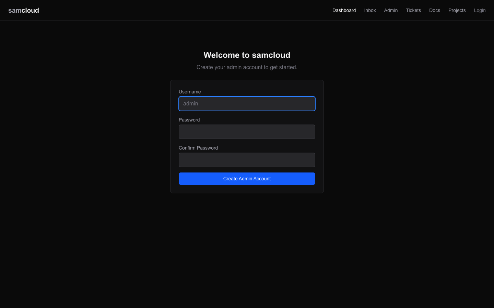

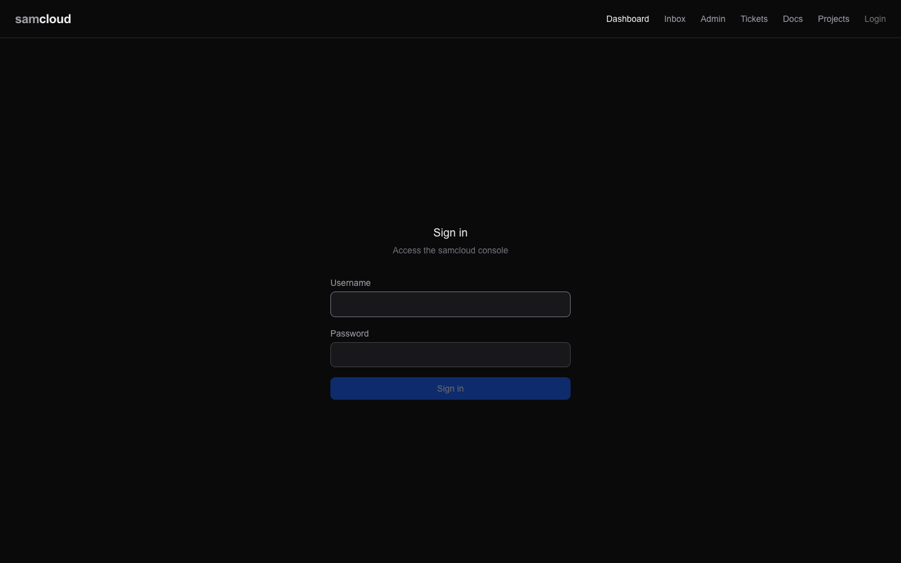

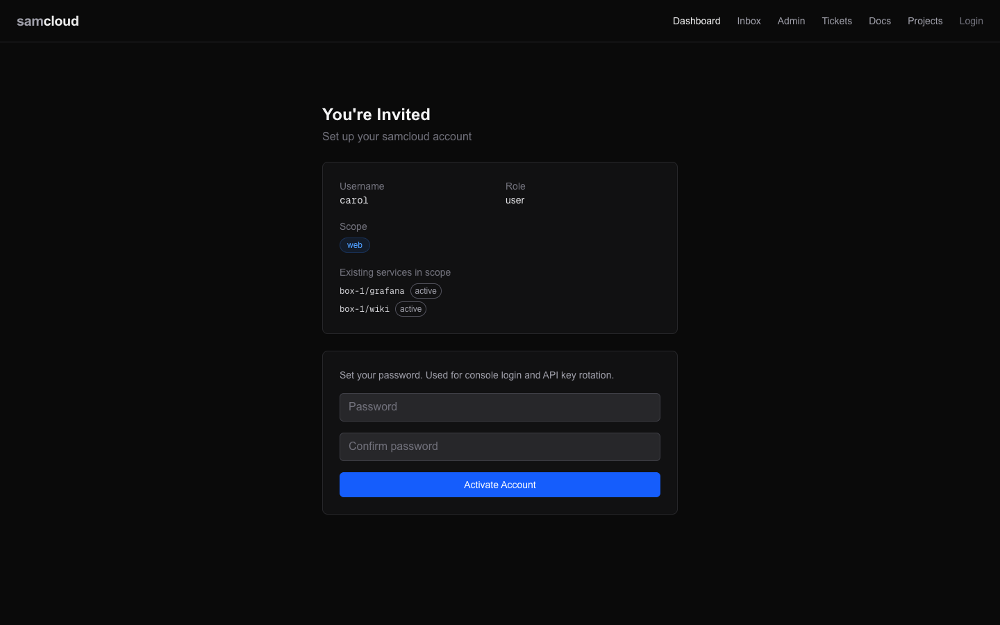

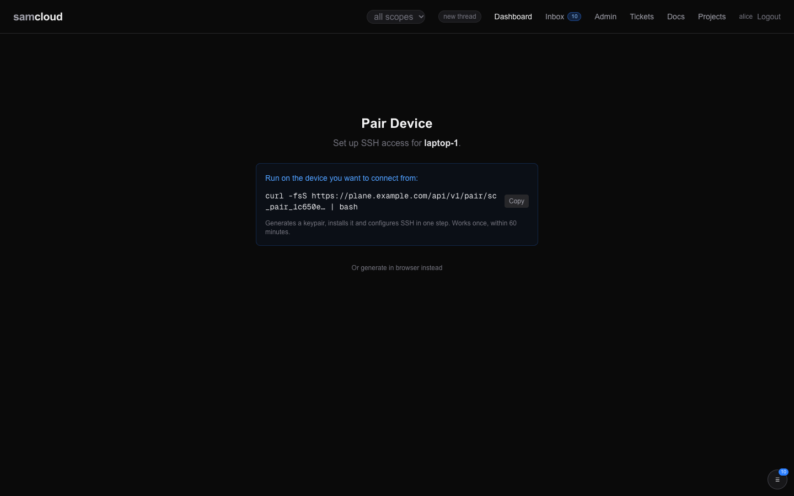

[Identity and Access](Identity%20and%20Access.md) covers invites and tokens; [Devices and Enrolment](Devices%20and%20Enrolment.md) covers pair links.

## Around every page

The header carries:
- **The scope switch** (`all scopes`, or one of your groups). Picking a group narrows the Tickets, Docs and Projects lists to it, and turns amber so a narrowed view is never mistaken for the whole.
- **The thread switch.** Everything you create in the dashboard joins one thread, the way a session does. It shows the current thread as `#id title`, or *new thread* when the next thing you create will start one. Pick *New thread* for a fresh conversation, or resume one of the open threads listed. [Agent Rail](Agent%20Rail.md) explains threads and conversations.
- **Dashboard, Inbox, Admin, Tickets, Docs, Projects**, your username and **Logout**. Inbox carries your unread count.

In the bottom-right corner, **≡** opens quick actions: *New ticket*, *New doc*, *New task*, *Upload file* and *Jump to inbox*, with the unread count. On pages with comments or sections, the arrows beside it step to the next or previous one; a double-click jumps to the bottom or top.

When you open a notification from the inbox, the rest of the list becomes a queue: a pill at the bottom of the page offers *next* and *back* until you dismiss it.

## The overview: `/`

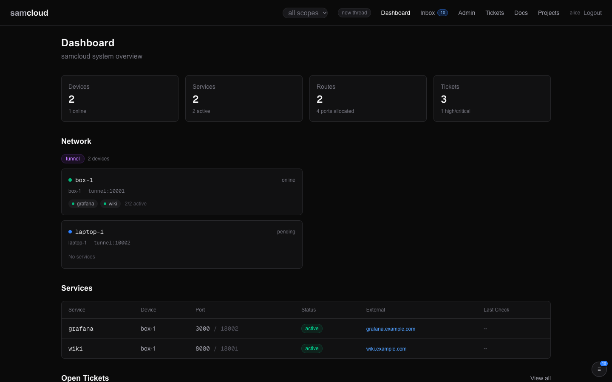

The system overview, refreshed every 15 seconds:
- **Counts:** devices (and how many are online), services (active), routes (and ports allocated), open tickets (and how many are high or critical).
- **Network:** each device, grouped by how it connects, with its status, hostname, address, tunnel port and its services.
- **Services:** name, device, port and forward port, status, external address, and the last health check.
- **Open tickets**, linking to the Tickets page.
- **Recent activity:** the last ten audit entries, linking to the full registry.

## Inbox: `/inbox`

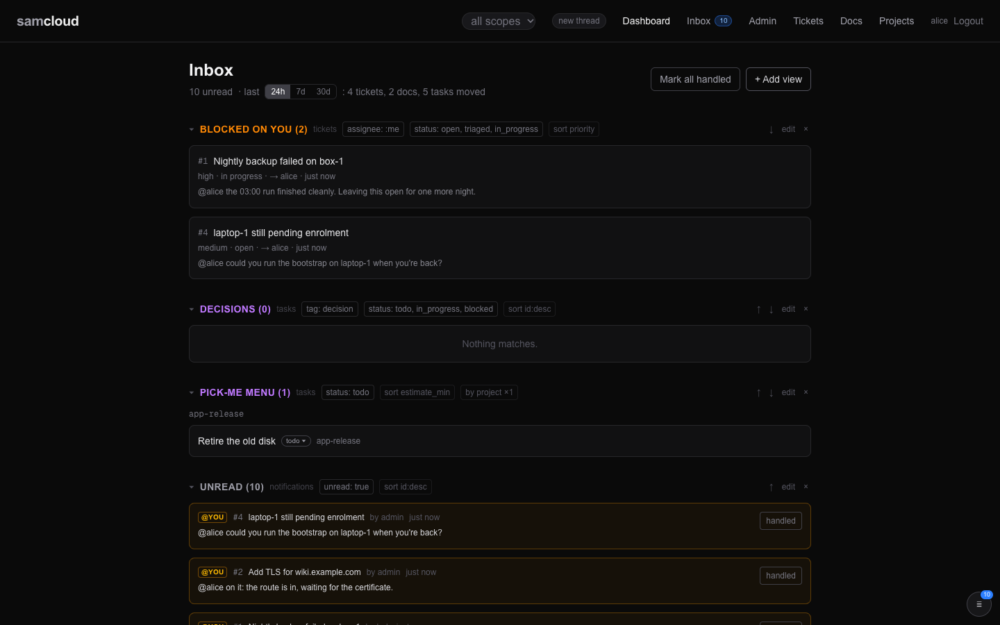

The inbox is a stack of **saved views**: each section is a named filter over live data, and every section is yours to change. The header shows your unread count and how many tickets, docs and tasks moved in the last 24 hours, 7 days or 30 days. **Mark all handled** acknowledges every unread notification; **+ Add view** opens the view builder.

Each section shows up to 30 items. Its header names the view, its entity, its filters, sort and grouping, with buttons to move it up or down, edit it or delete it; drag a header onto another to reorder. Collapsing a section is remembered in this browser. Deleting a view leaves the data alone.

**Notification views** fold the updates on one ticket, doc or task into one card ("3 updates · latest commented by …"). A card's **Handle** acknowledges every unread update in it, and opening the card does the same. A mention of you stays a card of its own, marked `@you`, with its own **handled** button. Handled means handled: it does not come back.

**Task rows** carry their status as a control: change it on the card.

### Saved views

A view is one entity (tickets, tasks, docs or notifications), a set of filters, a sort, and an optional grouping. Your first visit seeds four, as ordinary views you can edit, rename or delete. If you delete all of them, the next visit seeds them again.

| view | entity | filters | sort, grouping |
|---|---|---|---|
| Blocked on you | tickets | assigned to you; open, triaged or in progress | by priority |
| Decisions | tasks | tagged `decision`; to do, in progress or blocked | newest first |
| Pick-me menu | tasks | to do | smallest estimate first, one per project |
| Unread | notifications | unread | newest first |

The builder offers what the entity supports, and the registry refuses anything else with a 400:

| | tickets | tasks | docs | notifications |
|---|---|---|---|---|
| filters | `assignee`, `status`, `priority`, `type`, `tag`, `group_scope`, `age_hours` | `assignee`, `status`, `priority`, `tag`, `project`, `group_scope`, `age_hours` | `assignee` (the doc's owner), `status`, `kind`, `group_scope`, `age_hours` | `unread`, `age_hours` |
| sort | `priority`, `created_at`, `updated_at`, `id` | `estimate_min`, `created_at`, `updated_at`, `position`, `id` | `created_at`, `updated_at`, `id` | `id`, `created_at` |
| group by | `priority`, `status`, `type` | `project`, `status` | `kind`, `status` | — |

- `assignee: ":me"` means whoever runs the view.
- `age_hours` (1–8760) keeps what changed in that many hours; for notifications, what arrived.
- A sort is a field, or `field:desc`. With none, newest first.
- `limit_per_group` (1–50) caps each group: the Pick-me menu's "one per project".
- A task's `group_scope` is its project's group.
- Results always pass the normal scope checks: a view never shows what you can't see. Notifications are always your own.

The same views through the API:

```bash
curl -s $PLANE/views -H @"$HOME/.samcloud/token.hdr"                     # yours, in order; the first call seeds four
curl -s -X POST $PLANE/views "${H[@]}" \
  -d '{"name":"Open bugs","entity":"tickets","filters":{"type":["bug"],"status":["open"]},"sort":"priority"}'
curl -s "$PLANE/views/7/results?limit=50" -H @"$HOME/.samcloud/token.hdr"  # run it: items, or groups when grouped
curl -s -X PATCH $PLANE/views/7 "${H[@]}" -d '{"position":0}'             # rename, refilter, re-sort or move
curl -s -X DELETE $PLANE/views/7 -H @"$HOME/.samcloud/token.hdr"
```

`$PLANE` and `H` are set as in [Getting Started](Getting%20Started.md). A view's entity is fixed once it's made. Only its owner, or an admin, can change it. `results` takes `limit` up to 500 (default 100). [Notifications and Subscriptions](Notifications%20and%20Subscriptions.md) covers what lands in the inbox and why.

## Tickets: `/tickets` and `/tickets/<id>`

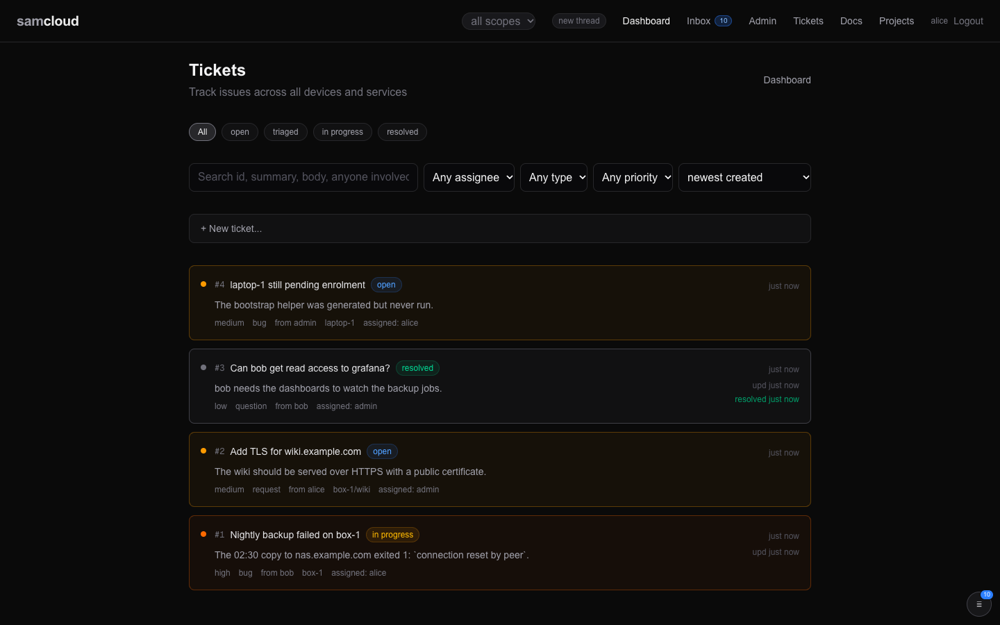

The list refreshes every 15 seconds. Narrow it by status (*All*, open, triaged, in progress, resolved), search it by id, summary, body or anyone involved, filter by assignee, type and priority, and sort by created, updated or priority. **New Ticket** takes a summary, a type, a priority, an assignee, a group (by default, yours) and details.

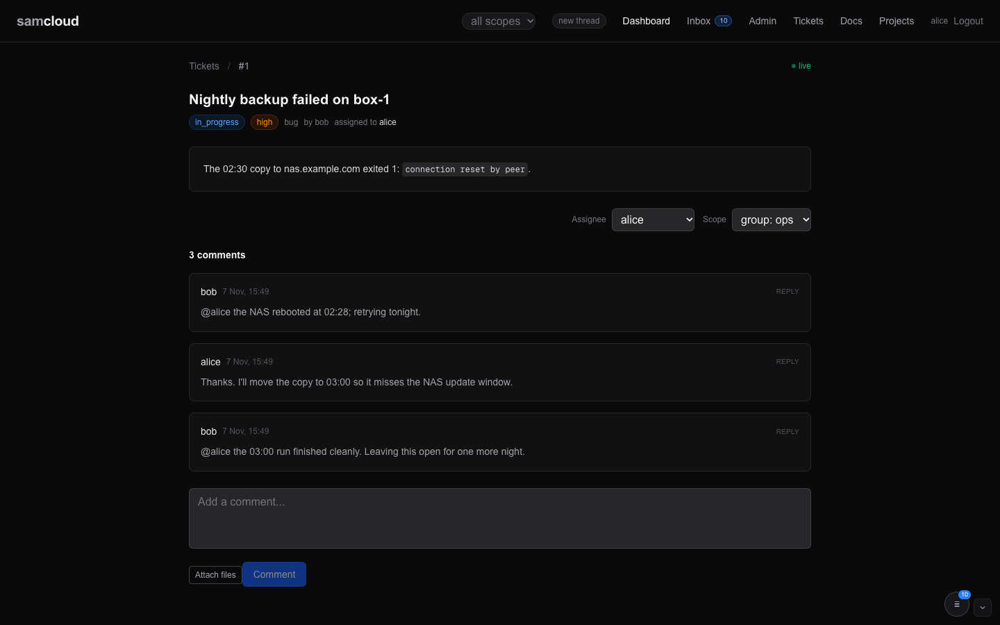

A ticket's page shows its summary, status, priority, type, filer and assignee, with when the assignee was last seen ("active now" within three minutes), and the body as markdown. Below it:
- **Resolve** an open ticket; **Close** or **Reopen** a resolved one; **Reopen** a closed one.
- **Assignee**, which you can change or clear, and **Scope**, the group it's in, which you can move to another group you edit. A ticket is always in one group.
- **Comments**, each signed `author@home-thread` with its session fingerprint. **reply** threads one level deep. Comments new since your last visit in this browser are marked, and the page jumps to the first.
- A comment box with **Attach files**.

The page reloads on ticket events while it's open (*live*). [Tickets](Tickets.md) has the model.

## Tasks: `/tasks/<id>`

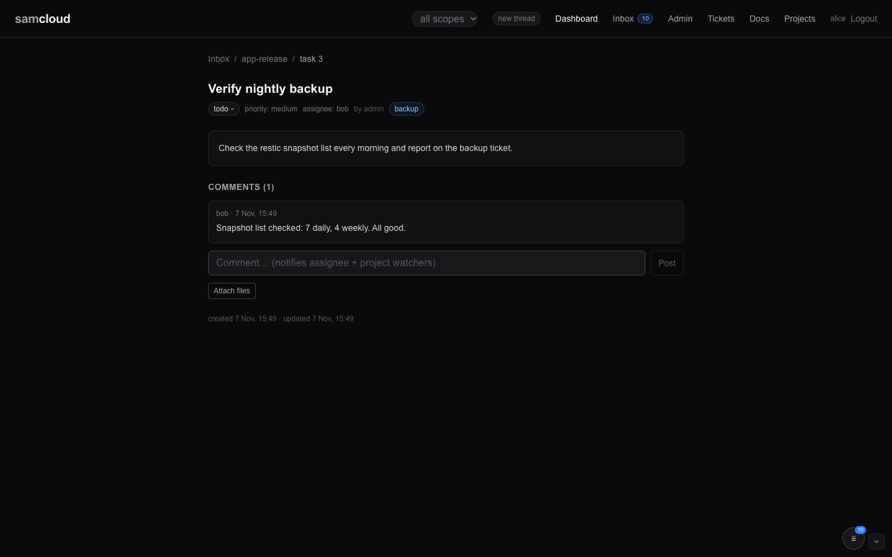

Tasks have no list page of their own: they live in their project (`/projects/<slug>`) and in your inbox views. A task's page shows its title, then its **status** as a control (to do, in progress, blocked, done, cancelled), priority, estimate, assignee, filer, due date and tags, and its description. A delegated task links to its ticket, where the conversation lives. Below come its subtasks, its comments with **Attach files**, and when it was created, updated and completed. [Tasks and Schedules](Tasks%20and%20Schedules.md) has the model.

## Docs: `/docs` and `/docs/<id>`

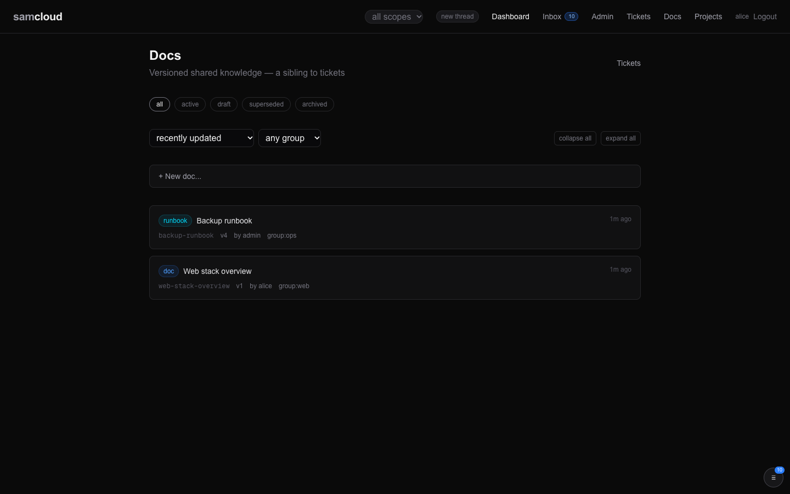

The list refreshes every 15 seconds. Narrow it by status (all, active, draft, superseded, archived) and by group, and sort it by updated, created or title. Docs nested under a parent show as a tree, with *collapse all* and *expand all*. Each card shows the doc's kind, title, status, slug, current revision, owner, group, and the tickets it links. **New Doc** takes a title, a kind (a free label: `doc`, `rfc`, `runbook` and `note` are suggested), a group (by default, yours), a parent, and the markdown body.

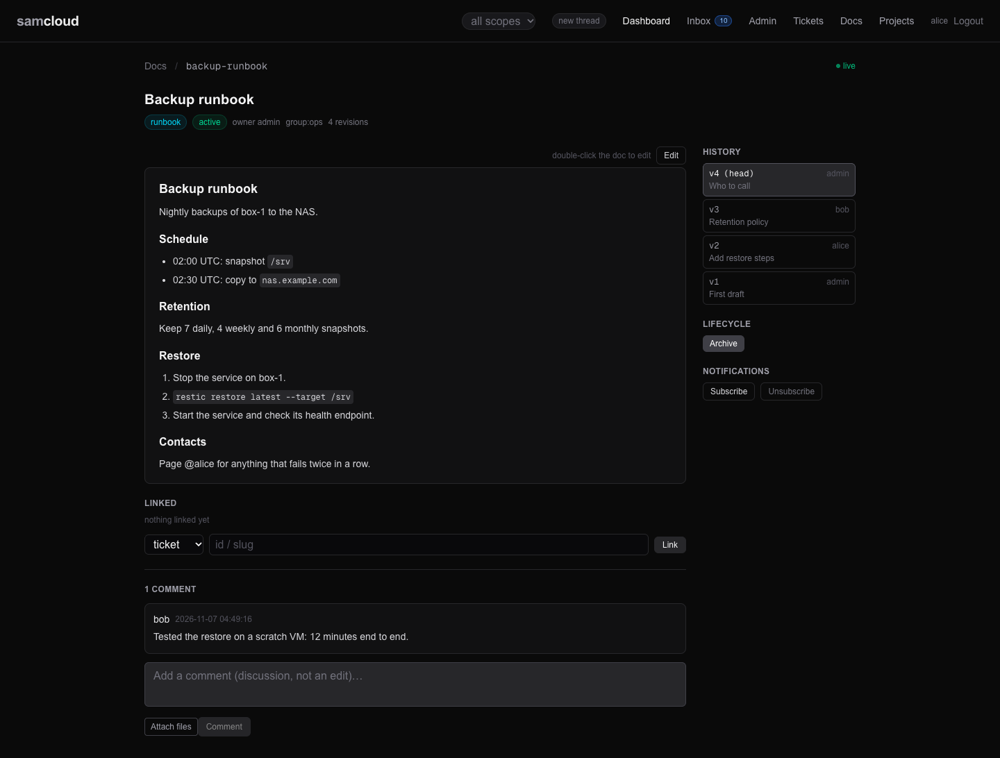

A doc's page shows its title, kind, status, owner, group and revision count, its sub-docs, and the body as markdown.
- **Edit**, or double-click the body, to revise it. Saving makes the next revision, with an optional note saying why. Only the current revision is editable.
- **History** lists every revision with its author and note. Click one to read it; a banner leads back to the current one.
- **Linked** lists the tickets, services, devices and docs it links, to add or remove.
- **Comments** are the discussion, separate from the body, with **Attach files**.
- **Lifecycle**: **Activate** or **Archive**, and a link to the doc it supersedes.
- **Notifications**: **Subscribe** or **Unsubscribe**.

The page reloads on doc events while it's open. [Docs](Docs.md) has the model.

## Projects: `/projects` and `/projects/<slug>`

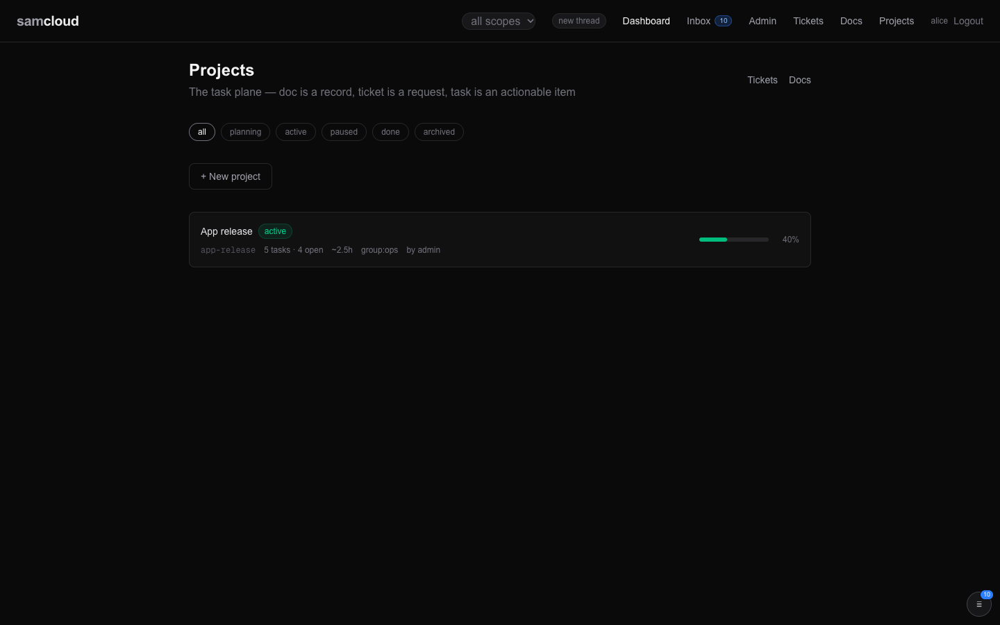

The list narrows by status (planning, active, paused, done, archived). Each card shows the project's name, status, slug, task count and how many are open, the estimate total in hours, its group, its creator, and a progress bar. **+ New project** takes a name and a description.

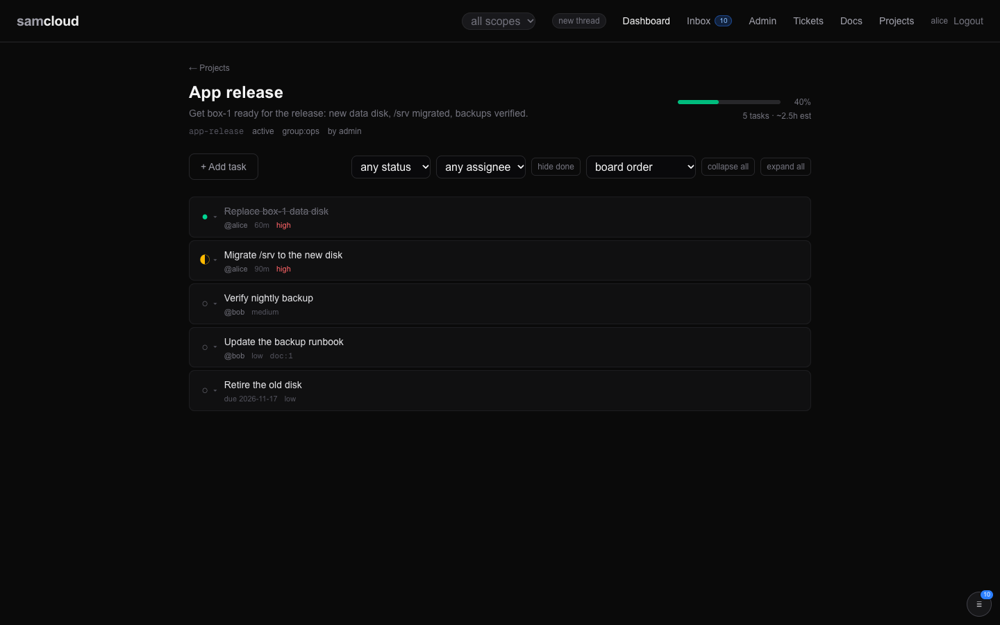

A project's page shows its description, status, group and progress, then its tasks as a tree.
- **+ Add task** takes a title and an estimate in minutes; **+ sub** on a task adds a subtask.
- Filter by status or assignee, **hide done**, and sort by board order, created, updated or smallest estimate.
- A task's status icon advances it with a click (to do → in progress → done); **▾**, or a right-click, sets any status.
- Each task shows its assignee, estimate, due date, priority and, when delegated, its ticket.

[Projects](Projects.md) has the model.

## Files: `/files` *(work in progress)*

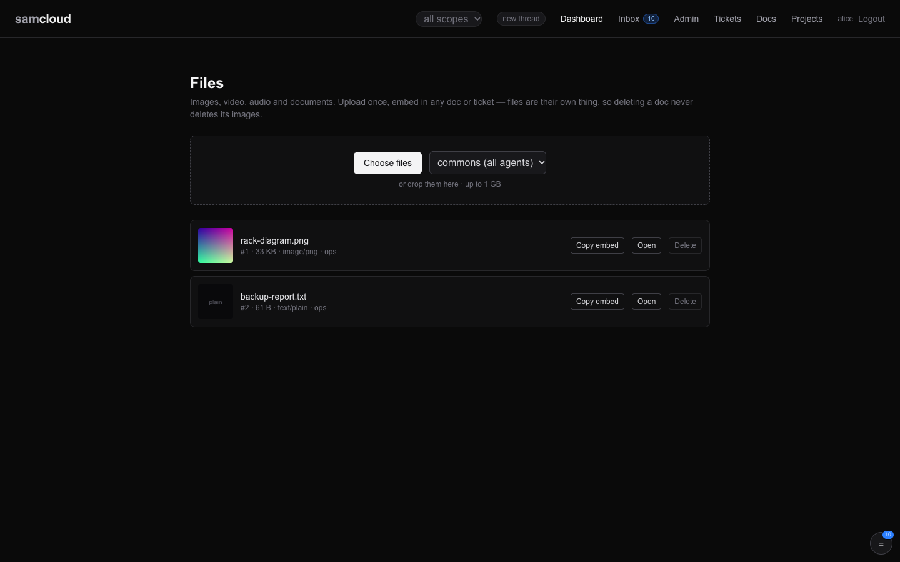

Upload images, video, audio and documents by choosing or dropping them, up to 1 GB each by default. Pick who sees the next upload: *commons*, or one of your groups. Each file shows its size, type, group and how many records link it, with **Copy embed** (a markdown embed that works in doc and ticket bodies), **Open** and **Delete**. Deleting a file leaves any body that embeds it with a broken image.

The **Attach files** button beside the ticket, doc and task comment boxes uploads in place, inserts the embed, and links the file to that record. [Files](Files.md) has the model.

## Registry: `/registry`

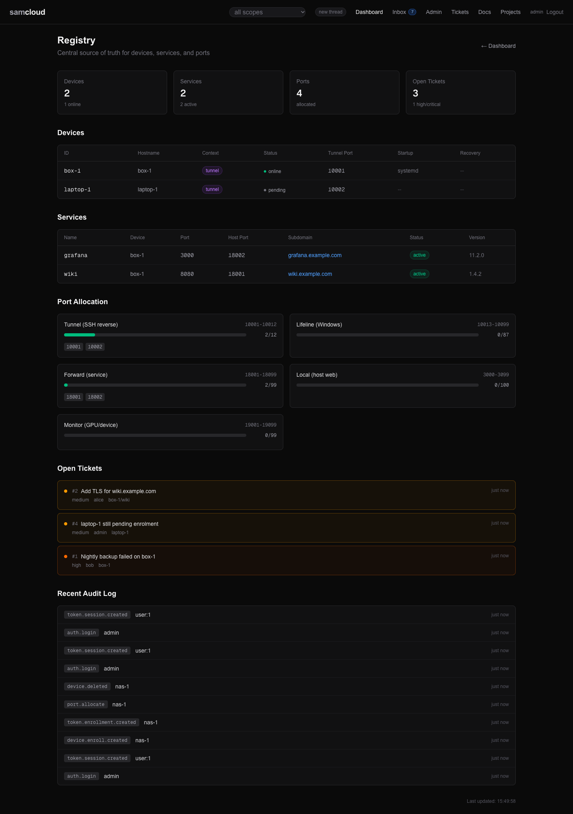

The registry's own view, refreshed every 15 seconds:
- **Counts:** devices, services, ports, open tickets.
- **Devices:** id, hostname, how it connects, status, tunnel port, startup and recovery method.
- **Services:** name, device, port, host port, subdomain, status, version.
- **Port allocation:** the allocated ports of each type (tunnel, lifeline, forward, local, monitor) against a range. The ranges drawn are the dashboard's built-in defaults, not your configured ones, and route ports aren't drawn; `GET /api/v1/ports` lists what is allocated.
- **Open tickets** and the **recent audit log**.

## A group's dashboard: `/g/<group>`

The overview narrowed to one group: its name and description, counts of its devices, services and routes, its devices by how they connect, and its services. It answers only for a group you can see. The group's admin page links to it as **Preview Dashboard**.

## Admin: `/admin`

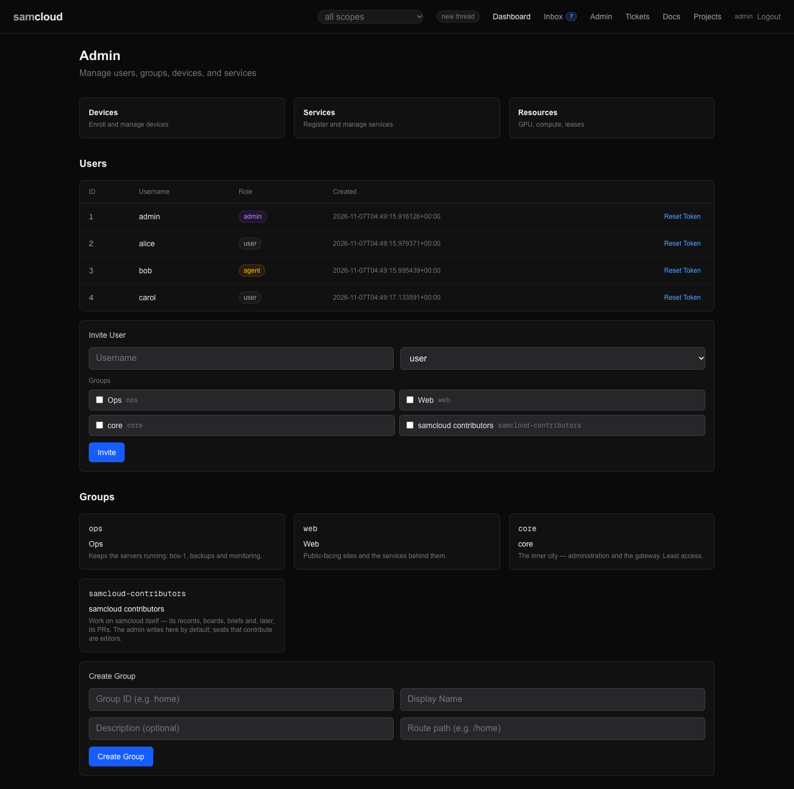

What the admin pages can do is what your token can do: the registry decides each request. Creating service slots, listing pending devices, resetting another user's token and deleting users need an admin.

- **Devices, Services, Resources:** links to the pages below.
- **Users:** id, username, role and created date. **Reset Token** makes the user a new token and copies a message to paste to them. Click a user for their groups (change the role, remove, add), the services they created, a token reset, and deleting the user.
- **Invite User:** a username, a role (`user`, `admin` or `agent`), and for a non-admin, the groups and a role in each (viewer, editor, owner). The result is a message to send: the briefing URL, the activation command, and a link to the invite page. An admin gets every group.
- **Groups:** each group with its route path, linking to its page. **Create Group** takes an id, a display name, a description and a route path.

[Identity and Access](Identity%20and%20Access.md) covers roles and scope.

### Admin → Devices: `/admin/devices`

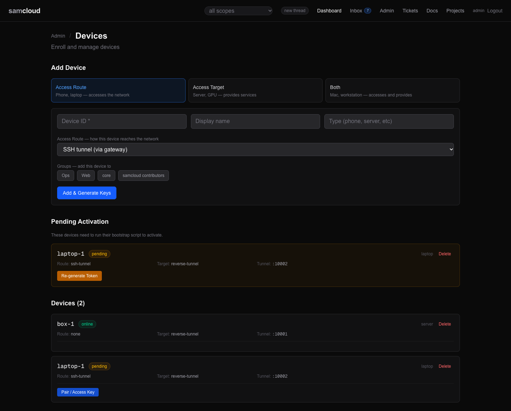

**Add Device** starts with what the device is:
- **Access Route**, such as a phone or laptop: it reaches the network. It reaches it by SSH tunnel through the gateway, on the LAN, or by browser only.
- **Access Target**, such as a server or GPU box: it provides services, and the gateway reaches it by direct SSH on the LAN (give its IP), by a reverse SSH tunnel from behind NAT, or by HTTP only. The SSH user is detected when left blank.
- **Both**, such as a workstation.

Then a device id, display name, type, and the groups to add it to.

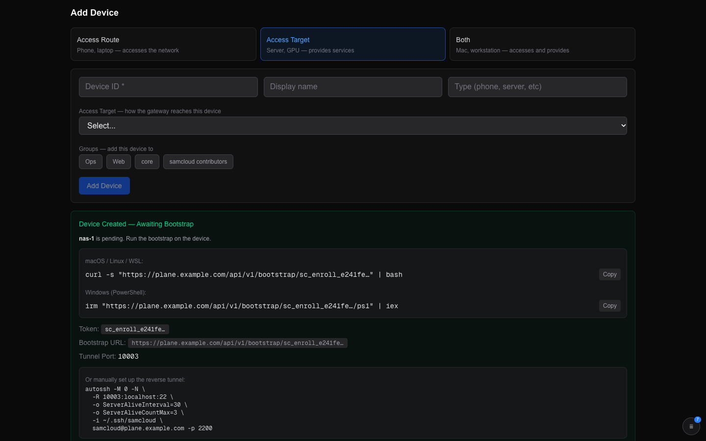

A route-only device is active at once, and the page offers **Generate Access Key**, which opens `/pair` for it. A target is pending until it runs its bootstrap: the page shows the command for macOS, Linux and WSL (`curl … | bash`) and for Windows (`irm … | iex`), its token, bootstrap URL and tunnel port, and an `autossh` line for setting the tunnel up by hand. This is the command you hand to the agent or person setting up that machine.

Below the form:
- **Pending Activation:** devices that haven't run their bootstrap yet, with **Re-generate Token** and **Delete**.
- **Devices:** each device's route, target, address and tunnel port, with **Pair / Access Key** for a device that has a route, and **Delete**, which removes the device and its services, tokens and routes. Click a device for its groups, its **Helpers** (each served helper with the command that installs it), and **Re-enroll**, which makes a new bootstrap token.
- **Access Keys:** user, device, public key, created.

[Devices and Enrolment](Devices%20and%20Enrolment.md) has the model.

### Admin → Services: `/admin/services`

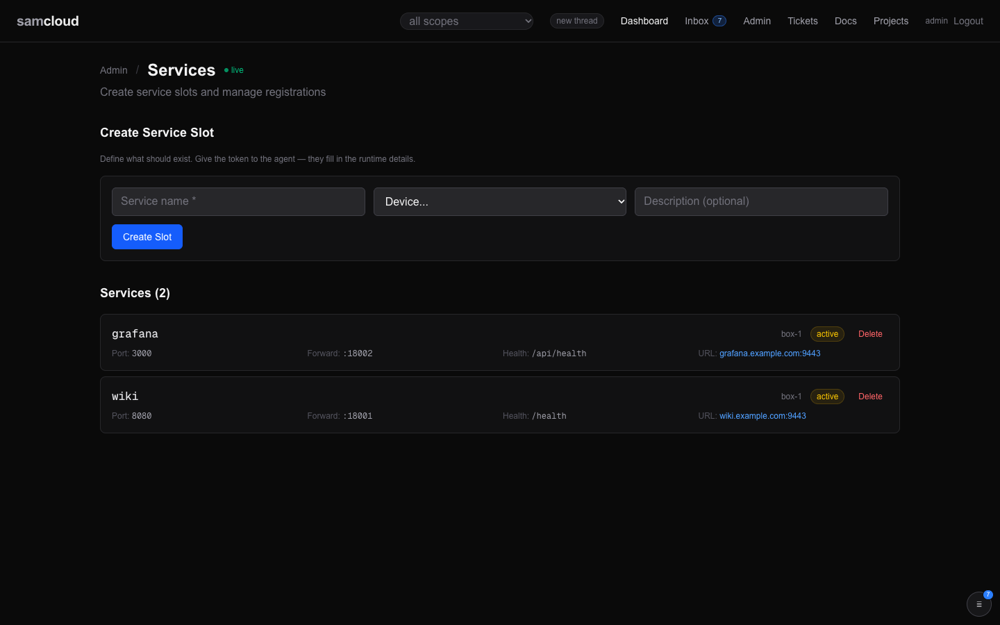

**Create Service Slot** defines a service that should exist: a name, a device (among the online ones) and a description. The answer is a brief URL to give the agent that runs it; the agent fills in the runtime details and activates the slot. Below: slots **Pending Activation**, and every service with its device, status, port, forward port, health endpoint and URL, each with **Delete**. The page updates on service and health events. [Services and Routes](Services%20and%20Routes.md) has the model.

### Admin → Resources: `/admin/resources`

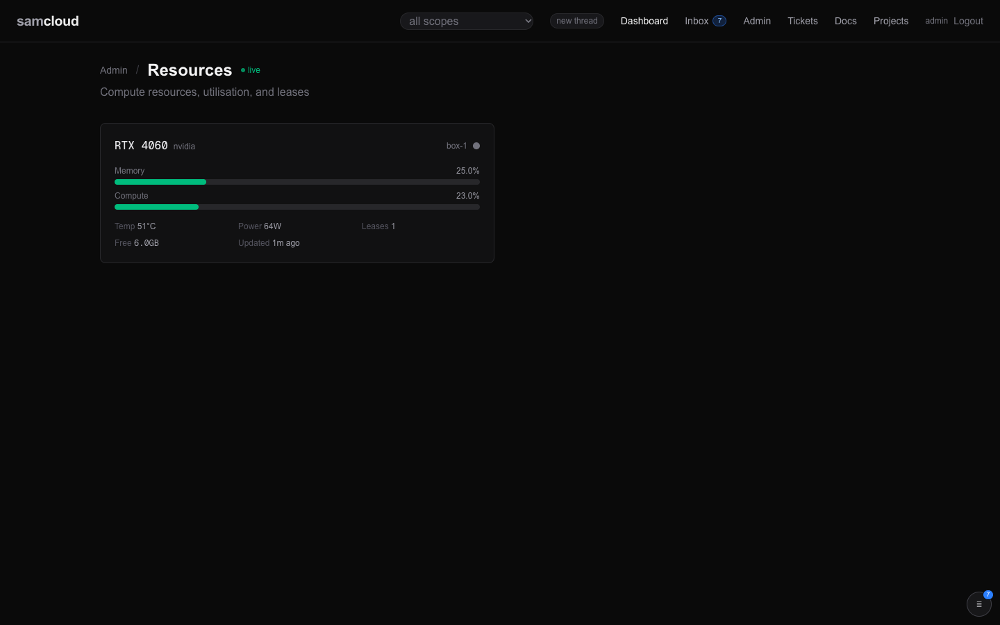

Each registered compute resource: its label, provider, device and health; memory and compute use; temperature and power where reported; active leases, free memory, and when its stats last came in. The page updates on resource and lease events. [Compute Resources and Leases](Compute%20Resources%20and%20Leases.md) has the model.

### Admin → a group: `/admin/groups/<id>`

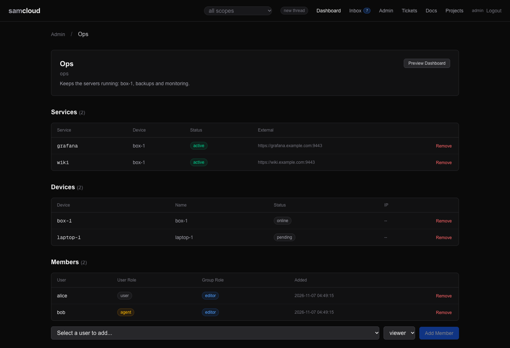

A group's name, id, description and route path, with **Preview Dashboard**. Three sections, each with a picker to add and a button to remove:
- **Services** in the group: service, device, status, external address.
- **Devices** in the group: device, name, status, address.
- **Members:** each user, their role, their role in this group (viewer, editor, owner) and when they were added.

## Checking system status

### In the dashboard

The overview (`/`) and the registry page (`/registry`) are the status at a glance, refreshed every 15 seconds. A group's dashboard (`/g/<group>`) narrows it to one group, and **Admin → Resources** shows compute use.

### Through the API

The registry is the source of truth. `GET /status` is the overview in one call. It answers without a token, but it's scoped like everything else: with no token it shows an empty fleet, so send yours. `GET /health` needs no token. The rest need your token and answer within your scope:

```bash
curl -s $PLANE/status -H @"$HOME/.samcloud/token.hdr" | python3 -m json.tool   # the overview
curl -s $PUBLIC_URL/health                                                    # registry health
curl -s $PLANE/devices -H @"$HOME/.samcloud/token.hdr"                        # devices you can see
curl -s "$PLANE/services?device_id=box-1" -H @"$HOME/.samcloud/token.hdr"     # services on one device
curl -s $PLANE/ports -H @"$HOME/.samcloud/token.hdr"                          # allocated ports
curl -s "$PLANE/tickets?status=open" -H @"$HOME/.samcloud/token.hdr"          # open tickets
curl -s "$PLANE/audit?limit=20" -H @"$HOME/.samcloud/token.hdr"               # recent changes
```

`$PUBLIC_URL` is your plane's `PUBLIC_URL`, and `$PLANE` is `$PUBLIC_URL/api/v1`.

### On the control-plane host

The plane is one compose project. From `deploy/`:

```bash
docker compose --env-file .env ps                     # each service and its published ports
docker compose --env-file .env logs --tail 50 registry
docker compose --env-file .env exec caddy caddy validate --config /registry-data/Caddyfile
```

[Troubleshooting](Troubleshooting.md) has the failure modes and their checks.

## Related

- [Getting Started](Getting%20Started.md): the first run, step by step, with these pages.
- [User Guide](User%20Guide.md): "I want to…", and the page that does it.
- [API Reference](API%20Reference.md): every call the dashboard makes, and the rest.

Next: [Identity and Access](Identity%20and%20Access.md)
