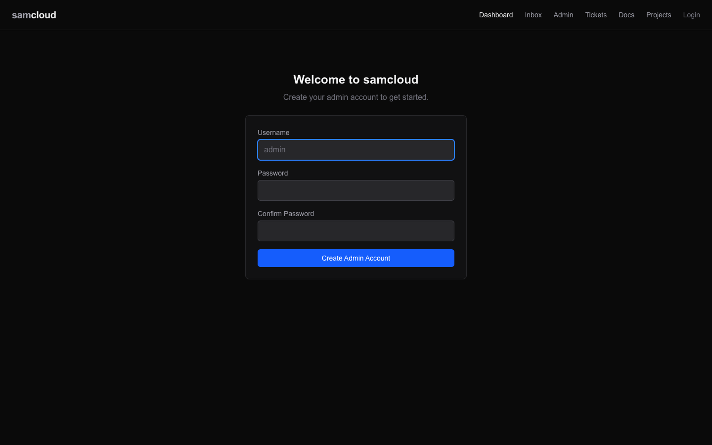

# Deployment

How a plane is installed, upgraded and released. The control plane is one Docker Compose stack, built from `deploy/docker-compose.yml`. You can run compose by hand for every step. The repo also ships helpers that build and deploy only what changed, and a small receiver that turns a merged pull request into a release; wiring them to a git hook or a webhook is optional.

## Install

You need one machine with Docker and Docker Compose v2: native Docker on Linux, or Colima on macOS. From a checkout:

```bash
cd deploy
cp .env.example .env          # set PUBLIC_URL and AUTH_SECRET; the comments say what each line does
docker compose --env-file .env up -d --build
```

`PUBLIC_URL` and `AUTH_SECRET` are the only required settings ([Configuration](Configuration.md#the-plane)). On a LAN with no domain, `PUBLIC_URL` is this machine's address and the registry's port, such as `http://192.0.2.10:7778`.



Then create the admin user, in the dashboard's first-run page or with `POST /api/v1/init`, which works once on a fresh registry. [Getting Started](Getting%20Started.md) walks through it and on to the first device.

Compose names the stack after the compose file's directory (`deploy`) unless you pass `-p`. The deploy helpers below need to know that name; `docker compose ls` shows it.

## Upgrading the plane

From the checkout on the control-plane host:

```bash
git pull
cd deploy && docker compose --env-file .env up -d --build
```

Compose rebuilds the images whose source changed and recreates their containers. Data lives in named volumes and survives.

A plain `up -d` can recreate the `sshd` container along with a service it depends on, and that drops every device's reverse tunnel until the device reconnects. To recreate only what changed, name the services and pass `--no-deps`, which is what the helpers below do:

```bash
docker compose --env-file .env up -d --build --no-deps registry console
```

A change to `docker-compose.yml` or to the env file needs a plain `docker compose up -d`: the helpers decide from source paths and don't see it.

## The build and deploy helpers

Two files in `.githooks/` hold the logic. They are shell scripts: run them by hand, from a CI job, or as git hooks.

| file | what it is |
|---|---|
| `.githooks/deploy-lib.sh` | functions the deploy scripts source: which services changed, the release base, the next version, the pull requests in a range |
| `.githooks/post-merge` | a release: version, build, recreate what changed, tag. Named so git runs it after a merge or a pull when `core.hooksPath` is `.githooks` |

### What a deploy recreates

`changed_services` in `deploy-lib.sh` decides from git, not from image ids, which are unstable when the build cache is cold. A service is recreated when files under its source paths changed in the range, or when its container isn't running:

| service | source paths |
|---|---|
| `registry` | `registry/`, `deploy/Dockerfile.registry` |
| `console` | `console/`, `deploy/Dockerfile.console` |
| `caddy` | `deploy/Dockerfile.caddy`, `deploy/caddy-entrypoint.sh` |
| `sshd` | `gateway/`, `deploy/Dockerfile.sshd`, `deploy/sshd-entrypoint.sh` |
| `sslh` | `deploy/Dockerfile.sslh`, `deploy/sslh` |

The recreate runs `up -d --no-build --no-deps` on that list only, so a registry change doesn't cascade through `depends_on` into `sshd` and drop the tunnels. Edits to `docker-compose.yml` or an env file are not covered; run `docker compose up -d` by hand for those.

### A release

`.githooks/post-merge` acts only on `main`. Each run is a release:

1. **The version** comes from the host's release tags (`next_version`): `HEAD`'s own tag when it has one, else the last `v*` tag reachable from it with the patch raised by one, else `0.0.1`. Nobody raises a version by hand. A new minor starts with a hand-made tag on `main`'s head (`git tag -a v0.13.0 -m …`); the next release is `0.13.1`.
2. **The range** starts at the last release tag (`release_base`), not at the previous `main`. Code can reach `main` without being released; the next release builds it in and recreates its service.
3. **The build** runs `docker compose build` with `SAMCLOUD_VERSION` and `GIT_COMMIT` as build arguments, which `GET /api/v1/` reports as `version` and `commit`. A failed build stops here: nothing is recreated and `HEAD` stays untagged, so its changes stay in the next range.
4. **The recreate** brings up only the changed services, as above.
5. **The tag** `vX.Y.Z` is written last, once the deploy ran.

The last line it prints is a contract that other tools read:

```
post-merge: result=ok version=0.13.1 commit=abc1234 prs=#98,#99
```

`result` is `ok`, `already-released` (`HEAD` already carries a release tag) or `build-failed`. The same line, with a timestamp and the merger, is appended to `~/logs/samcloud-releases.log` (`SAMCLOUD_RELEASE_LOG`).

### Where it deploys

The target is host configuration, not repo content. `~/.config/samcloud/deploy.env` (or the file `SAMCLOUD_DEPLOY_CONF` names) is sourced when present:

| setting | default | what it does |
|---|---|---|
| `PROD_PROJECT` | `samcloud-prod` | the compose project to build and recreate |
| `PROD_ENV_FILE` | `deploy/.env.production` | its env file |
| `DEPLOY_DISABLED` | `0` | `1` marks a host that is not the deploy host: the script reports the version and deploys nothing |
| `STG_PROJECT`, `STG_ENV_FILE` | `samcloud-stg`, `deploy/.env.staging` | a second stack on the same host that reuses the images; skipped when its env file is absent |

A plane installed as above, from `deploy/` with `.env`, sets `PROD_PROJECT=deploy` and `PROD_ENV_FILE=<checkout>/deploy/.env`, or is started with `-p samcloud-prod` and `--env-file deploy/.env.production` in the first place.

`.githooks/post-commit` acts only on a branch named `staging`, where it rebuilds a second stack. A single-stack plane can ignore it.

### Wiring it up

| how | what runs it |
|---|---|
| by hand | `bash .githooks/post-merge` on `main`, after a `git pull` |
| a git hook | `git config core.hooksPath .githooks`: git runs `post-merge` after every merge or pull into `main` on that checkout |
| a merged pull request | the deploy receiver below fast-forwards the deploy host's checkout, and the hook runs |

The reference deployment uses the third: every pull request the maintainer merges into `main` on GitHub is released on the deploy host.

## The deploy receiver

`deploy/deploy-hook/receiver.py` turns a merged pull request into a release. It is optional, stdlib-only Python, and runs on the deploy host under systemd, outside the compose stack, so a deploy cannot restart it.

GitHub sends it a signed `pull_request` webhook at `POST /github`. It deploys only when all of these hold:

- the `X-Hub-Signature-256` signature matches the secret in `DEPLOY_HOOK_SECRET_FILE` (otherwise `403`; with no secret file, `503` for everything);
- the event names the repository in `DEPLOY_HOOK_REPO`;
- the action is `closed` with `merged` true, into `main`;
- the merger's login is in `DEPLOY_HOOK_MERGERS`.

Anything else answers `200` with `{"deploy": false, "reason": …}`. A direct push to `main` sends no `pull_request` event, so it never deploys.

A deploy answers `202` at once and then, one at a time:

1. fetches `main` and its tags from `origin` (a read-only deploy key is enough);
2. checks the merge commit is on `origin/main`;
3. checks out `main` and fast-forwards it to the merge commit; git then runs `post-merge`, with `DEPLOY_PR_NUMBER`, `DEPLOY_PR_TITLE` and `DEPLOY_MERGER` in its environment;
4. reads the hook's `post-merge: result=…` line.

With a GitHub token in `DEPLOY_HOOK_GITHUB_TOKEN_FILE` (0600, `contents` and `pull requests` write on the repository), it then pushes the release tag and comments the result on every pull request the release carried. Git reads the token through `askpass.sh`; it is never on a command line. A failure is never worded as a release. Without a token, the result stays in the log and in `GET /health`:

```json
{"ok": true, "repo": "OWNER/samcloud", "receiver": "2.1.0", "announces": false,
 "last": {"sha": "…", "ok": true, "head": "abc1234", "version": "0.13.1", "result": "ok", "at": 1762500000, "pr": 98}}
```

### Installing it

1. Put its settings in `~/.config/samcloud/deploy-hook.env`; `DEPLOY_HOOK_REPO` and `DEPLOY_HOOK_MERGERS` are required ([Configuration](Configuration.md#the-deploy-hook) lists them all). Write the webhook secret to `~/.config/samcloud/deploy-hook.secret`, mode 0600.
2. Point `DEPLOY_HOOK_REPO_DIR` at the deploy host's checkout, with `core.hooksPath` set to `.githooks`, and set its `deploy.env` as above.
3. Run `deploy/deploy-hook/install.sh` on the host. It copies `receiver.py` and `askpass.sh` to `~/.local/samcloud/deploy-hook/`, renders the systemd unit from `samcloud-deploy-hook.service.in` for the user running it, installs it with `sudo` when it changed, restarts it and prints `/health`. The service runs that installed copy, so a deploy never rewrites the running receiver; run `install.sh` again after changing `deploy/deploy-hook/`.
4. Route a public name to its port (`DEPLOY_HOOK_PORT`, 9911), e.g. `https://hooks.example.org`, and add a GitHub webhook for "Pull requests" events with content type `application/json`, that URL plus `/github`, and the same secret.

## Pre-commit gates

`.githooks/pre-commit` is the contributor-side check. It runs before a commit lands when `core.hooksPath` is `.githooks`, or by hand with `bash .githooks/pre-commit`, and stops at the first failure:

| gate | what it runs |
|---|---|
| tsc | `npx tsc --noEmit` in `console/` |
| pytest | the registry's core test files, with `registry/.venv` |
| sandbox | `sandbox/harness.py`, the end-to-end harness |
| feature tests | each `sandbox/test_*.py` the hook lists, including `test_config_reference.py`, `test_post_merge_range.py` and `test_deploy_hook.py` |

It needs `registry/.venv`, the console's packages (`npm ci` in `console/`) and Go. When `SAMCLOUD_HOLDER` is set, as the rail sets it for a held agent, it refuses a commit in the primary checkout, on `main` or `staging`, or on a detached `HEAD`: a held agent commits only on a pull-request branch in a linked worktree. [Contributing](Contributing.md) covers the rest of the contributor path.

## Related

- [Configuration](Configuration.md): every setting, including the deploy receiver's
- [Architecture](Architecture.md): the containers, volumes and ports a deploy recreates
- [Contributing](Contributing.md): the path from a change to a merged pull request
- [Troubleshooting](Troubleshooting.md)

Next: [Configuration](Configuration.md)
