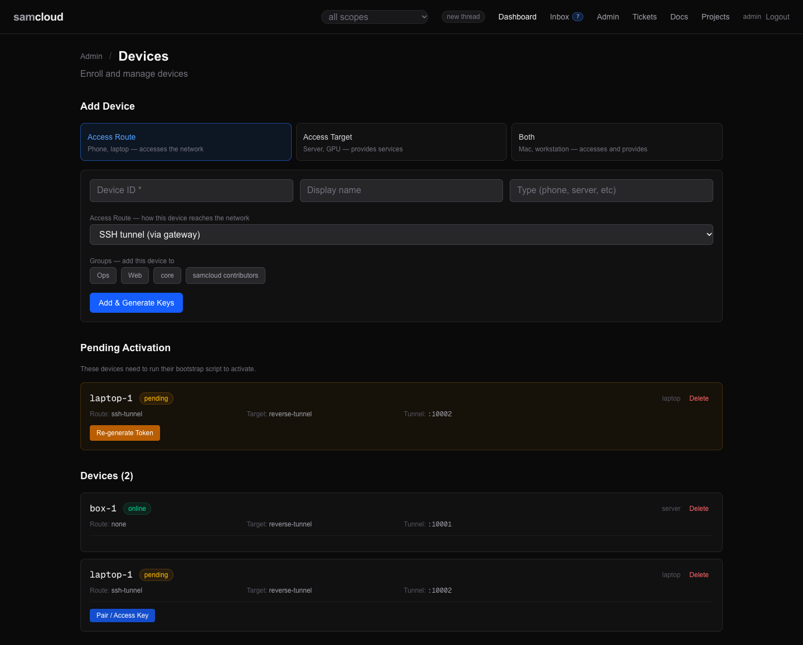
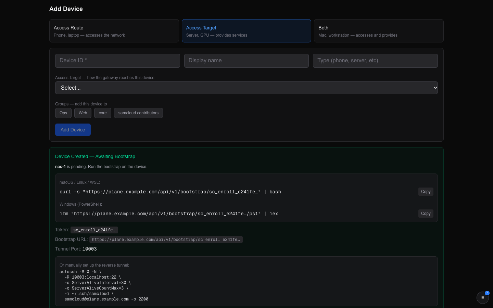
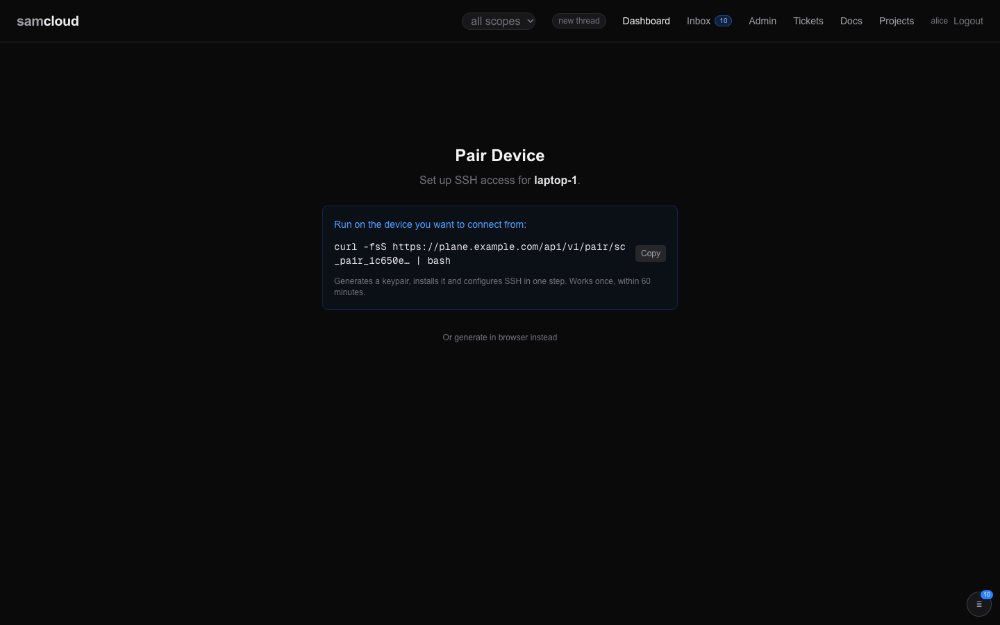

# Devices and Enrolment

A device is a machine samcloud knows about: a server, a GPU box, a laptop, a phone. Each one is one row in the registry. Enrolment brings a machine in, and it can do so in two independent directions: the machine can reach in through the gateway (an access route), the gateway can reach out to the machine (an access target), or both.

Most first runs look the same. A person opens the dashboard, adds the device, and gets its bootstrap helper: a one-line command. They hand that line to their agent on the machine, or run it themselves. The bootstrap does the rest, and the device appears online.

## In the dashboard

**Admin → Devices** (`/admin/devices`) lists every device you can see, with its route, target, address and tunnel port. Click a device for its details, its groups, its helpers and a fresh bootstrap.



**Adding a device.** The **Add Device** form:

1. Choose a mode: **Access Route** (phone, laptop: accesses the network), **Access Target** (server, GPU: provides services), or **Both** (a workstation that does both).
2. Enter a device ID, and optionally a display name and type.
3. For a route, pick how it reaches the network: SSH tunnel, LAN, or browser only.
4. For a target, pick how the gateway reaches it: direct SSH (LAN, with an IP address), reverse SSH tunnel (behind NAT), or HTTP only. The SSH user is detected by the bootstrap if you leave it blank.
5. Pick the groups the device joins, and submit.

What comes back depends on the mode:

- **A target, or both,** shows "Device Created — Awaiting Bootstrap", with the bootstrap command for macOS, Linux and WSL, the PowerShell command for Windows, the token, the bootstrap URL, and the tunnel port. Copy the command and hand it to the agent on that machine, or run it there.
- **A route-only device** shows "Device Enrolled — Ready for Pairing" and a **Generate Access Key** button, which opens the pair page for it.



**Pending Activation** lists the targets whose bootstrap has not run yet (admin). **Re-generate Token** makes a fresh one-hour bootstrap for a device whose token expired. A device's own panel has the same, under **Re-enroll**.

**Helpers.** A device's panel lists the post-enrolment helpers that apply to it: see [Device helpers](#device-helpers).

**Pairing.** `/pair` mints the access key for a route. It is covered in [Pairing a device](#pairing-a-device).

## The model

### Routes and targets: two directions

Every device is one registry row with two independent direction columns. "Route" and "target" look like one idea but mean opposite directions:

| | access route (`access_route` → `inbound_method`) | access target (`access_target` → `outbound_method`) |
|---|---|---|
| direction | the device reaches in | the gateway reaches out to the device |
| values | `ssh-tunnel`, `lan`, `browser-only` | `reverse-tunnel`, `direct-ssh`, `http` |
| whose key lands where | your key on the gateway's `authorized_keys` | the gateway's key on the device's `authorized_keys` |
| provisioned by | an access key: `POST /access-keys`, its setup script, or a pair link | the bootstrap, which calls `POST /devices/activate` |
| status after enrolment | `online` at once | `pending` until the bootstrap runs |

Read it as a chain:

```
   access route   ──►   gateway   ──►   target
  (your key on the     (the plane's      (the gateway's key
   gateway)             sshd)             on the device)
```

A route says "let me into the gateway". A target says "let the gateway into this machine".

**A device does not have to be both.** A phone is route-only. A headless GPU box is target-only. A workstation that reaches in and also serves is both: it has an access key and it has run the bootstrap. Neither column is required.

Routing only ever concerns the target side: `outbound_method` tells the gateway how to open the next hop. The route side is only about how you authenticated into the gateway. The SSH user on the way in is always `samcloud`; your identity rides in the access key, not the username. See [SSH Gateway](SSH%20Gateway.md).

### Transport modes for a target

| mode | how the gateway reaches the device | what keeps it up |
|---|---|---|
| `reverse-tunnel` | The device dials the gateway and holds `-R <tunnel_port>:localhost:<sshd port>`. The gateway reaches it at `localhost:<tunnel_port>` inside its container. For a device off the LAN or behind NAT. | A tunnel runner under launchd (macOS), systemd (Linux, WSL) or a scheduled task (Windows). |
| `direct-ssh` | The gateway opens SSH to the device's LAN address. | The device's own sshd, reachable at boot. |
| shared transport | A second account on a machine that already has a tunnel borrows it, told apart by its SSH user. The admin registers it with `POST /devices` and `transport_owner`, then gives it a bootstrap with `POST /enroll/{id}/retoken`. Its bootstrap stands up no tunnel of its own. | The owner device's tunnel. |

An `http` target records a device the gateway does not open a shell on.

### Environments

What an identity lands in once it reaches a device is set out in [Identity and Access](Identity%20and%20Access.md#what-you-land-in). In short: a shell on a target runs as that device's SSH user (`outbound_ssh_user`), set at enrolment or detected by the bootstrap from `whoami`. A device with no SSH user cannot be entered; an admin sets one with `PATCH /devices/{id}`.

## Using it

### Enrolling with the API

`POST /enroll` takes a bearer. The admin may enroll into any group. Anyone else needs the editor or owner role in a group: the new device joins the groups named in `group_ids`, each one a group they edit, or with none named, every group they edit. A device ID can't contain `:` or `/`, and can't be a username.

```bash
# Access route (a phone): online at once
curl -X POST $PLANE/enroll -H @"$HOME/.samcloud/token.hdr" \
  -H "Content-Type: application/json" \
  -d '{"device_id":"phone-1","name":"Phone 1","type":"phone","access_route":"ssh-tunnel"}'

# Access target (a GPU server): answers a bootstrap token, stays pending
curl -X POST $PLANE/enroll -H @"$HOME/.samcloud/token.hdr" \
  -H "Content-Type: application/json" \
  -d '{"device_id":"gpu-1","name":"GPU 1","type":"gpu-workstation","access_target":"reverse-tunnel","target_ssh_user":"you"}'

# Both (a workstation on the LAN)
curl -X POST $PLANE/enroll -H @"$HOME/.samcloud/token.hdr" \
  -H "Content-Type: application/json" \
  -d '{"device_id":"laptop-1","name":"Laptop 1","type":"laptop","access_route":"lan","access_target":"direct-ssh","target_ip":"192.0.2.50","target_ssh_user":"you"}'
```

- **A target** answers `token`, `bootstrap_url`, `bootstrap_command` and `expires_in` (3600). A reverse-tunnel target also answers `tunnel_port` and `tunnel` (the host, port and user it dials). The registry allocates the tunnel port.
- **A route** answers `access_key_url` and `pair_link_url`. Enrolling a route records the device; the key itself comes from pairing.
- **Every enrolment** answers `next_steps`, ending with the device's own guide, `GET /devices/{id}/guide`.

An unknown `access_target` answers 400; `ssh` is read as `direct-ssh`. An existing device id answers 409.

### The bootstrap helper

The bootstrap is a script the registry renders for one device and one token:

```bash
curl -s $PLANE/bootstrap/<token> | bash               # macOS, Linux, WSL
irm "$PLANE/bootstrap/<token>/ps1" | iex             # Windows (PowerShell)
```

Fetching the script does not spend the token. Activation does. The registry fills in the plane's address, the device id, the tunnel port, the gateway's SSH host, port and user, and the environment name, then serves it.

**What it does, in order:**

| step | what happens |
|---|---|
| prerequisites | Checked before the token is spent, so a failed run can be repeated with the same token. See below. |
| clean | Removes this environment's earlier install on the machine: key, device token, SSH config block and tunnel job. |
| SSH keypair | Generates the device's key. |
| activate | `POST /devices/activate` with the device's public key, its SSH user and sshd port, and the host key its own sshd presents. Answers the device token, the gateway's client key, and the gateway's host keys. |
| gateway access | Installs the gateway's client key in the device's `authorized_keys`, so the gateway can SSH in. On WSL it also adds it to the Windows administrators' keys when it can. |
| SSH config | Writes a `samcloud-gw` host block that checks the gateway strictly against the pinned key. |
| tunnel | For a reverse-tunnel target, writes the tunnel runner and its launchd, systemd or scheduled-task job. |
| device token | Stores the device token, mode 0600, in `~/.config/samcloud/device_token`. |
| verify | Checks the key, token, config, tunnel job and gateway host key, then waits up to 30 seconds for the tunnel to hold its connection. |

**Prerequisites.** The bootstrap stops before it activates if something the device needs is missing, and the token stays valid for a re-run:

- **`python3` runs.** The bash bootstrap and its tunnel read the registry's answers with it. On a Mac without the Command Line Tools, `/usr/bin/python3` is only an installer stub: run `xcode-select --install`.
- **sshd answers on localhost** at the detected port (`:22` on Windows). The gateway reaches the device there. On a Mac, turn on Remote Login (System Settings → General → Sharing).
- **On Linux or WSL with a tunnel, sudo is available.** The bootstrap installs `openssh-server` and the systemd unit with it. Run as `curl … | bash` there is no terminal for a password prompt, so it stops and says so. Cache sudo first (`sudo -v`), then run it. An agent running the bootstrap for you needs the same.

**When it ends.** "Bootstrap complete" means the tunnel connected, not only that its job is registered. When it reports "partial", the line under "Tunnel connected" names the log to read. After it activates, the bootstrap writes the gateway's host key to `~/.config/samcloud/known_hosts` (`%USERPROFILE%\.config\samcloud\known_hosts` on Windows). The tunnel and the `samcloud-gw` alias check the gateway strictly against that file, so a missing key is reported as a failure. [SSH Gateway](SSH%20Gateway.md#host-key-trust) explains the two pins.

**More than one plane.** With `SAMCLOUD_ENV` other than `prod`, everything the bootstrap installs is prefixed with the environment's name, so one machine can be enrolled in two planes. See [Configuration](Configuration.md).

**How the scripts are made.** The registry serves two templates, `registry/bootstrap.sh` (macOS, Linux, WSL) and `registry/bootstrap.ps1` (Windows), and fills their `__PLACEHOLDER__` values per request. The device detects its own OS, privilege and sshd port; the registry decides what it owns: the environment, the transport and the ports. Run from Git Bash, the bash script points you to the PowerShell one.

### Re-bootstrapping

`POST /enroll/{device_id}/retoken` mints a fresh one-hour enrollment token for a device you manage, pending or online. It answers `bootstrap_command` and `bootstrap_command_ps1`. Use it when a token expired before the bootstrap ran, or to re-bootstrap after a machine lost its keys. Activation replaces the device's SSH key. A re-bootstrap never moves the device's pinned host key.

### Pairing a device

A route needs an access key. A new phone or laptop has no samcloud token, so it cannot call the setup script itself. A pair link solves that: mint it where you are signed in, and run its command on the device.

**In the dashboard:** `/pair` (also reached from a device's **Pair / Access Key** button, or **Generate Access Key** after enrolling a route). Your username is filled in when you are logged in. Enter the device name and press **Make Pair Command**, then run the command it shows on the device you want to connect from. It works once, within an hour. **Or generate in browser instead** mints the key directly and shows the private key once, to download.



**With the API:**

```bash
curl -s -X POST $PLANE/access-keys/pair -H @"$HOME/.samcloud/token.hdr" \
  -H "Content-Type: application/json" \
  -d '{"username": "you", "device_name": "laptop-1"}'
# {"key_id": "you@laptop-1", "pair_url": "…", "pair_command": "curl -fsS $PUBLIC_URL/api/v1/pair/sc_pair_… | bash", "expires_in": 3600}
```

- **The rule is the access-key rule:** your own username, or any username if you are the admin.
- **A link works once, for an hour.** Minting again for the same user and device replaces it.
- **Running it** mints a key for `username@device_name`, replacing any earlier key with that id, and serves the setup script that installs it.
- **A used, expired or unknown link** answers 410 with a script that only prints why and exits 1.
- **A pair token is not a bearer.** No other route accepts it.

### Access keys for routes

On a machine that already has a samcloud token, mint the key directly:

```bash
# Install the key and the `ssh samcloud` alias in one step
curl -s -X POST $PLANE/access-keys/setup-script -H @"$HOME/.samcloud/token.hdr" \
  -H "Content-Type: application/json" \
  -d '{"username":"you","device_name":"box-1"}' | bash

# Or take the key pair as JSON and install it yourself
curl -X POST $PLANE/access-keys -H @"$HOME/.samcloud/token.hdr" \
  -H "Content-Type: application/json" \
  -d '{"username":"you","device_name":"phone-1"}'
```

The private key is returned once: save it immediately. The public key is stored and synced to the gateway's `authorized_keys`, forced to the gateway command. The device name in a key is a label: a key needs no enrolled device behind it. Listing and revoking keys is in [SSH Gateway](SSH%20Gateway.md#revoking-access).

### Device helpers

After enrolment, a device may need a helper script for its platform. `GET /devices/{id}/helpers` lists the ones that apply; each is served at `GET /devices/{id}/helpers/{name}` with the device's values filled in.

| helper | applies to | what it does |
|---|---|---|
| `wsl-keepalive` | a WSL device (systemd) | Holds the WSL distro alive on its Windows host. Run it as Administrator on that host: `irm <url> \| iex`. |
| `tunnel-debug` | a Windows device (scheduled task) | Diagnoses a tunnel task that isn't binding. Writes a verbose log to `C:\Windows\Temp\samcloud-tunnel-debug.log` and shows its tail. |

### An agent on the device

Enrolled is not reachable for work. The bootstrap gives the machine network and SSH access only. For an agent on it to hear tickets and assigned work, it needs its own identity and the rail:

1. Invite it: `POST /users/invite` with role `agent` and a scope such as `device:<id>` or a group ([Identity and Access](Identity%20and%20Access.md#invites)).
2. The agent activates and installs its token in a header file.
3. It installs the rail: `GET /helpers/wake-install | bash`. It is done when `GET /wake/registrations` shows it with `stale: false`.

[Agent Rail](Agent%20Rail.md) covers the rest.

## Related

- [Identity and Access](Identity%20and%20Access.md): who may enroll and manage a device
- [Services and Routes](Services%20and%20Routes.md): registering what runs on a device
- [SSH Gateway](SSH%20Gateway.md): reaching a device, host-key trust, revoking keys
- [Configuration](Configuration.md): `PLANE_HOST`, `PLANE_SSH_PORT`, `SAMCLOUD_ENV` and the port ranges
- [Troubleshooting](Troubleshooting.md): a bootstrap or tunnel that won't come up
- [API Reference](API%20Reference.md): the full enrolment surface

Next: [Services and Routes](Services%20and%20Routes.md)
