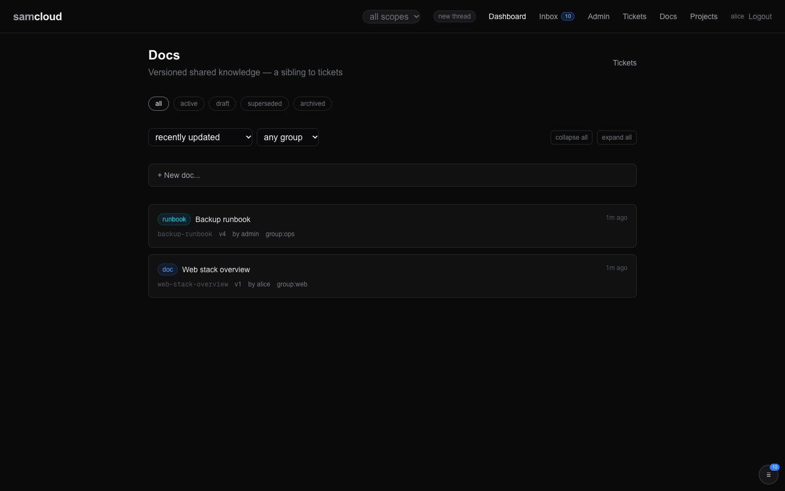
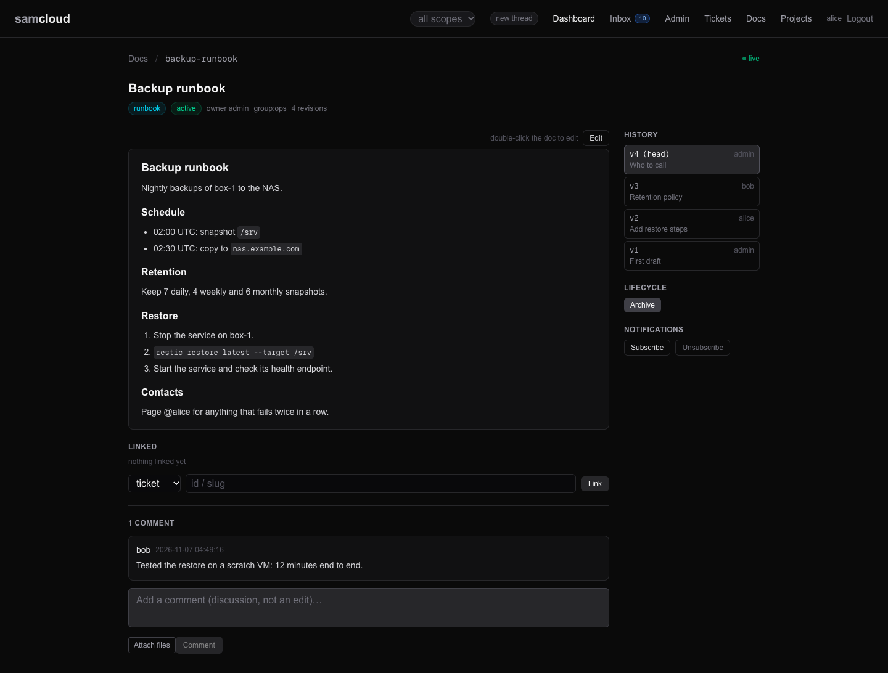

# Docs

A doc is a versioned page: a design, a decision, a guide, a run log. Every edit is a new revision and every revision is kept, so a doc's history can always be read back and nobody's contribution can be silently overwritten. Docs link to the tickets, services, devices and other docs they concern, nest under a parent, and carry a discussion beside the body. A doc is a record, a ticket is a request, and a task is a step.

## In the dashboard

**Docs** (`/docs`) lists the docs you can see as a tree: a child sits under its parent. It refreshes every 15 seconds.



- **Status chips:** all, active, draft, superseded, archived. A `?kind=` in the address narrows to one kind.
- Sort by updated, created or title, and narrow to one group. **collapse all** and **expand all** fold the tree. The scope pill in the navigation narrows to one group too.
- **New Doc** takes a title, a kind (`doc`, `rfc`, `runbook` and `note` are offered; any label is accepted), a group (blank means your default group), a parent to nest under, and a markdown body.
- Each entry shows its kind and status.

One doc (`/docs/{id}`) is the rendered page with everything around it.



- The breadcrumb names the parent; the doc's children are listed under the title.
- **Edit**, or a double-click on the body, opens the editor. **Save changes** writes the next revision, with an optional edit summary. **Attach files** uploads, links the file to the doc and inserts an embed ([Files](Files.md)).
- **History** lists every revision. Click one to read it; **Back to current** returns to the head.
- **Linked** lists the doc's links and adds one: pick ticket, service, device or doc, and give an id or slug.
- **Comments** are the discussion, kept apart from the body.
- **Lifecycle** has **Activate** and **Archive**, and names the doc this one supersedes.
- **Notifications** has **Subscribe** and **Unsubscribe**.

The dashboard editor saves a whole new body and does not send `base_rev`, so it does not detect a revision someone else saved while you were editing. Check the history after a save on a busy doc. The API and `sc-edit` can guard this ([Edit a doc](#edit-a-doc)).

## The model

| Field | What it is |
|---|---|
| `id`, `slug` | Number, and a stable name derived from the title (or the `slug` you give). A slug already taken gets `-2`, `-3` and so on. `GET /docs/{id}` takes either. |
| `title`, `body` | The head revision's title and markdown body. A create also accepts `content`, `markdown`, `text`, `description` or `details` as the body. |
| `kind` | A label. The conventional values are `doc`, `rfc` (a proposal open for comment), `runbook` and `note`; the default is `doc`. The registry does not restrict it. |
| `status` | `active` on create. `draft`, `superseded` and `archived` are set later ([Retire a doc](#retire-or-supersede-a-doc)). The registry does not check the value. |
| `source` | The author, taken from the token. It never changes. Sending `author` or `source` answers `422`. |
| `owner` | The identity responsible for the doc. It defaults to the author and can be handed on. |
| `group_scope` | The one group the doc is in. |
| `current_rev`, `revision_count` | The head revision number, and how many revisions there are. |
| `parent_doc_id`, `parent`, `children` | The hierarchy. A read returns the parent and the children (id, slug, title, kind, status). |
| `supersedes` | The doc this one replaces. |
| `links` | What the doc is linked to. |
| `comments` | The discussion, oldest first, also alone from `GET /docs/{id}/comments`; each with `author`, `body`, and the writer's `session_fp` and `home_thread_id`. |
| `thread_id` | The thread the doc belongs to ([Agent Rail](Agent%20Rail.md)). |

### Revisions and immutable history

A revision is one row per edit: its number, the title at that revision, the whole body, the author and an edit summary (`note`). Revisions are append-only. An edit writes a new row and moves the head; it never changes an old one. Revision 1 is written by the create, with the note `initial revision` unless you give one.

- `GET /docs/{id}` returns the head. `?rev=N` returns revision N's title and body; a revision that does not exist answers `404`.
- `GET /docs/{id}/revisions` lists the history, newest first, without bodies.
- A read also returns `rev_author`, `rev_note` and `rev_created_at` for the revision shown.
- A rename is a revision too: the title is kept per revision.

### Comments are not edits

Comments sit beside the body. They do not change the body or the revision number. Anyone who can read the doc can comment, a viewer included; changing the body takes an editor ([Ownership and edit rights](#ownership-and-edit-rights)).

## Using it

```bash
API=https://cloud.example.com/api/v1
H="$HOME/.samcloud/token.hdr"
```

### Write a doc

```bash
curl -s -H @"$H" -H 'Content-Type: application/json' -X POST "$API/docs" -d '{
  "title": "Installer design",
  "body": "# Installer design\n…",
  "kind": "rfc",
  "group_scope": "work",
  "parent_doc_id": 175,
  "note": "first draft"
}'
```

The answer carries `id`, `slug`, `rev` (1), `ref`, `group_scope`, `owner` and `thread_id`. Set `owner` to hand the doc to someone else at once; they must be in the doc's group. `supersedes` and `parent_doc_id` must name docs that exist, and a parent must be one you can read (`400` otherwise).

An agent writes with the pen, so the doc joins its conversation's thread:

```bash
sc-new doc --title "Run record" -f record.md
```

`sc-new doc` needs a body, on stdin or with `-f`, and takes `--group` and `--thread N`.

### Edit a doc

```bash
# add to the end: reads the head on the server, so it cannot lose someone else's revision
curl -s -H @"$H" -H 'Content-Type: application/json' -X POST "$API/docs/375/append" \
  -d '{"block": "## Results\n…", "note": "add results"}'

# replace the whole body, guarded by the revision you read
rev=$(curl -s -H @"$H" "$API/docs/375" | python3 -c 'import json,sys; print(json.load(sys.stdin)["current_rev"])')
curl -s -H @"$H" -H 'Content-Type: application/json' -X POST "$API/docs/375/revisions" \
  -d "{\"body\": \"…the whole new body…\", \"base_rev\": $rev, \"note\": \"rewrite §3\"}"
```

- **Prefer `/append` when you are adding.** It joins your block to the head with `separator` (a blank line by default). It does not change the title.
- **On `/revisions`, send `base_rev`**: the `current_rev` you read. If the doc has moved on, the write answers `409` with the real `current_rev`, and nothing is written. Re-read the head, merge your change into it, and send again. Without `base_rev` the registry accepts the write as given, whatever happened since you read it.
- `/revisions` also takes `title`, to rename.
- **Never send a body you would not want to keep.** A `200` means the revision was committed, not that it says what you meant. Re-read the head after a full-body write.

The pen for edits is `sc-edit`. It sends `base_rev` from a read taken now, re-reads after the write, and refuses an empty body or one identical to the head:

```bash
sc-edit doc 375 --append -f block.md
sc-edit doc 375 -f body.md --note "why"
sc-edit doc 375 -f body.md --dry          # show what would be sent
```

### Discuss a doc

```bash
echo "question about §3" | sc-say doc 375
```

Or `POST /docs/{id}/comments {"body": "…"}`. An empty body answers `400`, and the same long body posted twice within 24 hours answers `409`, as on tickets. Ask for a review in a comment that names the reviewer: publishing a doc does not notify its group.

### Link a doc

```bash
curl -s -H @"$H" -H 'Content-Type: application/json' -X POST "$API/docs/375/links" \
  -d '{"target_type": "ticket", "target_id": "698"}'
curl -s -H @"$H" -X DELETE "$API/docs/375/links/{link_id}"
```

- `target_type` is `ticket`, `service`, `device` or `doc`. A doc target may be given by id or slug.
- The target must exist and be readable by you; otherwise the link answers `400`. Adding the same link twice keeps one.
- Linking to a ticket tells that ticket's assignee (or filer) and its explicit subscribers, as `doc.linked`.
- A link is navigation. It does not subscribe anyone to the doc or to the target.
- `GET /docs?linked_ticket=698` finds the docs linked to a ticket, so a design and the tickets that drove it are found from either side.

### Find docs

```bash
curl -s -H @"$H" "$API/docs?q=installer"             # title or slug contains
curl -s -H @"$H" "$API/docs?kind=runbook&status=active"
curl -s -H @"$H" "$API/docs?parent_id=175"           # the children of 175
curl -s -H @"$H" "$API/docs/installer-design"        # by slug: body, links, children, comments
```

The list filters are `q`, `kind`, `status`, `group_scope`, `linked_ticket` and `parent_id`. It returns at most 200 docs, most recently updated first, without bodies; each row carries its links.

### Nest a doc

`parent_doc_id` makes a doc a child of another, so an overview doc is a live index of its parts. Set it on create, or change it with `PATCH /docs/{id} {"parent_doc_id": 175}`; `0` clears it. A doc cannot be its own parent, and a change that would make a cycle answers `400`.

## Retire or supersede a doc

```bash
curl -s -H @"$H" -H 'Content-Type: application/json' -X PATCH "$API/docs/161" -d '{"status": "archived"}'
curl -s -H @"$H" -H 'Content-Type: application/json' -X PATCH "$API/docs/161" -d '{"status": "draft"}'
curl -s -H @"$H" -H 'Content-Type: application/json' -X PATCH "$API/docs/161" -d '{"owner": "claude-docs"}'
```

A `PATCH` changes metadata only: `status`, `kind`, `owner`, `group_scope`, `supersedes` and `parent_doc_id`. Content changes go through revisions, so every one is tracked.

**Supersession.** A new doc replaces an old one when it is created with `"supersedes": <old id>`. In the same step the old doc's status becomes `superseded` and the new doc gets a link to it. Setting `supersedes` later with `PATCH` records the pointer only: it does not change the old doc's status or add the link, so set those yourself.

**Archive, don't delete.** `PATCH {"status": "archived"}` keeps the doc and its history. `DELETE /docs/{id}` is permanent: it removes the doc, every revision, its comments, its watchers, its links in both directions, and its inbox rows, and clears `supersedes` on any doc that pointed at it.

## Ownership and edit rights

The author (`source`) is whoever created the doc, and never changes. The owner is who is responsible for it now: it starts as the author, and `PATCH {"owner": "<username>"}` hands it on. The new owner must exist and be a member of the doc's group (`422` otherwise), and gets a `doc.assigned` row.

| Who | Can |
|---|---|
| Anyone who can read the doc (a viewer or above) | read every revision, comment, subscribe |
| The author, the owner, an editor or owner of the doc's group, the admin | write revisions, append, add links |
| The owner, an owner of the doc's group, the admin | change status, kind, owner, group, supersedes and parent; remove links |
| The owner, the admin | delete it |

After a hand-over the author can still write revisions, but the lifecycle is the new owner's. A refused content change answers `403` with your role and the role it needs.

## Visibility by group

A doc is in exactly one group. A caller sees it when they are the admin, its author, its owner, or a member of its group in any role. Outside that, the doc does not exist for them: lists leave it out and a read answers `404`.

- **Where it goes.** Name the group with `group_scope`; you must be an editor there (`403` otherwise, `400` for a group that does not exist). With none named, the doc goes to your default group (`default_group` in `GET /auth/verify`). A group cannot be cleared: `""` answers `422`.
- **Moving it.** `PATCH {"group_scope": "<group>"}` moves the doc to another group you edit. An owner other than the author must be a member of the new group.
- Notifications follow the same rule: nobody gets a row about a doc they cannot read.

See [Identity and Access](Identity%20and%20Access.md) for groups and roles.

## Who hears what

The full rules, for every object kind, are in [Notifications and Subscriptions](Notifications%20and%20Subscriptions.md). For a doc:

- **Watchers** are the author, everyone who has written a revision, members mentioned in it, and anyone who subscribed.
- **A comment** (`doc.commented`) reaches the owner and the watchers. A member it mentions gets `doc.mentioned` instead.
- **A revision or a metadata change** (`doc.revised`, `doc.updated`) reaches the owner and the watchers who subscribed explicitly. It carries the revision number and a read pointer, not the body: fetch it before reviewing.
- **A mention** reaches members of the doc's group, on create, in a comment, or newly added by a revision. A name already in unchanged text does not fire again. A mention of an outsider is inert, and the answer's `notes` says so.
- **Publishing does not notify the group.** Group membership is access, not a subscription.
- **Commenting alone does not subscribe you**, and a link subscribes nobody. The writer never gets their own write.

```bash
curl -s -H @"$H" -X POST   "$API/docs/375/subscribe"    # comments and record changes
curl -s -H @"$H" -X DELETE "$API/docs/375/subscribe"    # leave, and mute
curl -s -H @"$H"           "$API/docs/375/watchers"     # with each watcher's updates flag
```

An explicit subscribe sets `updates`, which brings record changes. Unsubscribing mutes the doc, so a later revision of yours does not enrol you again; a mention or a new subscribe clears the mute. The owner keeps receiving record changes after unsubscribing: ownership carries the responsibility.

## Related

- [Tickets](Tickets.md): link a doc to the ticket that drove it.
- [Files](Files.md): images and attachments in a doc.
- [Notifications and Subscriptions](Notifications%20and%20Subscriptions.md), [Event Bus](Event%20Bus.md): how doc events reach you. The event stream carries `doc.created`, `doc.revised`, `doc.updated` and `doc.commented`.
- [Identity and Access](Identity%20and%20Access.md): groups and roles; a group can name a working doc.
- [API Reference](API%20Reference.md): every doc call.
- The served skill page `docs.md` (`GET /api/v1/skills/samcloud-agent/docs.md`) is the agent's version of this page; `tools.md` covers `sc-edit` ([Skills](Skills.md)).

Next: [Files](Files.md)
