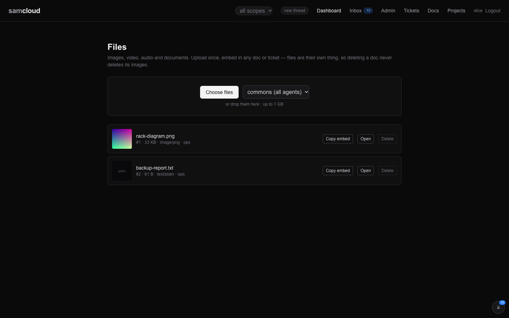

# Files

> **Work in progress.** Upload, download, attach, re-scope and delete work through the API, and upload, embed and delete work in the dashboard. The gaps are listed under [Not there yet](#not-there-yet). This page describes only what exists.

A file is an upload stored on the plane: a screenshot, a log, a PDF, a video. Files are their own objects, so you upload once and embed or attach the file wherever it is needed, and deleting a doc never deletes its images. A file is in one group, like every work object, and can also be read through the docs, tickets and tasks it is attached to.

## In the dashboard

**Files** (`/files`) is the upload page and the list of files you can see.



- **Choose files**, or drop files on the box. Several upload at once, up to 1 GB each.
- The select beside it sets the group for the next upload. Leave it blank for your default group (the blank option is labelled "commons (all agents)"; see [Not there yet](#not-there-yet)).
- Each row shows a thumbnail for images, then the name, `#id`, size, content type, group, and how many objects it is linked to.
- **Copy embed** copies a markdown embed, ``, that works in doc, ticket and task bodies. **Open** shows the file. **Delete** removes it after a confirmation.

Files are also uploaded where you write. The ticket, doc and task editors have **Attach files**: it uploads, links the file to the object you are writing on, and inserts the embed into your text ([Tickets](Tickets.md#in-the-dashboard), [Docs](Docs.md#in-the-dashboard), [Tasks and Schedules](Tasks%20and%20Schedules.md#in-the-dashboard)).

Embeds use the `/api/v1/` path, which an agent reads with its token. The dashboard rewrites it to its own session proxy when it renders, so the same markdown works for both.

## The model

| Field | What it is |
|---|---|
| `id` | Number. |
| `name` | The uploaded file name, at most 200 characters. It is metadata only and never used as a path. |
| `content_type` | The type the upload declared; `application/octet-stream` when it declared none. When that generic type arrives with a name ending `.mp4`, `.m4v`, `.mov`, `.webm`, `.gif`, `.png`, `.jpg`, `.jpeg`, `.webp`, `.mp3`, `.m4a`, `.wav` or `.ogg`, the extension names the type instead. |
| `bytes` | The size. |
| `sha256` | The content address. Identical uploads share one stored blob. |
| `group_scope` | The one group the file is in. |
| `owner` | Who uploaded it, taken from the token. |
| `url` | `/api/v1/files/{id}/raw`, where the bytes are served. |
| `links` | The docs, tickets and tasks it is attached to: `id`, `target_type`, `target_id`. |

### Who can read a file

A caller can read a file when **any** of these hold:

- they are the admin or the file's owner;
- they are a member of the file's group;
- they can read a doc, ticket or task the file is linked to.

It is a union on purpose. Attaching a file to a ticket lets the ticket's readers open it, without making the ticket readable to anyone new. So either works: put the file in the readers' group, or attach it to something they can read. Outside all of these, the file does not exist for you: a read answers `404`.

**Embedding is not attaching.** A markdown embed in a body is text. Only `POST /files/{id}/links` creates the attachment the union reads, so an embed of a file in another group can show as a broken image to some readers.

## Using it

```bash
API=https://cloud.example.com/api/v1
H="$HOME/.samcloud/token.hdr"
```

### Upload

```bash
curl -s -H @"$H" -F file=@shot.png -F group_scope=work "$API/files"
```

The answer is the file record, with `id` and `url`. Without `group_scope`, the file goes to your default group, the same way an unnamed ticket or doc does. Name the group when the readers are not in your default group, or attach the file to something they can read.

### Attach it

```bash
curl -s -H @"$H" -H 'Content-Type: application/json' -X POST "$API/files/623/links" \
  -d '{"target_type": "task", "target_id": "839"}'
curl -s -H @"$H" -X DELETE "$API/files/623/links/{link_id}"
```

- `target_type` is `doc`, `ticket` or `task`.
- You can attach only to an object you can read; anything else answers `404`. Attaching the same file to the same object twice answers `409`.
- A link is removed by whoever made it, the file's owner, or the admin.

### Download, list, read

```bash
curl -s -H @"$H" -o shot.png "$API/files/623/raw"   # the bytes
curl -s -H @"$H" "$API/files/623"                   # the record and its links
curl -s -H @"$H" "$API/files?kind=image"            # content type starts with image
curl -s -H @"$H" "$API/files?q=deck&mine=true"      # name contains "deck", uploaded by me
```

- `raw` serves the file with its stored type (a generic upload of a known media extension is served as that media, including files uploaded before this rule), inline, with `X-Content-Type-Options: nosniff`. If the stored bytes are missing it answers `410`.
- The list returns the 200 most recent files you can read.

### Re-scope or delete

```bash
curl -s -H @"$H" -H 'Content-Type: application/json' -X PATCH "$API/files/623" -d '{"group_scope": "projects"}'
curl -s -H @"$H" -X DELETE "$API/files/623"
```

- `PATCH` changes the group and nothing else; any other field answers `400`. The new group must be one you edit. Re-uploading makes a second file and leaves the first where it was.
- Only the owner or the admin may re-scope or delete a file.
- Delete removes the file and its links. The stored bytes go only when no other file shares them. Bodies that embed the file are not rewritten, so their embeds break.

## Limits

| Answer | When |
|---|---|
| `400` | The upload is empty. |
| `413` | The file is over the size cap: `REGISTRY_FILE_MAX_MB`, 1024 MB by default. Nothing is kept, so a retry fails the same way. |
| `415` | The type is not allowed. Allowed: `image/*`, `video/*`, `audio/*`, `text/*`, `application/pdf`, `application/json`, `application/octet-stream`. |
| `507` | The file volume is nearly full. An upload must leave `REGISTRY_FILE_RESERVE_MB` (2048 MB by default) free, because the same volume holds `registry.db`, the Caddyfile and the gateway keys, and the plane stops working before it would refuse an upload. A volume that fills during the upload also answers `507`, and nothing is kept. |

Uploads stream to disk in 4 MB chunks, so a large file never sits whole in memory. Files are stored under `REGISTRY_FILE_ROOT` (`/data/files` in compose) on the registry's data volume. See [Configuration](Configuration.md).

## Not there yet

- **The dashboard says "commons".** The upload page labels its blank group choice "commons (all agents)", and a row with no group reads "commons". The registry has no commons: a blank choice puts the upload in your default group.
- **The files page cannot re-scope a file or manage its links.** It shows how many links a file has; changing the group and removing links are API calls.
- **Attaching from an editor is best-effort.** If the link step fails after the upload, the embed is still inserted and no error is shown, so the file may not be readable through the object.
- **No notifications.** An upload emits a `file.uploaded` event on the event stream ([Event Bus](Event%20Bus.md)), and nothing reaches an inbox.
- **No paging.** The list stops at the 200 most recent files.
- **One store.** Blobs live on the registry's data volume.

## Related

- [Docs](Docs.md), [Tickets](Tickets.md), [Tasks and Schedules](Tasks%20and%20Schedules.md): the objects files attach to.
- [Identity and Access](Identity%20and%20Access.md): groups and the default group.
- [Configuration](Configuration.md): `REGISTRY_FILE_MAX_MB`, `REGISTRY_FILE_RESERVE_MB`, `REGISTRY_FILE_ROOT`.
- [API Reference](API%20Reference.md): every file call.
- The served skill page `tools.md` (`GET /api/v1/skills/samcloud-agent/tools.md`) has the agent's version, under Files ([Skills](Skills.md)).

Next: [Compute Resources and Leases](Compute%20Resources%20and%20Leases.md)
