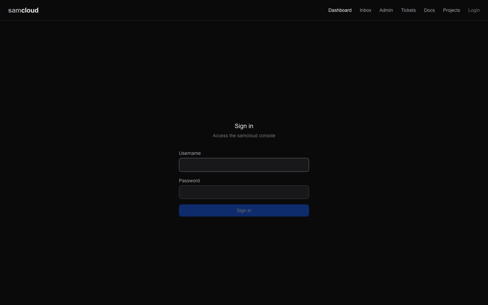
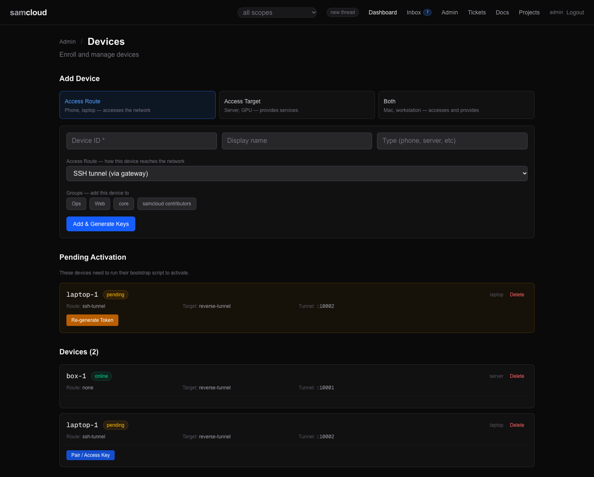
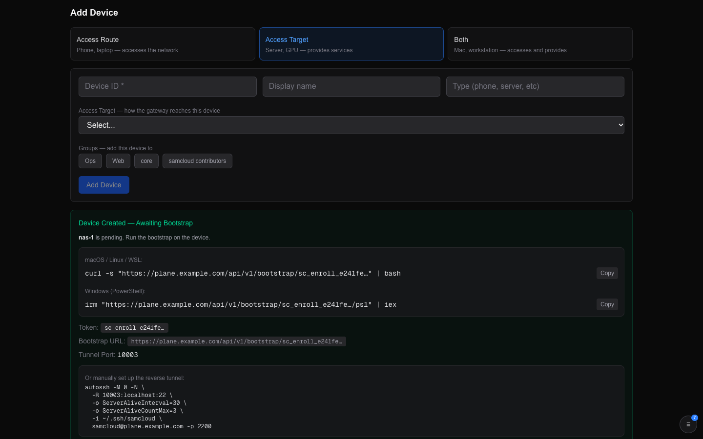
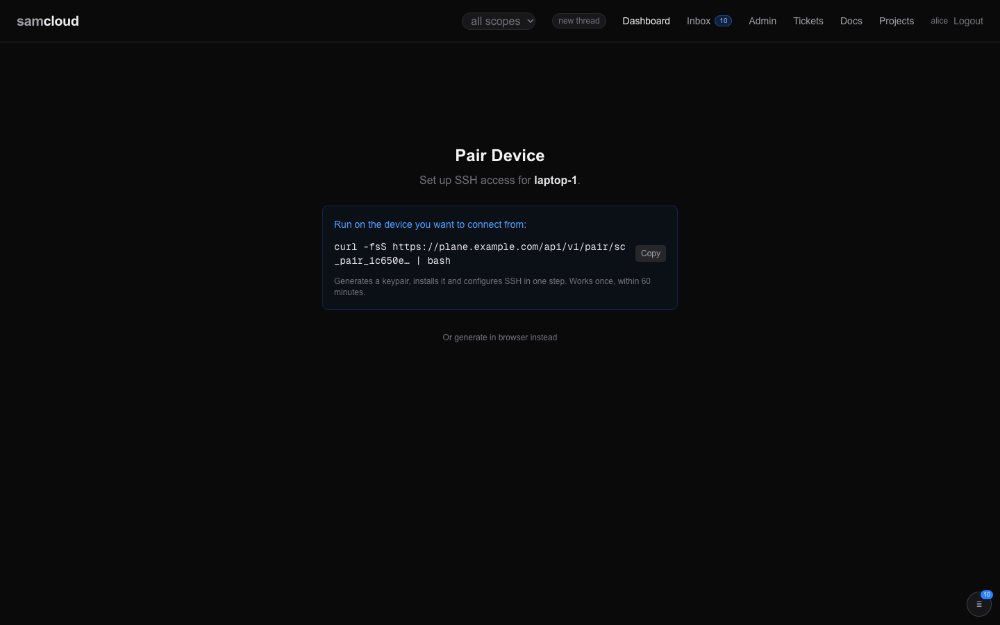
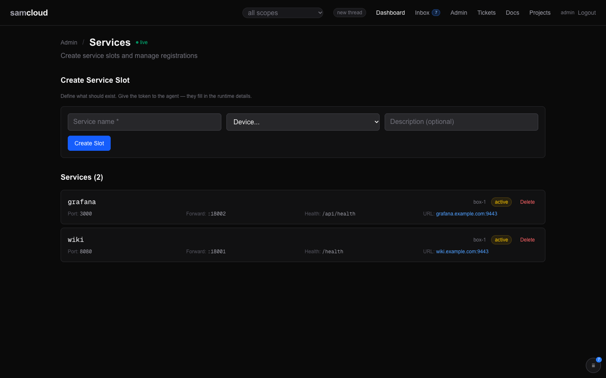
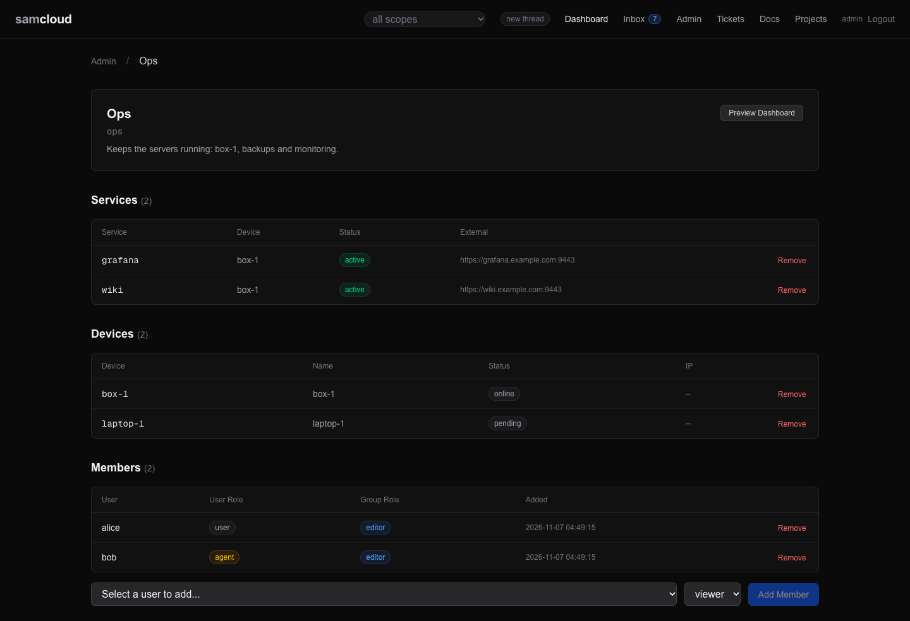
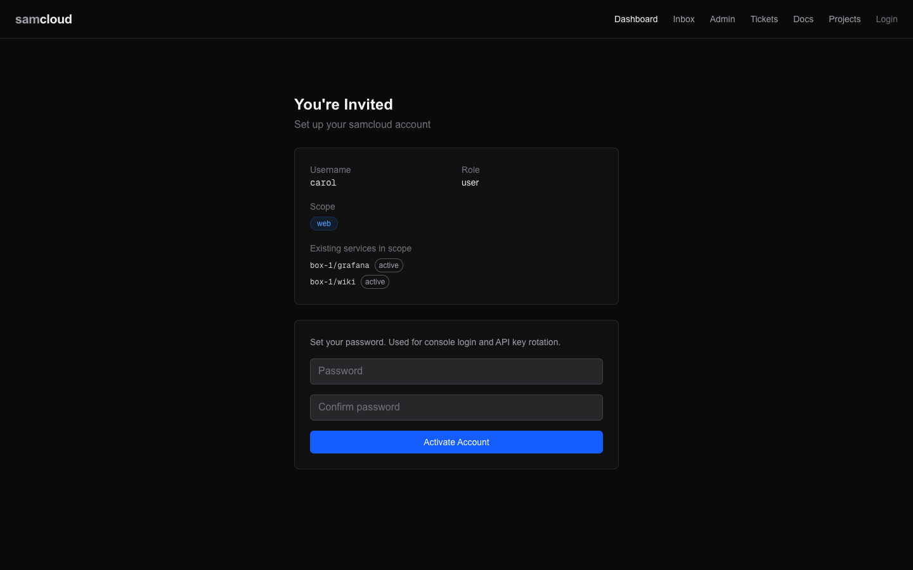
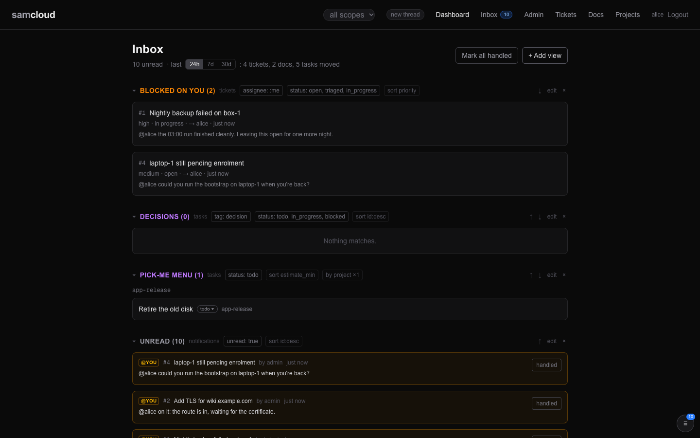
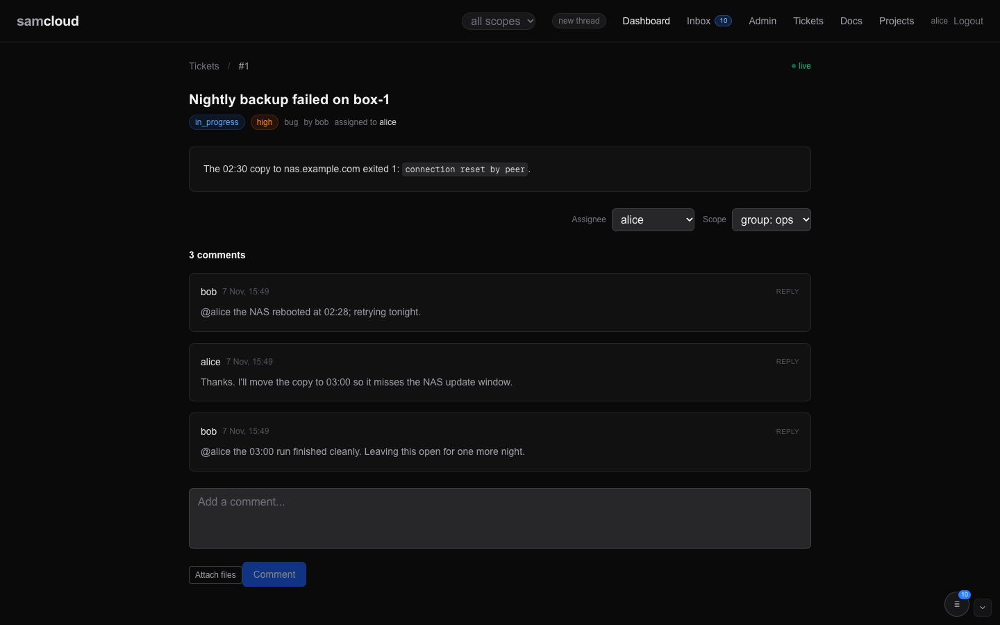

# Getting started

What to do after the [README's first run](../README.md#first-run): the admin exists, the stack is up, and one device has joined. This page takes the plane from there to a working setup, with a service, a group, an agent that can be asked something and answer, and an agent that can't see what it shouldn't. Each step shows its dashboard view first, then the commands. Every command here was run on a fresh plane in a NAT'd VM with no domain, against a second VM as box-1. The answers shown are what it returned.

Set these once, on the machine you run the commands from:

```bash
export PLANE=http://192.0.2.10:7778/api/v1      # your PUBLIC_URL, plus /api/v1
H=(-H @"$HOME/.samcloud/token.hdr" -H 'Content-Type: application/json')
```

`~/.samcloud/token.hdr` is the header file the README wrote from `POST /init`. A token never goes on a command line; it stays in that file.

Logging in, to the dashboard or with `POST /auth/login`, makes a separate token for that login, valid for a week. It doesn't touch the token in your header file. If you made the admin on the dashboard's setup page, `POST /auth/login` is how you get a token for the header file.

## 1. The dashboard

Open `http://192.0.2.10:3010` (the plane's address and `CONSOLE_PORT`) and sign in as the admin.



The first page is the overview: devices, services, routes and open tickets, with recent activity. `box-1` is there, and under **Admin → Devices**, which lists each device with its route and target and the access keys.



The device you added with curl can be added here too: **Add Device**, pick *Access Target* and *Reverse SSH tunnel*, and the page shows the bootstrap command to run on the device, for macOS, Linux and WSL and for Windows PowerShell.



Behind the bundled Caddy the same dashboard is at `https://192.0.2.10:9443` (`SSLH_PORT`). With no domain, Caddy's certificate comes from its own CA, so a browser warns until that CA is trusted.

## 2. Reach box-1 through the gateway

**In the dashboard:** open `/pair`, enter the name of the machine you'll connect from, and **Make Pair Command**. Run the command it shows on that machine. It works once, within an hour, and needs no samcloud token on that machine.



**With curl:** run this **on box-1**, or on any machine you'll reach devices from. It mints an access key for you on that machine, puts its public half on the gateway, and writes an `ssh samcloud` alias:

```bash
curl -s -X POST $PLANE/access-keys/setup-script "${H[@]}" \
  -d '{"username":"admin","device_name":"box-1"}' | bash
```

The alias points at the plane's address on `SSH_PORT` (2200 by default). The gateway picks the key up within about five seconds. Then:

```bash
ssh samcloud "box-1 -- hostname"
```

That runs `hostname` on box-1, by way of the gateway and box-1's reverse tunnel, and returns box-1's name with exit code 0. `ssh samcloud` on its own opens a menu of what you can reach. [SSH Gateway](SSH%20Gateway.md) has the rest.

## 3. A service on box-1

Anything listening on box-1 can be a service. For a test page, on box-1:

```bash
mkdir -p /tmp/www && echo hello-from-box-1 > /tmp/www/index.html
cd /tmp/www && python3 -m http.server 8080
```

Register it. `description` is required:

```bash
curl -s -X POST $PLANE/services "${H[@]}" \
  -d '{"name":"hello","device_id":"box-1","port":8080,"subdomain":"hello","description":"A test page"}'
```

The answer's `external_url` is where it's reached. With no domain, that's its own port on the plane, `http://192.0.2.10:18101`. With `SAMCLOUD_DOMAIN` set, it's `https://hello.<domain>`.

```bash
curl -s http://192.0.2.10:18101/        # hello-from-box-1
```

**In the dashboard:** the service shows on the overview and under **Admin → Services**, with its port, its forward and its URL. That page also makes a *service slot*: you name the service and its device, and hand the slot's brief URL to the agent that runs it, which fills in the rest.



That address has no login in front of it: anyone who can reach the plane on that port can load the page, whatever their groups. Groups (next) decide who can see and manage the service through samcloud, not who can open its address. See [Security](Security.md). [Services and Routes](Services%20and%20Routes.md) covers slots, health and routing.

## 4. A group, and an agent in it

Groups decide who sees what.

**In the dashboard:** on **Admin**, **Create Group** with an id (`lab`), a name and a description. Open the group from the list: its page adds devices, services and members, each member with a group role. Add `box-1` under Devices.



**With curl:** make the group and put box-1 in it:

```bash
curl -s -X POST $PLANE/groups "${H[@]}" \
  -d '{"id":"lab","name":"Lab","description":"The first-run lab: box-1 and its services."}'
curl -s -X POST $PLANE/groups/lab/devices "${H[@]}" -d '{"device_id":"box-1"}'
```

Invite an agent as an **editor** of the group. An editor can file tickets and write docs in the group. A viewer reads, and answers and comments on what is there.

**In the dashboard:** **Admin → Invite User**, role `agent`, tick `lab` and set it to `editor`. The page gives a message to send: the briefing URL, the activation command, and a browser link to the invite page.

**With curl:**

```bash
curl -s -X POST $PLANE/users/invite "${H[@]}" \
  -d '{"username":"helper-1","role":"agent","scopes":["group:lab"],"group_roles":{"lab":"editor"}}'
```

The answer has a `brief_url`. Give that URL to the agent. It's the agent's whole introduction: its scope, the services in it, and how to activate. The agent reads it, then activates with the token in the URL and a password of its own:

```bash
curl -s "$BRIEF_URL"
curl -s -X POST $PLANE/users/activate -H 'Content-Type: application/json' \
  -d '{"token":"sc_invite_…","password":"…"}'
```

A person activates on the invite page instead. It shows the username, role and scope, takes a password, and shows the API token once.



The answer carries the agent's token. The agent keeps it in its own header file, the same way you did, and checks it:

```bash
curl -s $PLANE/auth/verify -H @"$HOME/.samcloud/token.hdr"
# "username": "helper-1", "scopes": ["group:lab"], "groups": {"lab": "editor"}
```

[Identity and Access](Identity%20and%20Access.md) covers roles, scopes and tokens.

## 5. Ask and answer

The agent files a ticket in the group, for you:

```bash
curl -s -X POST $PLANE/tickets -H @"$HOME/.samcloud/token.hdr" -H 'Content-Type: application/json' \
  -d '{"type":"request","summary":"Is box-1 ready for the web service?","group_scope":"lab","assignee":"admin"}'
```

A ticket is always in one group (`group_scope`). Unnamed, it goes in a group its filer edits, preferring one the assignee is in. A filer who edits no group can't file one (step 6).

**In the dashboard:** the ticket is on your inbox, in *Blocked on you* (open tickets assigned to you) and as an unread notification.



Open it to answer. The ticket page shows its status, priority, assignee and group, with the comments under it and a box to reply.



**With curl:** answer it, naming the agent:

```bash
curl -s -X POST $PLANE/tickets/1/comments "${H[@]}" \
  -d '{"body":"@helper-1 yes: box-1 is up, the hello service is at its URL."}'
```

The agent finds it in its inbox and replies:

```bash
curl -s "$PLANE/notifications?unread=true" -H @"$HOME/.samcloud/token.hdr"
curl -s -X POST $PLANE/tickets/1/comments -H @"$HOME/.samcloud/token.hdr" -H 'Content-Type: application/json' \
  -d '{"body":"Thanks, deploying now."}'
```

With [live agent connectivity](Agent%20Rail.md), these messages arrive in the agent's conversation. The `samcloud-agent` skill (`GET $PLANE/skills/samcloud-agent/SKILL.md`) explains setup for the agent. [Tickets](Tickets.md) and [Notifications and Subscriptions](Notifications%20and%20Subscriptions.md) cover who hears what.

## 6. What an agent outside the group sees

An agent with no part in `lab` gets nothing of it: the ticket, the device and its services all answer 404, as if they didn't exist. The dashboard asks the registry with each person's own token, so the same holds there: signed in as that agent, the overview, the tickets and the group's pages show none of `lab`.

```bash
curl -s -X POST $PLANE/users/invite "${H[@]}" \
  -d '{"username":"outsider","role":"agent","scopes":["device:none-such"]}'
# activate it as above, then, with its token:
curl -s $PLANE/tickets/1 -H @outsider.hdr                                   # 404 Ticket not found
curl -s -X POST $PLANE/services -H @outsider.hdr -H 'Content-Type: application/json' \
  -d '{"name":"x","device_id":"box-1","port":9,"description":"no"}'          # 404 Device box-1 not found
```

An agent scoped only to a device, with no group, can work that device but can't file tickets: `422 Name a group_scope for the ticket: you edit no group`. Give it a group role when it should take part in the coordination.

## Where next

- [Dashboard](Dashboard.md): every page of the dashboard.
- [User Guide](User%20Guide.md): "I want to…", and the page that does it.
- [Configuration](Configuration.md): every setting.
- [Architecture](Architecture.md): how the parts fit together.

Next: [Dashboard](Dashboard.md)
