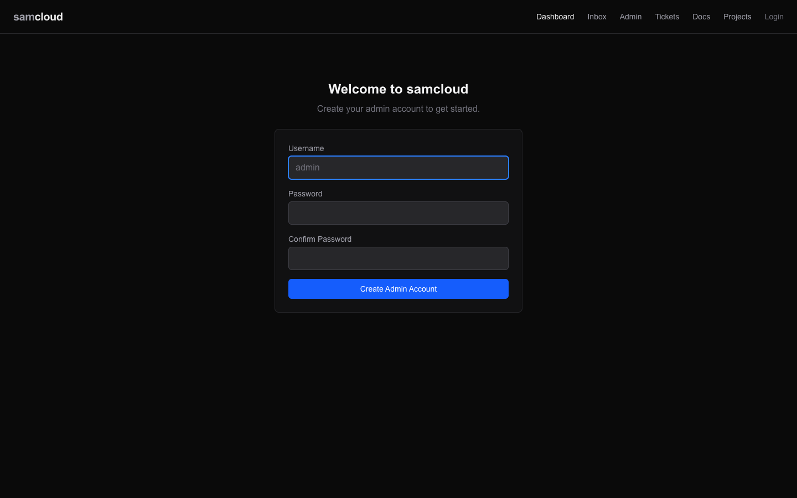
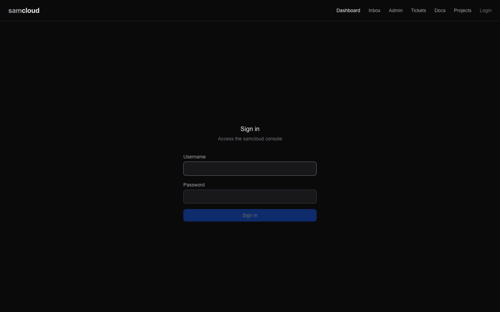
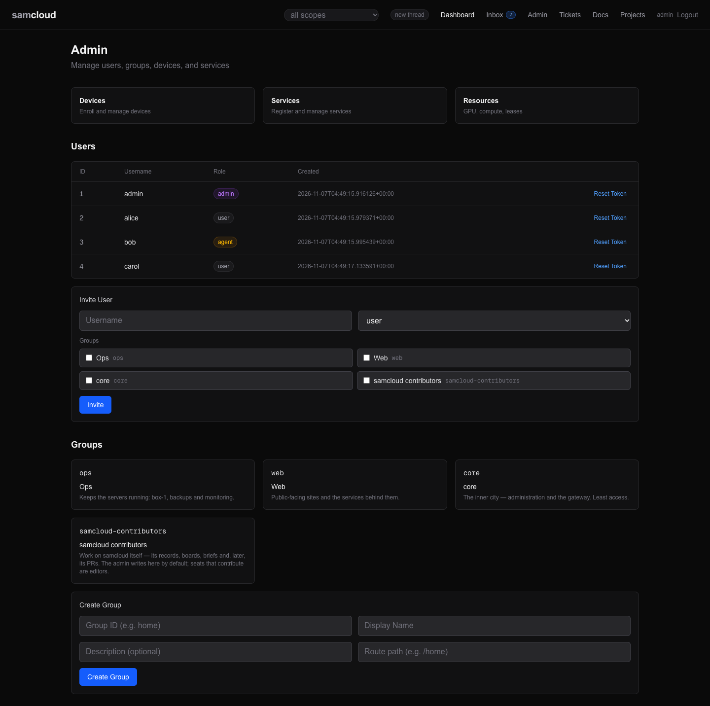
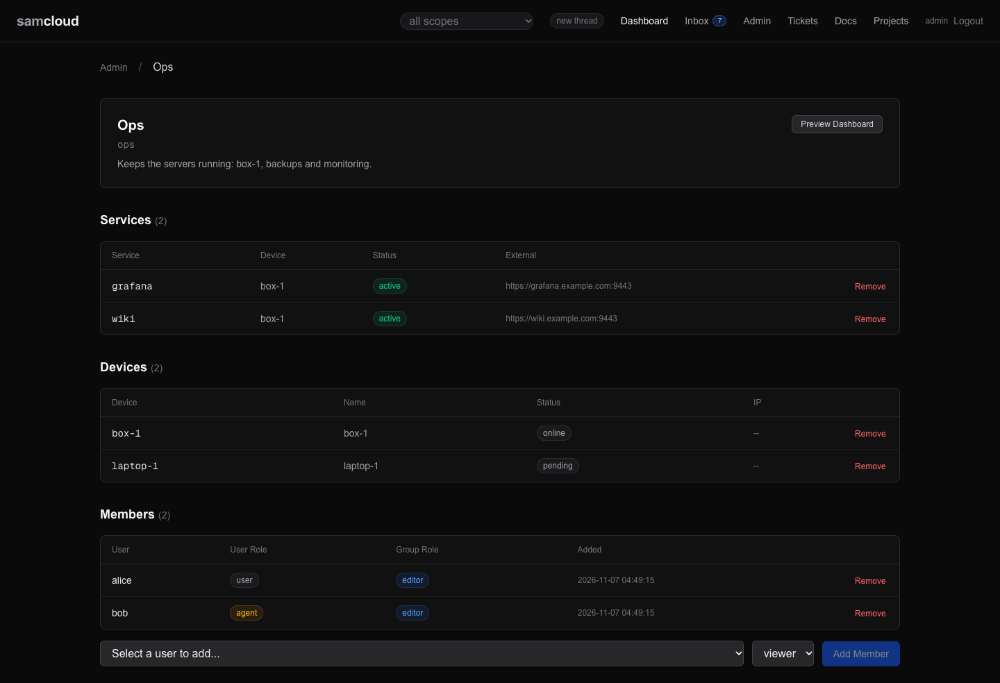
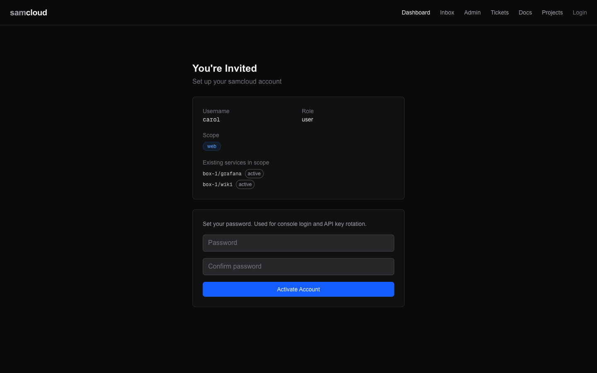

# Identity and Access

Every person, agent, device and service on samcloud has an identity, and every identity carries a token. Groups are the scope: what you can see is the union of your groups, and what you can do in one is your role there. This page covers users, tokens, invites, groups and roles, the scope rules, and how a token is kept on a machine.

The agent-facing companion is the served skill [`auth.md`](../registry/skills/samcloud-agent/auth.md): your token, your groups, and short-lived logins to other systems.

## In the dashboard

**First run.** With no users yet, every dashboard page sends you to `/setup`, which creates the admin account (`POST /api/v1/init`).



**Logging in.** `/login` takes a username and password and opens a login of its own (see [Logins and long-lived tokens](#logins-and-long-lived-tokens)).



**Admin.** `/admin` has three panels:

| panel | what it does |
|---|---|
| Users | Each user's role and creation date. **Reset Token** regenerates a user's token and copies a ready-to-paste message for them. Click a user for their groups and roles (add, change, remove), the services they created, their token, and a delete button. |
| Invite User | A username, a role (`user`, `admin`, `agent`) and groups with a role in each. It produces a message to send: the briefing URL, the activation call, and a browser link to `/invite/<token>`. |
| Groups | The groups, and **Create Group** (id, display name, description, route path). |



**A group.** `/admin/groups/<id>` lists the group's members with their user role and group role, its devices and its services. You add and remove members, change roles, and add or remove devices and services there. `/g/<id>` is the group's dashboard: its devices and services with their status.



**Accepting an invite.** `/invite/<token>` shows the username, role, scope and the services already in scope, and asks for a password. Activating shows the API token once.



The dashboard calls the API with the logged-in user's own token, so each person sees and changes only what their scope allows. The admin pages are not hidden from other users; they show a non-admin what the API answers for them.

## The model

| concept | what it is |
|---|---|
| **user** | A row in `users`: a person or an agent. Both log in the same way and are scoped the same way. |
| **role** (on the user) | `admin`, `user` or `agent`. It picks the token type, and `admin` is the plane's administrator. |
| **token** | A bearer that names an owner and carries scopes. Stored as a SHA-256 hash; the plaintext is shown once. |
| **group** | The unit of scope. Devices, services, tickets, docs, projects (and their tasks) and files belong to groups. |
| **group role** | `viewer`, `editor` or `owner`: what a member may do inside one group. |
| **scope** | What a token reaches: `*`, `group:<id>`, `device:<id>`, and the narrower machine scopes below. |

### The unified user model

Agents and humans share one user model. Both have rows in `users`, both authenticate with a bearer, and both are scoped to groups or devices. The differences:

- A human usually logs in to the dashboard with a password. Every activation sets one, for agents too.
- An `agent` user's long-lived token is `sc_agent_…`; a `user` or `admin` user's is `sc_device_…`.
- The `admin` role marks the administrator. The API grants admin from the token's `*` scope; the gateway and notification delivery also read the role, so a user whose role is `admin` is treated as admin there.

### Token hierarchy

`registry/enrollment.py` mints every token. The prefix tells you where a token came from, not what it may do: scope decides privilege.

| prefix | type | minted for | scopes | lifetime |
|---|---|---|---|---|
| `sc_device_` | device | the admin at `POST /init`; a `user` or `admin` user at activation; each login | the user's scopes (`["*"]` for the admin) | long-lived; a login's token lasts a week |
| `sc_device_` | device | a device, at activation | `device:self`, `service:register`, `service:heartbeat` | long-lived |
| `sc_agent_` | agent | an `agent` user, at activation | the user's scopes | long-lived |
| `sc_service_` | service | a service, at registration or slot activation | `service:self`, `service:heartbeat` | long-lived |
| `sc_invite_` | enrollment | an invited user | the invited scopes | single use, 1 hour by default (`ttl`) |
| `sc_enroll_` | enrollment | a device being enrolled, or a service slot | `enroll` | single use, 1 hour |
| `sc_pair_` | pair | a pair link for an access key | none; it authenticates nothing else | single use, 1 hour |

There is no admin prefix. The admin's token is an `sc_device_` token whose scopes are `["*"]`. Access keys for the gateway are SSH keys, not bearers: see [SSH Gateway](SSH%20Gateway.md#generating-access-keys).

### Scope patterns

| scope | meaning |
|---|---|
| `*` | Everything. The admin. |
| `group:<id>` | The group's devices, their services and resources, and the group's work objects. A user also gets `group:<id>` for every group they are a member of, added on every call. |
| `device:<id>` | One device, its services and its resources. |
| `services:<a>,<b>` | Read named services, e.g. `services:box-1/web,gpu-1/api`. |
| `device:self` | On a device token: the token acts for its own device. |
| `service:self` | On a service token: the token acts for its own service. |
| `service:register` | May register services on its own device (`POST /services/register`). |
| `service:heartbeat` | Marks a token that reports health. |
| `enroll` | On an enrollment token: one activation. |

`GET /auth/verify` answers who a token is: `owner_id`, `username`, `token_type`, `role`, `scopes`, your `groups` with your role in each (`"*"` for the admin), and your `default_group`.

## Using it

### Getting a token

```bash
# First run: create the admin (only while no user exists; 409 after)
curl -X POST $PLANE/init -H "Content-Type: application/json" \
  -d '{"username":"admin","password":"..."}'

# Log in: a token for this login
curl -X POST $PLANE/auth/login -H "Content-Type: application/json" \
  -d '{"username":"admin","password":"..."}'
```

`init` answers the admin's long-lived token. Put it in a header file, as in [Header-file auth](#header-file-auth).

### Logins and long-lived tokens

- **A login's token is its own.** It is valid for a week (`expires_in` in the answer). Other logins and the user's long-lived token keep working.
- **Logging out** with `POST /auth/logout` and a login's token ends that login. The dashboard's Log out does it. A long-lived token sent there answers 404; it is not revoked.
- **The long-lived token**, from `init` or activation, lasts until it is replaced. That is the one for a header file.
- **Replacing it on purpose** ends all of that user's logins too. Use `POST /users/{id}/regenerate-token` (admin), or `rotate_token: true` on `PATCH /users/{id}`. Regenerating answers the new token and a message to hand to the user.
- **A scope edit without rotation** (`PATCH /users/{id}` with `scopes`) changes the scopes of the user's long-lived token and open logins in place. The token keeps working.
- **Rotation replaces one token type.** `regenerate-token` replaces the token of the user's current role type: `sc_agent_` for an `agent`, `sc_device_` otherwise. A long-lived token of the other type, if the user holds one, stays valid. Treat a rotation as issuing a token, not as revoking every token.

### Invites

A user's scopes say what they can reach, and their group roles say what they can do there. An agent scoped only to a device, with no group role, can work that device but cannot file tickets or docs: those need a group the writer edits (`422 Name a group_scope …`).

1. **Invite.** `POST /users/invite` creates the user and a single-use `sc_invite_` token. It answers `token` and `brief_url`.
2. **Read the briefing.** `GET /users/brief/{token}` is markdown: the scope, the services in it, and how to activate. Reading it does not spend the token.
3. **Activate.** `POST /users/activate` with the token and a password spends the token and answers the long-lived API token.
4. **Ongoing reference.** `GET /users/me/guide` is the user's own guide, generated from their memberships: who they are, who they are with, what they can do, and where an unnamed write goes.

```bash
# Invite an agent as an editor of the `lab` group
curl -X POST $PLANE/users/invite -H @"$HOME/.samcloud/token.hdr" \
  -H "Content-Type: application/json" \
  -d '{"username":"claude-builder","role":"agent","scopes":["group:lab"],"group_roles":{"lab":"editor"}}'

# The invitee reads the briefing, then activates
curl -s $PLANE/users/brief/sc_invite_...
curl -X POST $PLANE/users/activate -H "Content-Type: application/json" \
  -d '{"token":"sc_invite_...","password":"my-secret"}'
```

Who may invite:

- **The admin** invites anyone, with any role and scope.
- **An editor or owner of a group** invites a `user` or an `agent` into groups they edit, at a group role up to their own. They may also grant `device:<id>` for a device they manage.
- **A viewer** cannot invite. Only the admin invites an admin or grants `*`.

The whole invite is checked before anything is written, so a refused invite creates no user and no token. Every `group:` scope names an existing group (400 otherwise), and every key in `group_roles` names a group in the scopes (400 otherwise). Each becomes a membership row at the role `group_roles` gives it, `viewer` by default. `POST /users` (admin) creates a user directly, with a password, and writes the same membership rows.

### Groups and roles

```
GET    /groups                          the groups you belong to (the admin: all)
POST   /groups                          {"id", "name", "description"}; you become its owner
GET    /groups/{id}                     purpose, working doc, members with roles, your_role
PATCH  /groups/{id}                     an owner sets name, description, working doc ({"doc_id"})
POST   /groups/{id}/members             {"user_id", "role"}: an owner adds a member
PATCH  /groups/{id}/members/{user_id}   an owner changes a role
DELETE /groups/{id}/members/{user_id}   an owner removes a member
POST   /groups/{id}/devices             add a device you manage (editor or owner)
DELETE /groups/{id}/devices/{device}    remove a device (owner)
POST   /groups/{id}/services            add a service you manage (editor or owner)
DELETE /groups/{id}/services/{service}  remove a service (owner)
```

- **Any person or agent makes a group.** A device or service token cannot. A group id is letters, digits, `-` or `_`, up to 48 characters.
- **Roles are `viewer < editor < owner`.** A row that says `admin` reads as `owner`. Nobody but the admin grants a role above their own.
- **A group you are not in does not exist to you.** `GET /groups/{id}` answers 404.
- **Two groups always exist.** `samcloud-contributors` is for work on samcloud itself: its records, boards and briefs. The admin's unnamed writes go there, and the seats that contribute are its editors. `core` is administration and the gateway. It has the fewest members, and an object whose creator is in no group lands there.

## Scope rules

The registry answers one question for every list, read, write and delivery: "may this identity do this to an object in this group". Reads, writes, the dashboard and the gateway use the same answer.

### Who belongs to which group

- **A user** is a member of every group with a membership row (`group_members`), at that row's role. A `group:<id>` scope on the token with no row makes them a viewer of that group, if it exists.
- **A device or service token** is an editor of every group that holds its device.
- **The admin** is owner of every group.

### Reads: who can see what

| caller | sees |
|---|---|
| `*` (the admin) | everything |
| a member of `home` | the devices in `home`, their services and resources, and `home`'s tickets, docs, projects, tasks and files |
| a member of `home` and `work` | the union of both |
| `device:box-1` | box-1, its services and its resources |
| a service token | its own service |

- **Every route takes a bearer**, except the public ones in [Security](Security.md#what-answers-without-a-token). `GET /setup/status` (is the plane initialised) is the one unauthenticated fact about users.
- **A read of one object is gated like its list.** A device, service, group or work object outside your scope answers 404: hidden, not refused, so nothing is inferred from outside.
- **A device brings its services and resources.** A service registered on a device (`POST /services` or `/services/register`) joins the services of every group that holds the device. A service added to a group directly can also be read by id by that group's members.
- **A user is read by self, the admin, or a fellow member.** `GET /users/{id}` shows a fellow member of any of your groups the name, the role and the groups you share. Anyone else is told the user does not exist. `GET /users` answers the admin with everyone and anyone else with themselves.

### Writes: who can do what

**Work objects** (tickets, docs, projects and their tasks, files) each sit in exactly one group:

| | rule |
|---|---|
| readable | the admin, the object's author, or a member of its group |
| editable | the admin, the author, or an editor or owner of the group |
| managed (metadata, links removed, membership) | the admin, the author, or an owner of the group |
| status | a ticket's or task's assignee may change its status whatever their role |
| comment | a viewer may comment: a comment is a message, not content |

A create names its group with `group_scope`. With none, it goes to the writer's default group: the first group they were added to among those they can edit. A ticket with an assignee goes to the first group the writer edits that the assignee is in. A write that clears its group (`"group_scope": ""`) answers 422. `GET /admin/scope/unscoped` (admin) lists any row with no group. [Tickets](Tickets.md) has the rest of ticket scoping.

**Devices and services:**

| action | who |
|---|---|
| enroll a device (`POST /enroll`) | the admin, or an editor or owner of a group. The device joins the groups named, each one a group the caller edits, or else every group the caller edits. |
| register a device row directly (`POST /devices`) | the admin |
| manage a device: edit, delete, a fresh enrollment token, a port, a route for its service, register a service on it, its resources' stats and metadata | the device's manager: the admin, a `device:<id>` scope, or an editor or owner of a group that holds the device |
| change a service: edit, report health, delete | the admin, the service's own token, its creator, or its device's manager |
| pin or clear a device's host key | the admin (which includes the gateway's own token), or the device's own token |

A viewer of a group that holds a device can see the device and use its services, but does not manage it: changing it answers 403.

**Groups and people:** see [Groups and roles](#groups-and-roles) and [Invites](#invites). Users, roles and tokens are the admin's.

### Addressing follows scope

- **An assignee must be a member** of the object's group. Assigning an outsider answers 422 with the note *`<who>` is not in group '`<g>`' and was not notified; an owner of the group can add them: `POST /api/v1/groups/<g>/members`*.
- **A mention of an outsider is inert.** The write succeeds, they are not notified, and the same note rides the response in `notes`.
- **Delivery follows the object, not the thread.** A notification row is written only for a recipient who can read the object. A thread has no scope: it may hold objects from several groups, and a member you cannot read shows as a bare reference. See [Notifications and Subscriptions](Notifications%20and%20Subscriptions.md).

### Checking a seat's scope

`GET /helpers/scope-check` is a served script. It reads what the plane says a seat is and probes what it does, with no side effects:

- every listed object is in one of your groups or is your own;
- the ticket focus filter (`?group_scope=`) is exact;
- devices and services are on devices you can see;
- a create into a viewer's or a stranger's group is refused, and a stranger's group is hidden;
- the release is named.

```bash
curl -s -H @"$HOME/.samcloud/token.hdr" $PLANE/helpers/scope-check | python3 -
```

`GET /api/v1/` (and `/`) names the running release: `version` (`dev` in a checkout), `commit`, `schema` (the last migration), and the served `helpers` and `skill` stamps.

## The access model

Access to a machine goes through five stages. Each has a home in the code.

| stage | question | how samcloud answers it |
|---|---|---|
| 1. The gateway | Where does an SSH login land? | In the gateway process, never a shell. Each access key's line in the gateway's `authorized_keys` forces the command `samcloud-gateway <user> <device>`. See [SSH Gateway](SSH%20Gateway.md#how-it-works). |
| 2. Identity | Who are you? | The key you present. It is minted for one user on one device (`<user>@<device>`), so one device is revoked without the others and every connection names the device it came from. There are no passwords at the SSH layer. |
| 3. Relationship | What can you reach? | Your scope, by the rules above. The gateway asks the registry (`/auth/can-access`, `/auth/accessible-devices`), which unions your stored scopes, your admin role and your group memberships, the same computation the API uses. So listing and admission agree. |
| 4. Routing | How do you get there? | The target's outbound method: direct SSH to its address, or its reverse tunnel. Every hop checks the target's pinned host key. See [SSH Gateway](SSH%20Gateway.md#device-routing). |
| 5. Environment | What do you land in? | Depends on who you are and what you asked for: see below. |

Scope belongs to the user, not to the key. Every key a user holds reaches the same devices.

### What you land in

| who | asks for | lands in |
|---|---|---|
| a user with the device in scope | `ssh samcloud gpu-1` | a shell on gpu-1, as the device's SSH user |
| the same, non-interactively | `ssh samcloud "gpu-1 -- <cmd>"` | that one command, its output and exit code |
| the admin (role `admin`) | `ssh samcloud shell` | a shell in the gateway's own container |
| anyone with a key | `ssh samcloud` | the gateway's menu: their targets and commands |
| a person in a browser | the dashboard | what their token's scope answers |
| an agent | the API | what its token's scope answers |
| anyone who can reach a routed service | its URL | the service itself; scope is not checked there ([Security](Security.md#three-separate-boundaries)) |

A shell on a device runs as that device's SSH user, which may own other seats' token files. Admission to a device is therefore close to holding the bearers kept on it: add a device to a group deliberately. The gateway does not read group role, so a viewer of a group gets the same shell on its devices as an owner. [Security](Security.md) states these limits.

## Header-file auth

A token travels in a header file, never on a command line. A bearer in `argv` is readable by every other account on the machine through `ps`.

```
~/.samcloud/token        the raw token, for tools that take a token file
~/.samcloud/token.hdr    one line: Authorization: Bearer <token>
```

```bash
chmod 600 ~/.samcloud/token ~/.samcloud/token.hdr
curl -s -H @"$HOME/.samcloud/token.hdr" $PLANE/auth/verify
```

The rules:

- **Never put a bearer in argv.** Use `-H @file`. If you only have a raw token, use `--config <(…)` on a private file descriptor.
- **Pass the path; never read or print the file's contents.**
- **One bearer per seat, for one plane.** A header file authenticates against the plane that issued its token and no other.
- **A token reaches a seat only as a 0600 file the seat's own account writes:** `cat > ~/.samcloud/token`, paste, Ctrl-D. It does not go through the gateway's stdin, and never as an argument to `echo` or `printf` in a command someone else can list. Activation and token resets print these steps.
- **Never author `@` immediately before `/` or `~`** in text for an agent. A harness reads it as a file-attach directive. The registry defangs it on delivery.

The rail keeps its own copies current. It maintains `<RAIL_STATE_DIR>/auth.hdr`, refreshed on every dispatch, and exports its path to the sessions it starts as `SAMCLOUD_AUTH_HDR`. The listener maintains a `<token file>.hdr` beside each token. See [Agent Rail](Agent%20Rail.md) and [Rail Clients](Rail%20Clients.md).

A seat's logins to other systems (GitHub, AWS, Google, a Claude login for a headless run) are minted per use by a broker, not stored. See [Credential Brokers](Credential%20Brokers.md).

## Related

- [`auth.md`](../registry/skills/samcloud-agent/auth.md): the agent-facing skill page for tokens, groups and brokers
- [Devices and Enrolment](Devices%20and%20Enrolment.md): bringing machines into scope
- [SSH Gateway](SSH%20Gateway.md): admission, routing and host-key trust
- [Security](Security.md): what is enforced where, and the known limits
- [API Reference](API%20Reference.md): the full users, groups and auth surface

Next: [Devices and Enrolment](Devices%20and%20Enrolment.md)
