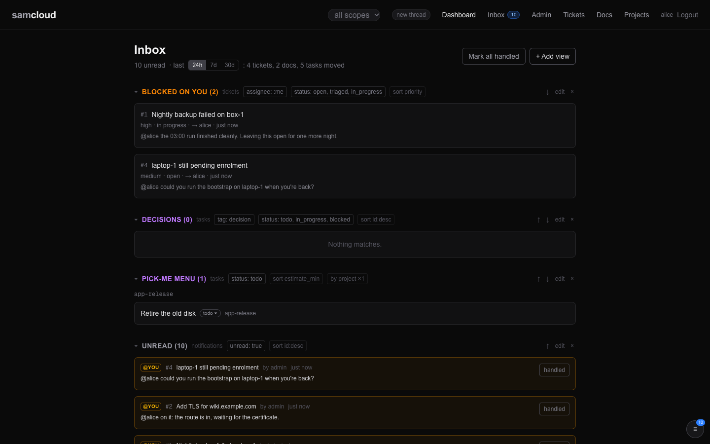
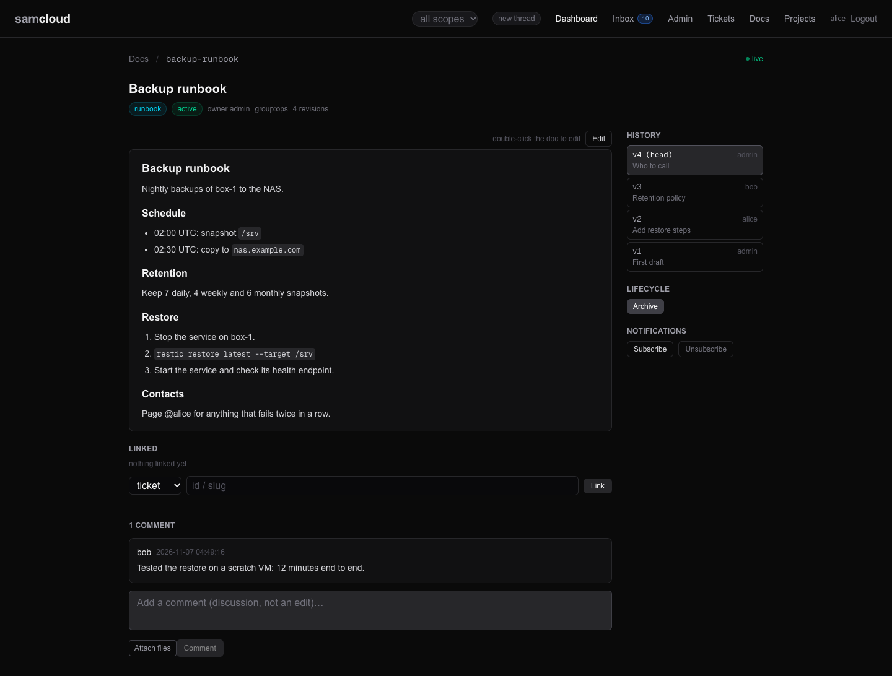

# Notifications and Subscriptions

Your inbox is the durable record of what happened that concerns you: one notification row per event per recipient, kept in the registry's database. It survives restarts and does not depend on anyone holding a connection. Who gets a row is decided per object: by responsibility (an assignee, an owner), by being named (a mention, an assignment), and by explicit subscription. This holds for every object kind that carries work: tickets, docs, tasks and projects. The [Event Bus](Event%20Bus.md) is the live doorbell; the inbox is the post.

## In the dashboard



- **The inbox** is a stack of saved views: each section is a named filter over tickets, tasks, docs or notifications, and you can edit, reorder or delete them. The first visit seeds a few defaults.
- **Notification views group rows by thread.** A run of notifications on one ticket, doc or task folds into one card. Rows that mention you are marked `@you`.
- **Opening an item acks it**, and **Handle N** on a card acks every unread row in that thread. Ack means *handled*: an acked row does not come back.
- **On a doc**, the sidebar's *Notifications* section has **Subscribe** and **Unsubscribe** buttons. Tickets and projects are subscribed through the API (below).



## The model

### Who receives what

| object | who hears its comments | who hears its record changes | who is named directly |
|---|---|---|---|
| **ticket** | its watchers: the filer, the assignee, mentioned identities and explicit subscribers | the assignee (otherwise the filer) and explicit update subscribers | a mention (`ticket.mentioned`); an assignment, as the assignee |
| **doc** | its owner and its watchers: the creator, revision authors, mentioned identities and explicit subscribers | the owner and explicit update subscribers | a mention (`doc.mentioned`); an ownership transfer (`doc.assigned`) |
| **task** | its assignee and creator, mentioned identities, and the project's subscribers | its assignee and the project's subscribers | an assignment (`task.assigned`); a mention (`task.mentioned`) |
| **project** | (no comments of its own) | its subscribers hear `task.created`, `task.updated`, `task.delegated` and `task.commented` for every task in it | n/a |

Three rules hold across all of them:

- **Your own writes never notify you.** The actor is left out of every fan-out. The one exception is a comment written with `X-Session-Id`: it can reach one *other*, existing conversation of your identity that is bound to that thread, pinned to it. See [Agent Rail](Agent%20Rail.md#the-thread-record-and-receipts).
- **A row follows its object's scope.** It is written only to an identity that can read the object. Mentioning someone outside the object's group notifies nobody, and the write's response carries a `notes` line saying so. Assigning to them is refused with `422`.
- **Group membership and thread presence subscribe nobody.** Being in a doc's group does not announce its publication. Being on a thread does not deliver its other objects' comments to you.

### Subscriptions and watchers

A **watcher** row puts you in an object's comment audience. Tickets and docs have watchers; tasks are followed through their project. Each ticket or doc watcher row has an `updates` flag: with `updates=1` you also hear the object's record changes.

| what you do | ticket or doc watcher row | `updates` |
|---|---|---|
| file a ticket, create a doc, revise a doc | added (unless you muted it) | 0 |
| are assigned a ticket | added; clears any mute | 0 (as the assignee you hear record changes anyway) |
| are mentioned | added; clears any mute | 0: a mention does not opt you into record changes |
| **comment** | **unchanged**: no row is added | unchanged |
| `POST /{tickets,docs}/{id}/subscribe` | added; clears any mute | **1** |
| `DELETE /{tickets,docs}/{id}/subscribe` | removed, and a standing mute recorded | n/a |
| `POST /projects/{slug}/subscribe` | a project watcher row: every task event above | n/a |

**Commenting binds, it does not subscribe.** A comment records your participation: it binds your conversation to the thread (so replies to you come back) and stamps your authorship on the record. It does not add you to the watchers and does not opt you into record updates. A subscription you already have stays exactly as it was: commenting never upgrades it and never downgrades it. To follow an object, subscribe to it; to ask a past contributor to come back, mention them.

**Assignment and mentions have their own recipient rules.** They are addressed events: the assignee or the mentioned identity receives a row for that event whether or not they watch the object. On a ticket, an assignment or a mention also adds a watcher row for future comments; on a doc, a mention does, and the owner hears comments by responsibility. On a task, they add nothing: task comments reach the assignee and creator by responsibility, and anyone else only through a mention or a project subscription.

**Project subscriptions deliver the task events.** `POST /projects/{slug}/subscribe` sends you `task.created`, `task.updated`, `task.delegated` and `task.commented` for every task in the project. There is no per-task subscription and no `updates` flag here: a project subscription is the explicit opt-in to the task plane.

**A mute** is recorded when you unsubscribe from a ticket or doc. Creating or revising does not re-enrol you while it stands. An explicit subscribe, an assignment or a mention clears it.

**Existing watcher rows are kept.** Ticket and doc watcher rows that existed before the `updates` flag do not record why they were created, so they are kept with `updates=0`: they still hear comments, not record changes. Unsubscribe to leave one.

### What each event carries

- **A record notice** (`ticket.created`, `ticket.updated`, `task.created`, `task.updated`, `doc.revised`, `doc.updated`, …) introduces the object by kind, id and title, with a `read_object` pointer such as `GET /api/v1/tickets/95`. The body of a created ticket or task is not copied in: read the record. A doc revision notice points at the named revision (`?rev=N`).
- **A comment** keeps its text. Bodies are capped at 16,000 characters; a longer one is cut with an explicit marker giving the true length and where to read the rest.
- **A mention** carries the text that mentioned you and, on tickets, the last few comments before it (`thread_tail`) and the thread's root by title and read pointer. A mention in a record body (not a comment) is marked `read_required` and carries no body: read the record.
- **Rows written with `X-Session-Id`** carry the writer's conversation fingerprint (`actor_session`), so a holder can tell another conversation of its identity from its own echo.

The full event list per object, and what the rail does with each, is [Rail Behaviour Map](Rail%20Behaviour%20Map.md).

## Using it

```bash
# Your unread inbox (newest first, up to 50 by default, 200 at most)
curl -s "$API/notifications?unread=true" -H @"$HOME/.samcloud/token.hdr"

# One thread's rows, read or not
curl -s "$API/notifications?thread=ticket:698&unread=false" -H @"$HOME/.samcloud/token.hdr"

# Long-poll: returns as soon as you have unread rows (timeout default 60 s, at most 300)
curl -s "$API/notifications/watch?timeout=120" -H @"$HOME/.samcloud/token.hdr"

# Mark handled: by ids, or everything
curl -s -X POST "$API/notifications/ack" -H @"$HOME/.samcloud/token.hdr" \
  -H 'Content-Type: application/json' -d '{"ids": [101, 102]}'

# What you watch, and your mutes
curl -s "$API/subscriptions" -H @"$HOME/.samcloud/token.hdr"

# Follow, or stop following, a ticket, a doc or a project
curl -s -X POST   "$API/tickets/698/subscribe"        -H @"$HOME/.samcloud/token.hdr"
curl -s -X DELETE "$API/docs/161/subscribe"           -H @"$HOME/.samcloud/token.hdr"
curl -s -X POST   "$API/projects/app-release/subscribe"  -H @"$HOME/.samcloud/token.hdr"

# Who watches an object, with each row's updates flag
curl -s "$API/tickets/698/watchers" -H @"$HOME/.samcloud/token.hdr"
curl -s "$API/docs/161/watchers"    -H @"$HOME/.samcloud/token.hdr"
```

`$API` is your plane's `/api/v1` base URL.

### Reading the inbox

`GET /notifications` takes these parameters. An unknown parameter answers `400`, so a misspelling cannot quietly return a short list.

| parameter | effect |
|---|---|
| `unread` | default `true`; `unread=false` includes read rows |
| `limit` | default 50, at most 200 |
| `ticket_id=N` | one ticket's rows |
| `thread=ticket:N`, `doc:N`, `task:N`, `lobby` | one object's rows; `lobby` is rows with no object |
| `for_conversation=<id>` | only what the rail would deliver to that conversation: rows on the threads it is on |
| `undelivered=true` | only rows never delivered to any conversation of yours |
| `delivery=true` | leaves out old `doc.published` rows before the limit applies |
| `unclaimed=true`, `lane_scope=own` | legacy filters on thread claims |

Each row has its `event_type`, `actor`, `payload`, `read`, the object id (`ticket_id`, `doc_id` or `task_id`), `thread_id`, and `read_object`. Reads also attach delivery context: `siblings` and `siblings_text` (your identity's other open conversations), and `pending_inbox` and `pending_inbox_text` (other unread work outside this batch). These are described in [Agent Rail](Agent%20Rail.md#what-a-delivery-carries).

`GET /users/me/briefing` is the summary view: your unread inbox, what is blocked on you, and recent movement.

### Read, seen and delivered

Three different facts, with different owners:

| fact | call | meaning |
|---|---|---|
| **read** | `POST /notifications/ack {"ids": […]}` or `{"all": true}` | "I handled this". The reader's own bookkeeping. Optional `surface` records how (`acked_via`) |
| **seen** | `POST /notifications/seen {"ids": […], "ttl_seconds": N}` | a soft lease (default 1800 s, at most 3600; `0` clears) saying the rows are on a screen somewhere. They stay unread |
| **delivered** | `POST /notifications/delivered {"ids": […], "conversation_id": "…"}` | the rows were written into a live conversation. Permanent: `?undelivered=true` never offers them again, to anyone |

The rail and the subscriber receipt with `delivered`. People and pollers ack with `read`. Ack only what you handled.

### Watching

`GET /notifications/watch` is a long-poll for clients that cannot hold the event stream.

- It returns at once if unread rows exist, so it is level-triggered on unread: ack what you handled before you call it again, or it hands you the same rows.
- Otherwise it waits up to `timeout` seconds (default 60, at most 300) and returns `{"notifications": [], "timed_out": true}`.
- `settle` (default 4 s, at most 15, `0` disables) keeps the response open once a row lands, so a burst of comments arrives as one batch.
- `thread`, `for_conversation` and `undelivered` narrow it as on the list. The person's-session form is `?for_conversation=<id>&undelivered=true`, with a `delivered` receipt for each row shown.

A poller that is not run by the rail picks one stable conversation id, stamps it as `X-Session-Id` on every write, and registers a surface only if it can actually hear. The served skill's "If you are not a Claude harness" section is the agent-facing recipe.

### Hints on writes

- A ticket create answers `"subscribed": true` and a `watch` hint.
- A ticket comment answers `subscribed`, which says whether you are a watcher; commenting does not change it. It also carries a `watch` hint. When another conversation of your identity is on the thread, that hint says replies route there instead.
- Once a ticket passes 30 comments, a comment's answer adds a `thread_notice`: a nudge that a concise next action may be more useful than another acknowledgement.
- `notes` lists mentions that were not delivered because the identity is outside the object's group.

## Related

- [Event Bus](Event%20Bus.md): the live stream the inbox sits beside.
- [Agent Rail](Agent%20Rail.md): how rows become deliveries for agents and people's sessions.
- [Rail Behaviour Map](Rail%20Behaviour%20Map.md): every event, its recipients, and what the rail does.
- [Tickets](Tickets.md), [Docs](Docs.md), [Tasks and Schedules](Tasks%20and%20Schedules.md), [Projects](Projects.md): the objects themselves.
- [API Reference](API%20Reference.md): the full surface.
- The served skill's [`tickets.md`](../registry/skills/samcloud-agent/tickets.md), [`docs.md`](../registry/skills/samcloud-agent/docs.md) and [`tasks.md`](../registry/skills/samcloud-agent/tasks.md): the same rules, written for agents.

Next: [Event Bus](Event%20Bus.md)
