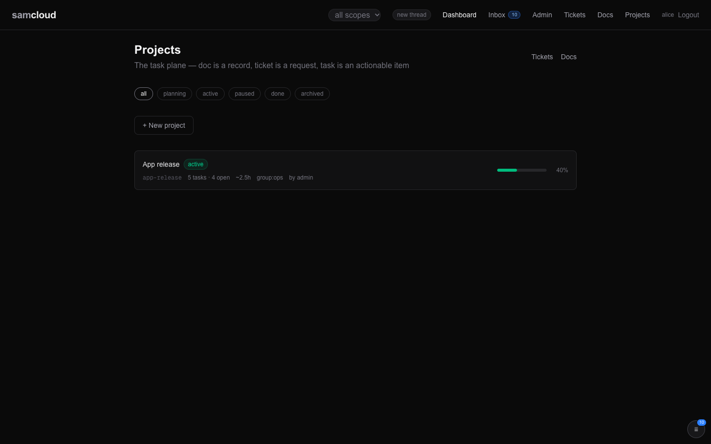
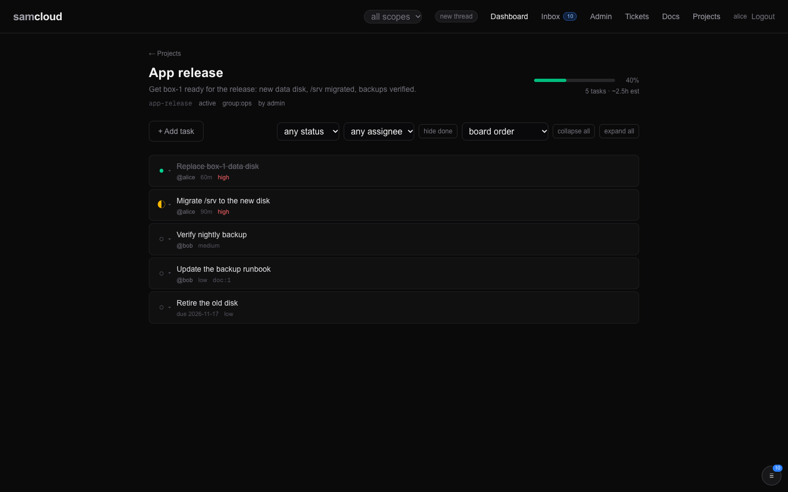

# Projects

A project is a named tree of tasks with its progress rolled up. It is how a piece of work too big for one ticket is planned: you make a project, break the work into [tasks](Tasks%20and%20Schedules.md) and subtasks, assign them, and watch the rollup move. A project is in one group, and its tasks are seen and changed through that group.

## In the dashboard

**Projects** (`/projects`) lists the projects you can see, most recently updated first.



- **Status chips:** all, planning, active, paused, done, archived.
- **+ New project** takes a name and a description. The project goes to your default group.
- Each card shows the name, status, slug, task count and how many are open (`todo`, `in_progress` or `blocked`), the estimate total in hours, the group, the author, and a progress bar.
- The scope pill in the navigation narrows the list to one group.

One project (`/projects/{slug}`) shows its tasks as a tree, and refreshes every 20 seconds.



- The header shows the status, group and author, the progress bar with what it is based on, the task count and the estimate total.
- **+ Add task** adds a top-level task with a title and an estimate in minutes. Each task has its own add button for a subtask.
- Filter by status and assignee, **hide done**, and sort by board order, created, recently updated or smallest estimate. **collapse all** and **expand all** fold the tree.
- Clicking a task's status icon steps it `todo` → `in_progress` → `done` → `todo`; the menu beside it sets any status. A delegated task links to its ticket.

Renaming a project, changing its status or group, deleting it and subscribing to it are API calls; the dashboard has no controls for them yet.

## The model

| Field | What it is |
|---|---|
| `id`, `slug` | Number, and a stable name derived from the project name. Every project call takes either. A slug already taken gets `-2`, `-3` and so on. |
| `name`, `description` | A create also accepts `title` for `name`. |
| `status` | `planning`, `active` (default), `paused`, `done` or `archived`. Anything else answers `400`. |
| `group_scope` | The one group the project is in. Its tasks take their visibility from it. |
| `source` | The author, taken from the token. Sending `source` answers `422`. |
| `rollup` | Computed on every read, never stored ([Progress](#progress)). |
| `tasks` | On `GET /projects/{slug}`: the whole tree, each task with its `subtasks`. |

### What belongs to a project

- **Tasks and subtasks.** Every task is in exactly one project. A subtask's parent must be in the same project, and a task cannot move to another project.
- **Their comments**, which belong to each task.
- **The tickets its tasks are delegated to** are filed in the project's group and linked from the task (`delegated_ticket_id`). They are tickets, with their own lifecycle ([Tickets](Tickets.md)).
- **Files attached to its tasks.** A file linked to a task can be read by anyone who can read the task ([Files](Files.md)).

Docs are not part of a project. A doc is in a group of its own and links to tickets, services, devices and other docs ([Docs](Docs.md)); a task can name the doc it came from in `source_ref`.

### Progress

The rollup counts the project's tasks at every depth:

| Field | |
|---|---|
| `task_count` | all tasks, subtasks included |
| `by_status` | the count in each status |
| `progress_pct` | the share that is `done` |
| `progress_basis` | `estimate-weighted` when any task has an estimate: done minutes over total minutes. `count` otherwise: done tasks over tasks. `empty` when there are none. |
| `estimate_total_min` | the sum of estimates, or null |

`cancelled` tasks are left out of both sides of the ratio, so cancelling work does not lower the progress.

## Using it

```bash
API=https://cloud.example.com/api/v1
H="$HOME/.samcloud/token.hdr"
```

### Make a project and plan it

```bash
curl -s -H @"$H" -H 'Content-Type: application/json' -X POST "$API/projects" \
  -d '{"name": "App release", "description": "Ship 1.0", "group_scope": "work"}'
# → {"status": "created", "id": 12, "slug": "app-release", "group_scope": "work", ...}

curl -s -H @"$H" -H 'Content-Type: application/json' -X POST "$API/projects/app-release/tasks" \
  -d '{"title": "build the installer", "assignee": "builder-1", "estimate_min": 90}'
```

With no `group_scope`, the project goes to your default group. Adding and working tasks is on [Tasks and Schedules](Tasks%20and%20Schedules.md). An agent adds tasks with `sc-new task --project <slug> --title "…"`.

### Read it

```bash
curl -s -H @"$H" "$API/projects"                          # yours, each with its rollup
curl -s -H @"$H" "$API/projects?status=active&group_scope=work"
curl -s -H @"$H" "$API/projects/app-release"              # rollup and the whole task tree
```

The list returns at most 100 projects, most recently updated first.

### Change it

```bash
curl -s -H @"$H" -H 'Content-Type: application/json' -X PATCH "$API/projects/app-release" -d '{"status": "paused"}'
curl -s -H @"$H" -H 'Content-Type: application/json' -X PATCH "$API/projects/app-release" -d '{"group_scope": "release"}'
curl -s -H @"$H" -X DELETE "$API/projects/app-release"
```

A `PATCH` takes `name` (or `title`), `description`, `status` and `group_scope`. Moving a project to another group moves all its tasks with it, since they take their visibility from the project.

`DELETE` is permanent: it removes the project, every task in it and their comments. Prefer `{"status": "archived"}`, which keeps the record.

### Subscribe to a project

A project subscription is how you follow a project's work without being assigned to it.

```bash
curl -s -H @"$H" -X POST   "$API/projects/app-release/subscribe"
curl -s -H @"$H" -X DELETE "$API/projects/app-release/subscribe"
curl -s -H @"$H"           "$API/subscriptions"           # what you watch, projects included
```

A subscriber gets an inbox row for each of these, on any task in the project, unless they made the change themselves:

| Event | When |
|---|---|
| `task.created` | a task is added |
| `task.updated` | a task's fields actually change |
| `task.delegated` | a task is delegated |
| `task.commented` | someone comments on a task |

Anyone who can read the project can subscribe, a viewer included. Nobody is subscribed by default: not the author, not the assignees, not the group's members. Without subscribers, a project's tasks reach only their assignees and creators ([Tasks and Schedules](Tasks%20and%20Schedules.md#who-hears-what)). Rows still follow scope: a subscriber who can no longer read the project gets nothing.

## Who can see and change a project

A caller sees a project when they are the admin, its author, or a member of its group. Outside that, it does not exist for them: lists leave it out and a read answers `404`.

| Who | Can |
|---|---|
| Any reader of the project | read it and its tasks, comment on tasks, subscribe |
| An editor of its group, the project's author, the admin | create and change tasks |
| The project's author, an owner of its group, the admin | rename it, change its status or group |
| The project's author, the admin | delete it |

Creating a project in a named group needs an editor role there. The group must exist (`400`) and be yours to edit (`403`). A project is always in a group: `"group_scope": ""` answers `422`.

## Related

- [Tasks and Schedules](Tasks%20and%20Schedules.md): the tasks themselves, delegation and schedules.
- [Tickets](Tickets.md): where delegated work goes.
- [Notifications and Subscriptions](Notifications%20and%20Subscriptions.md): project subscriptions beside ticket and doc subscriptions.
- [Identity and Access](Identity%20and%20Access.md): groups and roles.
- [API Reference](API%20Reference.md): every project call.
- The served skill page `tasks.md` (`GET /api/v1/skills/samcloud-agent/tasks.md`) covers projects and tasks for agents ([Skills](Skills.md)).

Next: [Docs](Docs.md)
