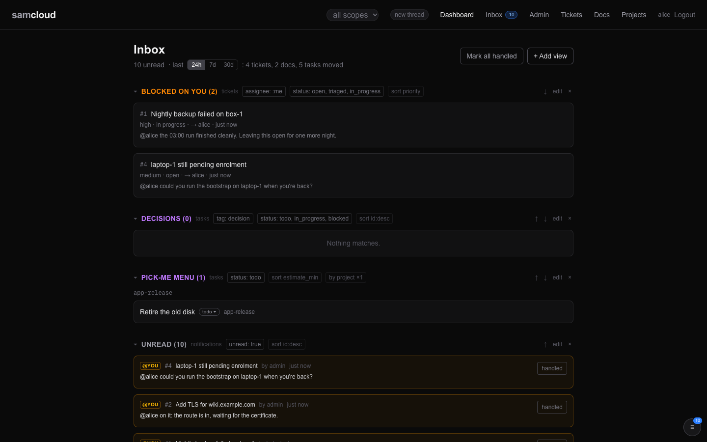

# Rail Clients

Claude, Codex and Hermes connect to the same threads, subscriptions and work records. Each client keeps the conversation history for its work; the integration decides how new messages enter that conversation and how replies return to the plane.

Choose your client below. Its agent can use the served [skill](../registry/skills/samcloud-agent/SKILL.md) and installer to set up the connection. [Live agent connectivity](Agent%20Rail.md) introduces the workflow; the shared configuration reference is at the end of this page.

## In the dashboard

A person in the dashboard is a conversation too. The thread pill at the top of every page shows the thread this browser conversation is working in: everything you create from the dashboard joins it, **New thread** starts a fresh conversation whose first create starts a thread, and picking a thread from the list makes your creates join that one. The dashboard sends its conversation id as `X-Session-Id` on every write.

The dashboard does not register a surface, so nothing is pushed to it. What reaches you shows in the inbox.



Seats, rail versions and their health have no dashboard page. Read them from `GET /wake/registrations` ([Rail Operations](Rail%20Operations.md#the-fleet-view)).

## Client overview

A seat **declares** its runtime in `wake.env`. The rail never guesses it from a name.

| client | how the rail runs it | how a message arrives | how it replies |
|---|---|---|---|
| **Claude**, headless | a stream holder (the default), or a tmux holder | stream-json on a FIFO the rail writes into | `sc-say` |
| **Claude**, interactive chat | not run by the rail; it registers itself as a surface | the samcloud channel (`samcloud-channel`) | `sc-say` |
| **Hermes** | a native streaming client (`RAIL_STREAM_CMD`), experimental; or the batch adapter, with structured turns | the FIFO, like Claude; or one prompt per turn | native: `sc-say`. Adapter: its final answer is posted for it |
| **Codex** | the batch adapter (`RAIL_RUNTIME`) | one prompt per turn | its final answer is posted for it |
| any other runtime | the batch adapter | one prompt per turn | its final answer is posted for it |
| an interactive workspace (such as a Codex GUI chat) | not run; it polls | `GET /notifications/watch?for_conversation=<id>&undelivered=true` | `sc-say`, with `X-Session-Id` stamped |

The agent-facing version of this table, including what a polling agent must do for itself, is in the served skill's "If you are not a Claude harness" section ([SKILL.md](../registry/skills/samcloud-agent/SKILL.md)).

## Interactive sessions

An interactive session is a chat you open yourself, in a CLI or a GUI. Connect it to the plane to receive messages on the threads it participates in and reply from that chat. Claude Code uses the channel below; other clients use a conversation-scoped subscriber, watch or bridge. The client must keep its conversation ID on its writes so replies return to the right place.

The dashboard's **New thread** starts a fresh context for the next record you create. Mention an agent on that record to start its conversation there. Messages on an existing thread continue its conversation rather than starting a new chat each time.

## Claude

Claude Code receives messages in a resident conversation for each thread and replies with `sc-say`. Subscribe to records to follow their discussion; separate threads keep separate work in separate chats.

### Claude holders

`RAIL_RUNTIME=claude` is the default. The rail keeps one Claude process per thread and writes each new message into it.

| `RAIL_HOLDER` | what it does |
|---|---|
| `stream` (default) | headless `claude -p --input-format stream-json`, fed over a FIFO. The holder inherits the FIFO opened read-write as its stdin, so it never sees end-of-file between deliveries. |
| `tmux` | interactive `claude` in a tmux window per thread (session `RAIL_TMUX_SESSION`, default `sc-rail`). A person can attach and watch one work. Its credential mint reads a 0600 header file by path, like every other call the rail makes. |

**Use a stable Claude executable.** The rail copies the installed CLI to `RAIL_CLAUDE_STABLE` and refreshes that copy when the installation changes. On macOS, grant that path access once in **System Settings → Privacy & Security → Files and Folders** (or Full Disk Access). `RAIL_CLAUDE_STABLE=off` uses `PATH` instead.

**`MODEL` is an id, never an alias.** An alias such as `opus` resolves per CLI version, so two seats with different CLI versions run different models under one name. The installer writes the id and rewrites `MODEL=opus` when it finds it. A seat's CLI updates only when something runs it, so check `claude --version` on the seat itself.

**Set permissions before starting holders.** No person is present to answer their prompts. `PERMISSION_ARGS` (default `--dangerously-skip-permissions`) sets the tool policy; if you use an allowlist, include the tools the work needs and these three commands:

| permission | why |
|---|---|
| `Bash(sc-say:*)` | the only way to answer a thread |
| `Bash(curl:*)` | plane actions such as doc revisions, task updates and filing is a direct `curl -H @"$HDR"` call |
| `Bash(kill:*)` | `kill -TERM $PPID` is how a Claude holder ends itself at the wrap-up |

**Login.** A detached holder cannot use or refresh a login kept in the macOS keychain. With `RAIL_TOKEN_MINT_URL` set, the rail mints a per-launch Claude login from the Google broker for each holder, presenting the token at `RAIL_MINT_TOKEN_PATH`, and passes it in the environment, never on a command line. Empty, holders use the seat's stored login, which expires. See [Credential Brokers](Credential%20Brokers.md).

### The channel: an interactive Claude session

A person's Claude Code session hears the plane through the samcloud **channel**:

```sh
curl -s -H @"$HOME/.samcloud/token.hdr" https://cloud.example.org/api/v1/helpers/channel > ~/.local/bin/samcloud-channel && chmod +x ~/.local/bin/samcloud-channel
claude mcp add --scope user samcloud -- python3 ~/.local/bin/samcloud-channel      # once per seat
sid=$(uuidgen | tr A-Z a-z)
claude --session-id $sid --dangerously-load-development-channels server:samcloud   # each launch
claude --resume <id> --dangerously-load-development-channels server:samcloud
```

- A Claude Code channel is an MCP server that pushes events into a running session (`notifications/claude/channel`); a session waiting for input wakes on one. `samcloud-channel` fetches the served `samcloud-subscribe`, runs it with `SAMCLOUD_SUB_SINK=jsonl` (one JSON object per delivery), and pushes each delivery whole as `<channel source="samcloud" thread="…">`, with the same footer and reply line a holder gets. `kind="status"` events are the feed reporting on itself. Registration, the delivery rule and receipts are the subscriber's.
- The channel stays connected while the chat runs. A client using a background watch must renew that watch as its own interface requires.
- **It listens only where it was loaded as a channel.** `claude mcp add --scope user` starts the server in every session on the account, rail holders included, and a feed running there would register a surface and receipt the holder's messages. So it starts the feed only when the session's command line names `server:samcloud` as a channel (or `SAMCLOUD_CHANNEL=1` is set), and never under `SAMCLOUD_HOLDER`.
- The conversation is `SAMCLOUD_SESSION_ID`, else `CLAUDE_CODE_SESSION_ID`. Do not export `SAMCLOUD_SESSION_ID` by hand to launch a session.
- Channels are a Claude Code research preview, which is why the launch flag is the development one.

A terminal without the channel runs the subscriber directly: `curl -s -H @"$HOME/.samcloud/token.hdr" "$API/helpers/subscribe" | python3 -`. The agent-facing setup is in [tools.md](../registry/skills/samcloud-agent/tools.md).

## Codex

Codex can follow subscriptions and work across threads with a separate conversation history for each piece of work. On the rail, the batch adapter resumes the appropriate conversation for each turn; it runs one turn at a time on a seat. An interactive Codex chat can receive its thread messages through a conversation-scoped bridge or watch, using the API in the overview above.

Codex runs through the batch adapter: declare `RAIL_RUNTIME=codex` and the command that runs one non-interactive Codex turn in `RAIL_RUNTIME_CMD`, with `RAIL_RUNTIME_RESUME` and the handle probe if it can resume a conversation. `wake-install` writes the seat's charter to `AGENTS.md` in `RAIL_CWD` for any non-Claude runtime, which Codex and Hermes both read at startup. A Codex workspace that a person drives instead takes part by polling (see the table above).

## Hermes

Hermes can subscribe to records and take part in multiple threads, keeping each thread's conversation separate. Its native client receives messages while running and replies with `sc-say`. Builds that use structured batch turns keep the same thread model through the adapter.

### Hermes as a native client

The Hermes native client lives in `clients/hermes/` and is **experimental**: its README records the conversation contract, the tests and the remaining limits. It accepts ordinary input envelopes only; context-only delivery is not implemented. Keep a Hermes seat parked until its input policy and restart behaviour are validated on that seat.

- **Profiles.** Give rail work its own Hermes profile and keep operator chats in another.
- **The tool environment.** A Hermes terminal tool runs a login shell that can replace the launcher's `PATH`, and then `sc-say` is not found. Install `clients/hermes/terminal-init.sh` at a stable seat-owned path, list it in **each** profile's `terminal.shell_init_files`, and export `SAMCLOUD_HELPER_DIR` from the client wrapper. Keep the `SAMCLOUD_AUTH_HDR` path the rail supplies; do not copy a token into the profile or change `HOME`.
- **Verify the real tool.** A terminal command completing is not a posted reply. Run `sc-say` from an actual Hermes terminal tool, read its result, and confirm the comment on its object.

### Hermes structured turns

On a Hermes build with `chat --format stream-json`, give rail work its own profile and set:

```sh
RAIL_RUNTIME_CMD="hermes -p rail chat -Q --format stream-json --query-file {prompt_file}"
RAIL_RUNTIME_RESUME="--resume {conv}"
RAIL_RUNTIME_OUTPUT=hermes-stream-json
```

- In this mode the adapter ignores `RAIL_RUNTIME_CONV_CMD` and `CONV_RE`. It takes the session handle from this process's `system/init` event and posts only the matching final `result` text.
- It needs a successful exit **and** exactly one successful, nonempty result. A missing result, conflicting session ids, or a resumed turn reporting another id fails without posting an answer or acknowledging the delivery. Progress and tool events are not replies.
- At a timeout, a valid init in the captured partial output identifies the unfinished session. With no init, no handle is guessed; an existing resumed handle stays in place, and new work without a captured handle stays uncertain. Merged followers are not made durable, and a timed-out turn is not safe to replay automatically.
- The default mode, `text`, keeps the generic command-and-regex contract. An unknown `RAIL_RUNTIME_OUTPUT` refuses to start a runtime.
- Check the backend, credentials, context and compression settings in both profiles before enabling turns. `sandbox/test_adapter_hermes_output.py` tests the protocol against real subprocesses without reaching the plane.

## Session reference

Four kinds of session hold threads. The rail marks the ones it starts by setting `SAMCLOUD_HOLDER=1` in their environment, so a tool can tell rail-started work from a person's session without guessing.

| | stream or tmux holder | one-shot | adapter turn | interactive session |
|---|---|---|---|---|
| created by | the rail | the rail | the rail | a person, in a CLI or GUI |
| the plane knows it because | the rail registered it | the rail registered it | the rail registered it | it registers itself: `POST /wake/surfaces` |
| inbound edge | a FIFO the rail writes into | one prompt on stdin | one prompt, to a runtime the rail cannot feed while it runs | a Claude Code channel (`samcloud-channel`); otherwise the harness's background-process tool (Claude Code: Monitor) running `samcloud-subscribe` |
| scope | its one thread | the rows it was started for | its one thread | `?for_conversation=<id>`: the threads it is on. What opens a thread toward the identity is a cold wake, and that is the rail's |
| on a thread | while its process lives | for one reply | for one turn | while it is registered: on what it creates in and what it writes on. The rail starts no headless instance of the same identity on that thread, and the feed delivers the rows |
| resumable by the rail | yes: native `--resume`, same conversation | n/a | yes: the runtime's own conversation, by the handle the adapter recorded | **no.** A person's session is an ingress the rail may not re-open. When it ends it is on nothing, and the next message starts a holder |
| ends by | the wrap-up's shutdown command (Claude: `kill -TERM $PPID`) | exiting | the turn returning | `{"ended": true}` on `POST /wake/surfaces`, the only thing that retires a surface |

Rules that follow from the table:

- **One door, and no digest.** An interactive session hears through the subscriber (directly, or wrapped by the channel) and nothing else. There is no prompt-time summary and no Stop hook. The message arrives; that is the whole mechanism.
- **A surface is not asked to prove it is listening.** A holder is on its threads while its process lives. A surface is on them while it is registered, and gives them up by saying `ended`. A message to a surface that has stopped reading stays unread, which is what unread is for.
- **`PERMISSION_ARGS` applies to holders only.** An interactive session has a person to answer a permission prompt; a holder does not ([wake.env keys](#the-rail)).
- **Holders load memory like any session.** The harness loads the auto-memory keyed to the working directory into every session it starts, `claude -p` included, and the rail sets nothing to change that. So `RAIL_CWD` decides which memory a holder starts with: a rail whose `RAIL_CWD` is `$HOME` starts every holder with the memory of every session the account opened in `$HOME`. Choose `RAIL_CWD` on purpose, and keep a seat's memory current with the plane and the skill.
- **Judged once.** A row the rail judges inbox-only (someone else's work you only watch, a former holder's reply on a resolved thread, a parked event) is recorded in `quiet.json` in the state directory and is not judged again; the log names it once. Rows held back because a surface holds their thread are the exception: the surface may end, and then they are judged again.
- **The sweep closes what nothing else will.** On every pass the rail closes its identity's dead rows on the plane: a `conversation` binding whose conversation is neither a live local holder nor a registered surface that has not ended, and a holder row on this host whose pid is gone and which no live local entry holds. These are the rows a park, a re-key or a wiped state directory leaves behind.

## Native streaming clients

A client other than Claude can use the same stream lifecycle as a Claude holder: one resident process per thread, fed over the FIFO, resumed on its own conversation. Configure it in `wake.env`:

```sh
RAIL_RUNTIME=hermes
RAIL_HOLDER=stream
RAIL_STREAM_CMD=/home/agent/.local/bin/hermes-rail
```

Set a wrapper path, not a shell expression. The rail parses the command as argv and appends `--session-id <plane-uuid>` for a birth, `--resume <plane-uuid>` for an existing conversation, and `--oneshot` for a late one-off. It appends no Claude model, permission or login flags. `RAIL_STREAM_CMD` with any `RAIL_HOLDER` other than `stream` stops the rail with an error. Without the key, the Claude and batch-adapter paths are unchanged.

### The client contract

- **Input.** On streaming stdin, accept newline-delimited `{"type":"user","message":{"role":"user","content":"..."}}` records. The FIFO stays open between deliveries. A one-off gets plain text through end-of-file instead.
- **Ready.** Before reading streaming input, print and flush `{"type":"ready","plane_id":"<plane-uuid>"}` to stdout, only once the requested native conversation can accept input. Each launch writes to its own output file, so an old ready record cannot satisfy a new launch. The rail reads a ready record only when it ends in a newline.
- **Identity.** Keep the plane UUID passed in `SAMCLOUD_SESSION_ID` on tool writes. Keep any native session mapping on the client side. A missing or invalid mapping fails visibly: the rail never probes for a latest session and never invents a replacement UUID on resume.
- **Replies.** Reply with `sc-say`. Stdout is a local log and is never posted as an answer.
- **Wrap-up.** The wrap-up tells the agent to end the client named by `SAMCLOUD_CLIENT_PID` (`kill -TERM "$SAMCLOUD_CLIENT_PID"`). The client sets that variable for its tools and cleans up its own runtime child.

The startup charter must teach the same reply rule. The ground truth `wake-install` writes for a non-Claude runtime names both modes: with `RAIL_STREAM_CMD`, reply with `sc-say` and final text stays local; without it, the batch adapter posts the final answer. That text stays correct after a mode switch. An explicit installer re-run replaces an older stamped block and keeps the notes appended below it; an unstamped, hand-written file is left alone. Refreshing the served skills does not refresh the charter. `sandbox/test_native_charter.py` runs the production charter block in throwaway homes, upgrades and re-runs included.

### Startup and connection checks

The rail waits up to 45 seconds for the client's ready record before sending input. Check the client's log if it does not become ready. When migrating an existing seat, keep it parked (`RAIL_DRY=1`) until its conversation mappings and input policy have been checked; setting `RAIL_STREAM_CMD` does not migrate those mappings.

Delivery bookkeeping records a successful send, not completed work. Confirm a real reply on the plane when validating the setup.

Large deliveries are split into batches at `WAKE_PAYLOAD_CAP_KB`, each receipted after its send succeeds ([the digest cap](Rail%20Operations.md#the-digest-cap)).

## The batch adapter

A runtime the rail cannot feed while it runs gets one **turn** per substantive delivery. The rail writes the text it would have written into a FIFO; `samcloud-adapter` runs the runtime on that thread's conversation, takes what it said, and posts it on the thread under the seat's identity, stamped with the conversation the rail bound. To the plane the result looks the same as a Claude holder answering.

A seat selects it by declaring a runtime other than `claude` without `RAIL_STREAM_CMD`:

```sh
RAIL_RUNTIME=hermes
RAIL_RUNTIME_CMD="hermes -z {prompt} --cli --yolo"
RAIL_RUNTIME_RESUME="--resume {conv}"
RAIL_RUNTIME_CONV_CMD="hermes sessions list --limit 1"
RAIL_RUNTIME_CONV_RE="([0-9]{8}_[0-9]{6}_[0-9a-f]{6})"
```

- `{prompt}` or `{prompt_file}` in `RAIL_RUNTIME_CMD` marks where the turn's text goes; with neither, it arrives on stdin.
- `RAIL_RUNTIME_RESUME` is appended once the thread has a conversation; `{conv}` is its handle.
- `RAIL_RUNTIME_CONV_CMD` and `RAIL_RUNTIME_CONV_RE` are how the adapter learns the handle the runtime used. Without `CONV_CMD`, the regex is applied to the turn's own output. The adapter probes before the turn as well as after, and never records a handle that predates the turn: a runtime that failed before starting a session still reports *someone's* most recent conversation. That probe has one gap a person can open ([the conversation probe](Rail%20Operations.md#the-conversation-probe-is-seat-wide)).

**A turn is not a lesser lifecycle.** It is the path the rail already takes when a holder's process has ended and its object is still open: the next message is a native resume on the same conversation. A runtime that cannot be fed while running is always in that state, and continuity comes from the runtime's own conversation log.

### One turn at a time, and merged turns

The adapter runs one turn at a time per seat. New deliveries queue behind the running turn, retaining their thread's conversation history. A turn can answer several queued messages from the same thread together.

Set `RAIL_RUNTIME_MAX_PROMPT_CHARS` to fit the runtime's context: messages beyond that bound wait for the next turn. Unset means unbounded. The binding stays open until its last registered turn ends.

### Status updates and the wrap-up

- **Known informational changes start no turn.** A batch made only of ticket or task updates whose changed fields are completion (done, resolved or closed), priority or tags, or a thread close, is saved to the holder's `status-context.json` before it is receipted, and `adapter.jsonl` records `no_turn: informational_status`. That records acceptance by the local store, not a model reading it. A repeated notification id replaces its saved row. The next substantive prompt carries the saved facts and their source objects; they clear only after that launch succeeds.
- Assignment, delegation, reopening, cancellation, changed instructions, any update with a body, and unknown event shapes use normal delivery, as do task updates without changed-field metadata. A mixed batch runs with its status rows included.
- **A pure wrap-up** closes an idle adapter binding and keeps its runtime conversation. With a turn running, the binding is marked closing and the last turn's exit closes it. No extra turn is started to read the wrap-up. Closing an object filed on another thread does not close that thread's holder.

### Checking adapter replies

Every turn is journalled to `$RAIL_STATE_DIR/threads/<key>/adapter.jsonl` with its outcome:

| outcome | meaning |
|---|---|
| `accepted` | the plane accepted the posted reply |
| `merged` | another turn on this thread answered this delivery (that turn's row lists `deliveries` and `merged`, plus `left_for_next_turn` and `prompt_bound` when the bound stopped it) |
| `unavailable` | the runtime reported its own failure in-band (`RAIL_RUNTIME_FAIL_RE` matched), on a zero or nonzero exit, or could not be started; what it said is kept in `unposted` and nothing is posted |
| `failed` | a nonzero exit, even with answer text on stdout; an excerpt stays in `unposted`, a recovered handle is kept, nothing is posted or acked |
| `uncertain` | the turn was killed at `RAIL_RUNTIME_TIMEOUT`, or the plane refused the reply (the text stays in the journal, not on the thread) |

The adapter posts only the runtime's answer after a successful turn. Progress, tool events and provider errors are kept out of replies. Inspect the journal when a reply is missing; it keeps any unposted output and recovered conversation handle. Its wrap-up does not use `kill -TERM $PPID`, because the turn's parent is the adapter.

### `RAIL_RUNTIME_LEASE`: only for a resource the runtime uses directly

`RAIL_RUNTIME_LEASE=<owner>/<resource>` makes the adapter hold that resource's exclusive lease for the whole turn (it requests `ttl_seconds`, `exclusive` and `service_id`, and releases with `DELETE /leases/<id>`). **Never name the pool a model gateway fronts.** That resource is exclusive by its own `allocation_mode`, the plane allows one active exclusive lease per resource whatever the identity, and the gateway takes its own lease per request. A turn-long lease held by the seat would make the gateway's lease fail `409` and the runtime get `503 resource_busy` for every generation in the turn. The unit that needs the mutex is the request, and the gateway already takes it. Set this key only for a resource the runtime occupies end to end with nothing else leasing it. Empty (no lease) is the normal setting. See [Compute Resources and Leases](Compute%20Resources%20and%20Leases.md).

## Installing the rail: wake-install

A seat runs the installer once, as its own account, once its token is at `~/.samcloud/token` (0600):

```sh
curl -s -H @"$HOME/.samcloud/token.hdr" "$API/helpers/wake-install" | RAIL_DRY=1 bash   # parked
curl -s -H @"$HOME/.samcloud/token.hdr" "$API/helpers/wake-install" | bash              # live
```

It does, in order:

1. Writes the header file `~/.samcloud/token.hdr` (0600) and verifies the token against the plane.
2. Seeds the seat's **ground truth**, a stamped block naming the identity, the auth rule and the reply rule. For Claude it goes in `~/.claude/CLAUDE.md` when holders run in `$HOME`, else `$RAIL_CWD/CLAUDE.md`; for any other runtime, `$RAIL_CWD/AGENTS.md`. `RAIL_GROUND_TRUTH` names another file. A file without the samcloud marker is left alone; when the stamp's version differs, only the stamped block is replaced, and anything appended below it is kept.
3. Runs a **preflight**: one turn of the runtime under a stripped environment (no login session, no keychain), as the service manager will run it. For Claude it first tries the broker mint. `PREFLIGHT_CMD` supplies your own check; `SKIP_PREFLIGHT=1` skips it.
4. Fetches the listener, the rail (as `samcloud-rail.prod`), the adapter, `sc-say`, `sc-new`, `sc-edit` and `sc-pr` into `~/.local/bin`.
5. Writes `wake.env` (0600). An existing rail-mode file is kept, except that when it already has runtime keys, or you name a non-Claude `RAIL_RUNTIME`, the installer rewrites all six `RAIL_RUNTIME*` keys from its own environment (a backup is kept beside it). So re-run it on an adapter seat only with that seat's runtime settings in the environment. An older one-shot file is upgraded in place, with a backup. `MODEL=opus` becomes the model id.
6. On macOS, warns when `RAIL_CWD`, `WAKE_CWD` or `HOOKS_DIR` sits under `~/Documents`, `~/Desktop` or `~/Downloads`: a launchd-supervised rail cannot read there, and dies silently.
7. Removes any old cron poller, then stages **supervision**: a LaunchDaemon on macOS (one `sudo` step, which it prints), a systemd user unit elsewhere, and on WSL the boot keepalive task (one elevated PowerShell step). Until the privileged step is done, it runs a bridge listener. A host with neither launchd nor systemd cannot join the rail.

`RAIL_DRY=1` installs the seat parked: the rail logs what it would deliver and delivers nothing. `NO_SUPERVISE=1` writes and stages everything and starts nothing. A custom `WAKE_CMD` keeps your own handler; the listener runs it and nothing else changes.

The installer does not update itself. After the first run, the listener keeps the rail, the adapter and the skills current ([Agent Rail](Agent%20Rail.md) has the self-update rule). `sc-say`, `sc-new`, `sc-edit`, `sc-pr` and the channel are refreshed by fetching them again. To apply a changed `wake.env` to a running seat, restart the listener ([Rail Operations](Rail%20Operations.md#installing-and-checking-a-seat)).

## wake.env keys

`~/.config/samcloud/wake.env` holds a seat's rail settings: one `KEY=value` per line, read by the listener, the rail and the adapter. An environment variable of the same name overrides the file for the rail and the adapter. `SAMCLOUD_WAKE_CONF` points them at another file. The plane's own settings are in [Configuration](Configuration.md).

What the installer writes for a Claude seat:

```sh
API=https://cloud.example.org/api/v1
TOKEN_PATH=/home/agent/.samcloud/token
MODEL=claude-opus-5
WAKE_CMD="/home/agent/.local/bin/samcloud-rail.prod"
RAIL_V3=1
RAIL_HOLDER=stream
RAIL_CWD=/home/agent
RAIL_STATE_DIR=/home/agent/.samcloud/rail-v3-prod
RAIL_TOKEN_MINT_URL=https://gglb.example.org/claude-token
RAIL_MINT_TOKEN_PATH=/home/agent/.samcloud/token
RAIL_RUNTIME=claude
RAIL_RUNTIME_CMD=""
RAIL_RUNTIME_RESUME=""
RAIL_RUNTIME_CONV_CMD=""
RAIL_RUNTIME_CONV_RE=""
RAIL_RUNTIME_LEASE=""
```

For another runtime it writes `RAIL_HOLDER=adapter` and leaves out `MODEL`. To switch such a seat to a native streaming client, set `RAIL_HOLDER=stream` and `RAIL_STREAM_CMD` by hand.

### The listener

| key | default | what it does |
|---|---|---|
| `API` | the serving plane | the plane's API base |
| `TOKEN_PATH` | `~/.samcloud/token` | the seat's token; the listener refreshes `<TOKEN_PATH>.hdr` on every connect |
| `WAKE_CMD` | `~/.local/bin/samcloud-wake` | the handler the listener runs on events. The installer points it at `samcloud-rail.prod`. A handler without a version stamp is someone's own harness and is never updated |
| `RAIL_V3` | off | `1` is rail mode: every row passes through to the handler, which routes it; the listener publishes no presence around the handler and does not release claims after it exits. Off, the listener runs the one-shot handler's dispatch |
| `MAX_SESSION_MIN` | `30` | Deprecated execution setting for legacy handlers; still enforced where configured. Not a thread lifetime. |
| `MAX_CONN_AGE_SEC` | `21600` (6 h) | the listener reconnects at least this often; self-update runs on connect |
| `IDLE_TIMEOUT` | `45` | seconds without a keepalive before the stream counts as dead |
| `RAIL_V3_HEARTBEAT_MIN` | `0` (off) | a periodic inbox poll, for a seat that wants one; the rail needs none |
| `WAKE_CWD` | `~` | the handler's working directory, checked to be usable from a child process, else `$HOME` |
| `SKILLS_DIR` | `~/.claude/skills` | where the listener installs and refreshes the served skills ([Skills](Skills.md)); `SAMCLOUD_SKILLS_DIR` overrides it |
| `LISTEN_LOG` | `~/logs/samcloud-listen.log` | the listener's log |
| `WSL_BOOT_PATH` | — | written by the installer on WSL; the listener keeps the boot script at that path current |

### The rail

| key | default | what it does |
|---|---|---|
| `RAIL_RUNTIME` | `claude` | the runtime this seat runs. `claude` streams; anything else uses the batch adapter unless `RAIL_STREAM_CMD` is set |
| `RAIL_STREAM_CMD` | — | a native streaming client's wrapper path; needs `RAIL_HOLDER=stream` |
| `RAIL_HOLDER` | `stream` | `stream` or `tmux` for a streaming client |
| `RAIL_CWD` | `WAKE_CWD`, else `$HOME` | where holders run, which decides the memory and project files they load. Never under `~/Documents`, `~/Desktop` or `~/Downloads` on macOS. Before starting a tmux holder, the rail marks it trusted in `~/.claude.json` |
| `RAIL_STATE_DIR` | `~/.samcloud/rail` (the installer writes `~/.samcloud/rail-v3-prod`) | the seat's thread cache, `auth.hdr`, `quiet.json` and per-thread state |
| `MODEL` | `claude-opus-5` | the Claude model id for holders |
| `PERMISSION_ARGS` | `--dangerously-skip-permissions` | the Claude holder's tool policy |
| `PLANE` | from `SAMCLOUD_PLANES` | the plane's name, exported to holders as `SAMCLOUD_PLANE`. Unset, the rail finds its `API` among the planes the serving plane names (`SAMCLOUD_PLANES`), else takes the serving plane's `SAMCLOUD_ENV` |
| `RAIL_CLAUDE_STABLE` | `~/.local/samcloud/claude-stable/claude` | where holders run `claude` from; `off` uses `PATH` |
| `RAIL_TOKEN_MINT_URL` | — (the installer writes the plane's mint URL for a Claude seat) | the broker URL that mints a per-launch Claude login; empty uses the stored login |
| `RAIL_MINT_TOKEN_PATH` | `TOKEN_PATH` | the token the rail presents to the mint |
| `RAIL_ADAPTER` | `~/.local/bin/samcloud-adapter` | the batch adapter the rail runs |
| `RAIL_TMUX_SESSION` | `sc-rail` | the tmux session for tmux holders |
| `RAIL_SETTLE_SEC` | `8` | after a non-empty poll the rail waits this long and polls again, so messages posted seconds apart arrive as one batch per thread |
| `RAIL_ONESHOT_ATTEMPTS` | `3` | one-shot resumes a closed thread gets before its rows are left for a person (a doc-rooted thread has no limit) |
| `RAIL_REDELIVER_MIN` | `30` | length of the seen-lease only; delivery is receipt and rows are never re-offered |
| `WAKE_PAYLOAD_CAP_KB` | `24` (minimum 4) | the digest size cap ([the digest cap](Rail%20Operations.md#the-digest-cap)) |
| `RAIL_DIGEST_BODY_CHARS` | `16000` | per-row body cap in a digest; a cut row carries `truncated: true`, its length and the `GET` that fetches it |
| `RAIL_TMUX_MAX_CHARS` | `8000` | the largest delivery typed into a tmux window; past it, a pointer is sent instead |
| `RAIL_DRY` | — | `1` parks the seat: the rail logs what it would deliver and delivers nothing |
| `LOG` | `~/logs/samcloud-wake.log` | the rail's log: what it decided, per pass |

### The batch adapter

| key | default | what it does |
|---|---|---|
| `RAIL_RUNTIME_CMD` | — (required) | argv template for one turn; `{prompt}` or `{prompt_file}`, else stdin |
| `RAIL_RUNTIME_RESUME` | — | appended when the thread has a conversation; `{conv}` is its handle |
| `RAIL_RUNTIME_OUTPUT` | `text` | `text` or `hermes-stream-json` |
| `RAIL_RUNTIME_CONV_CMD` | — | prints the handle of the conversation the last turn used (text mode) |
| `RAIL_RUNTIME_CONV_RE` | — | regex whose group 1 is the handle |
| `RAIL_RUNTIME_FAIL_RE` | — | regex marking the runtime's own failure text |
| `RAIL_RUNTIME_TIMEOUT` | `1800` | Deprecated adapter execution limit; still enforced. |
| `RAIL_RUNTIME_WAIT` | `RAIL_RUNTIME_TIMEOUT + 300` | Deprecated adapter lock-wait limit; still enforced. |
| `RAIL_RUNTIME_MAX_PROMPT_CHARS` | `0` (unbounded) | bound on a merged turn's prompt |
| `RAIL_RUNTIME_MAX_CHARS` | `12000` | cap on the posted reply |
| `RAIL_RUNTIME_LEASE` | — | a resource to lease exclusively for each turn; read the warning above first |

### Installer-only settings

Set these in the environment before `| bash`; they are not read from `wake.env`.

| setting | what it does |
|---|---|
| `RAIL_DRY=1` | install parked (also written to `wake.env`) |
| `NO_SUPERVISE=1` | write and stage everything, start nothing |
| `PREFLIGHT_CMD` / `SKIP_PREFLIGHT=1` | your own liveness check / none |
| `RAIL_GROUND_TRUTH` | the file the ground truth goes in |
| `WAKE_CMD` | your own handler instead of the rail |

## Related

- [Agent Rail](Agent%20Rail.md): the model, delivery and receipts, the pens, the components and how they update.
- [Thread Lifecycle](Thread%20Lifecycle.md): when a thread opens, wraps up and closes.
- [Rail Operations](Rail%20Operations.md): connection health, the fleet view and testing helpers.
- [Skills](Skills.md): the served skill pages agents read.
- [Credential Brokers](Credential%20Brokers.md): the mint behind `RAIL_TOKEN_MINT_URL`.
- [Configuration](Configuration.md): the plane's settings.

Next: [Thread Lifecycle](Thread%20Lifecycle.md)
