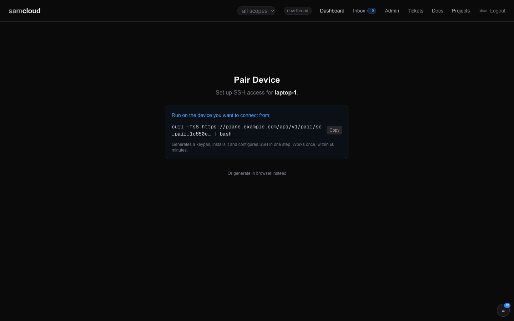

# SSH Gateway

The gateway is how people and agents reach machines. It is an interface: one SSH endpoint, `ssh samcloud`, that lists what you can reach and runs a shell or a command there. It is also a transport: devices hold their reverse tunnels to it, and the plane's own service forwards ride through it. You never land in a shell on the plane. Every login lands in the gateway process, which checks who you are with the registry and routes you onward.

## In the dashboard

The gateway has no page of its own; its keys do:

- **Pair a device** at `/pair` to mint an access key for it ([Devices and Enrolment](Devices%20and%20Enrolment.md#pairing-a-device)).

  

- **Admin → Devices** lists **Access Keys**: each key's user, device, public key and creation date. Revoking a key is an API call ([Revoking access](#revoking-access)).

## How it works

The gateway is a compiled Go binary, `/usr/local/bin/samcloud-gateway`, in the plane's sshd container. That sshd accepts one SSH user, `samcloud`, by key only.

Every managed key in the gateway's `authorized_keys` forces a command. The registry writes these lines, and rewrites them at every start, whenever an access key is minted or revoked, and whenever a device activates. Lines it did not write are kept. You never hand-edit them.

```
# an access key: a person's or agent's key, forced into the gateway
command="REGISTRY_URL=… GATEWAY_TOKEN=… GATEWAY_KEY=… /usr/local/bin/samcloud-gateway you phone-1",restrict,pty ssh-ed25519 AAAA…

# a device key: its reverse tunnel and nothing else
command="/bin/false",restrict,port-forwarding,permitlisten="localhost:10003" ssh-ed25519 AAAA…
```

- **An access key** carries no port forwarding. The sshd allows only remote forwards (`AllowTcpForwarding remote`), so `ssh -L`, `-W` and `-R` with an access key are refused.
- **A device key** runs no command and may bind only its own tunnel port (`permitlisten`). A device with no tunnel port gets no forwarding at all.
- **`GATEWAY_TOKEN` and `GATEWAY_KEY`** are the gateway's own credentials: a registry token to ask about permissions, and the key it uses to SSH onward to targets. They are separate from the access key you log in with.

When you connect with an access key, the gateway:

1. identifies you from the forced command's arguments (username and device), **not** from the SSH username, which is always `samcloud`;
2. asks the registry what you may reach;
3. shows your targets, routes you to one, or runs one command on one.

## Connecting

> **The SSH user is always `samcloud`.** Your identity comes from the key, not the username: connecting as `you@gateway` fails with `Permission denied (publickey)`. The setup script (`POST /access-keys/setup-script | bash`) or a pair link writes the `ssh samcloud` alias once, and you never type the host, port or user again.

```bash
# The interactive menu
ssh samcloud

# Straight to a device's shell
ssh samcloud gpu-1

# One command on a device: its stdout, its exit code. The form agents and scripts use.
ssh samcloud "gpu-1 -- systemctl is-active my-service"

# Machine-readable listings
ssh samcloud "devices --json"
ssh samcloud "status --json"

# A shell in the gateway's container (the admin only)
ssh samcloud shell
```

Without the alias, the raw form is:

```bash
ssh -i <key> -p <port> samcloud@<gateway-host> "<device> -- <cmd>"
```

The port is the host's `SSH_PORT` (default 2200). Where only the sslh mux is reachable, it is `SSLH_PORT` (default 9443), which serves SSH and HTTPS on one port. The aliases the registry writes use `GATEWAY_SSH_HOST` and `GATEWAY_SSH_PORT`. See [Configuration](Configuration.md).

## Commands

Each command works in the interactive menu and as `ssh samcloud "<command>"`:

| command | what it does |
|---|---|
| `<device-id>` | Open an interactive shell on the device. |
| `<device-id> -- <cmd>` | Run one command on the device. Its stdout is yours; its exit code is the gateway's. The `--` needs whitespace on both sides, and a newline or tab counts, so a command piped in on stdin after `<device> --` works. |
| `devices` / `ls` `[--json]` | List the targets you can reach. `--json` gives `[{"id", "method", "status", "detail"}]`. |
| `status` `[--json]` | The plane's totals: devices, services, ports, open tickets. |
| `shell` | Drop to a shell in the gateway's container (admin only). |
| `help` | Show the commands. |
| `exit` / `quit` / `q` | Leave the menu (interactive only). |

**Exit codes, non-interactive.** A remote command's own exit code is passed through unchanged. Gateway failures use shell-style codes, with a message on stderr and nothing on stdout:

| code | meaning |
|---|---|
| `2` | usage error, such as `<device> --` with no command |
| `125` | the target is misconfigured: no outbound method, no address, no tunnel port, no SSH user, or a method the gateway can't route |
| `126` | access denied |
| `127` | unknown target; the message carries the usage line and points at `devices` |
| `255` | ssh failed to connect, or the target's host key was refused or could not be checked |

These can collide with a remote command's own code, so tell them apart by the gateway's message on stderr. `shell` without admin exits 1 with "Permission denied: admin access required".

### Built for agents

The non-interactive form is meant to be scripted:

- **One command, no menu.** The first standalone ` -- ` splits the directive: the left side names the target, the right side runs verbatim on it.
- **No terminal.** A one-off command runs without a PTY (`ssh -T`), so output is clean. The interactive form keeps one.
- **Clean stdout.** Gateway chatter ("Connecting to …") goes to stderr. Stdout carries only the remote command's output.
- **A real exit code**, so `ssh samcloud "gpu-1 -- test -f /x" && …` is honest.
- **Fails, never hangs.** A one-off command runs with `BatchMode=yes` and a 15-second connect timeout. A device that doesn't trust the gateway's key is a denial, not a password prompt.
- **The alias is optional.** The alias the registry writes uses `RequestTTY auto`: interactive `ssh samcloud` gets a terminal for the menu, and `ssh samcloud "<dev> -- <cmd>"` runs without one. The raw `ssh -p … samcloud@<host> "<dev> -- <cmd>"` behaves the same.
- **Structured listings.** `devices --json` and `status --json` answer JSON instead of the menu's table.

## Device routing

The gateway reads each target's outbound method from the registry:

| method | the hop |
|---|---|
| `direct-ssh` | SSH to the device's LAN address and SSH port |
| `reverse-tunnel` | SSH to `localhost:<tunnel_port>` inside the gateway's container, through the tunnel the device holds |

Either way it logs in as the device's SSH user (`outbound_ssh_user`) with the gateway's key, which the device's bootstrap installed. You never need the address, the tunnel port or the SSH user. A device listed by `devices` is one with an outbound method; a route-only device is not a target.

```
Target: box-1  (direct-ssh, 192.0.2.10)       → ssh to 192.0.2.10
Target: gpu-1  (reverse-tunnel, :10003)       → ssh to localhost:10003, through gpu-1's tunnel
```

Every hop checks the target's host key: see [Host-key trust](#host-key-trust).

## Access control

- **Admission and listing use one predicate.** The gateway asks `GET /auth/can-access` before it routes, and `GET /auth/accessible-devices` for `devices`. Both union the user's stored scopes, the admin role and every group membership, the same computation the API applies to a bearer. What `devices` lists is what you can enter.
- **The admin** (role `admin`) reaches every device and may use `shell`.
- **Everyone else** reaches the devices in their scope: a `device:<id>` scope, or a group that holds the device.
- **Group role is not consulted.** A viewer of a group gets the same shell on its devices as an owner.
- **If the registry does not answer,** the gateway denies.
- **What is recorded.** The registry records what it does itself: access keys minted and revoked, `authorized_keys` syncs, enrolment and activation, and host-key pins, conflicts and clears. The gateway also reports each connection (`gateway.connect`), route and one-off command (`gateway.route.<device>`, `gateway.exec.<device>`), denial (`gateway.route.denied`, `gateway.exec.denied`, `gateway.shell.denied`), admin shell (`gateway.shell`) and host-key event to `POST /api/v1/audit`. The registry serves no such route, so those reports are not recorded.
- **A one-off command adds no privilege.** It runs as the same account an interactive shell lands in, after the same admission check.

What a shell on a device means for the tokens kept there is set out in [Identity and Access](Identity%20and%20Access.md#what-you-land-in) and [Security](Security.md).

## Worked example: an agent on machine A runs a command on device B

Goal: an agent on **box-1** (machine A, an access route) checks a service on **gpu-1** (device B, a target).

```bash
# 1. Once: make A an access route. This mints A's key and installs it with the
#    `ssh samcloud` alias. Run on A; the token here is only for this call.
curl -s -X POST $PLANE/access-keys/setup-script \
  -H @"$HOME/.samcloud/token.hdr" -H "Content-Type: application/json" \
  -d '{"username":"claude-builder","device_name":"box-1"}' | bash

# 2. Confirm B is a target you can reach.
ssh samcloud "devices --json" | jq '.[] | select(.id=="gpu-1")'

# 3. Run one command on B and capture its output (no PTY, real exit code).
ssh samcloud "gpu-1 -- systemctl is-active my-service"   # → "active"  (exit 0)

# 4. Or open a shell on B.
ssh samcloud gpu-1
```

That is `route → gateway → target`. Step 1 put A's key on the gateway (the route side). The gateway already holds its own key on B, installed by B's bootstrap (the target side). The agent never touches B's address, tunnel port or SSH user.

## Generating access keys

An access key is an SSH key pair for one user on one device, `<username>@<device_name>`. You may mint one for yourself; the admin may mint one for anyone. Minting again for the same user and device replaces the key.

```bash
# Install the key and the alias in one step
curl -s -X POST $PLANE/access-keys/setup-script -H @"$HOME/.samcloud/token.hdr" \
  -H "Content-Type: application/json" -d '{"username": "you", "device_name": "laptop-1"}' | bash

# Or take the key pair as JSON
curl -X POST $PLANE/access-keys -H @"$HOME/.samcloud/token.hdr" \
  -H "Content-Type: application/json" -d '{"username": "you", "device_name": "phone-1"}'
```

The JSON answer holds the private key, shown once: download it immediately. The public key is stored in the registry, and `authorized_keys` is synced at once. For a device with no samcloud token, use a pair link instead: [Pairing a device](Devices%20and%20Enrolment.md#pairing-a-device).

## Revoking access

```bash
curl -s "$PLANE/access-keys" -H @"$HOME/.samcloud/token.hdr"                     # your keys (the admin: all, or ?username=)
curl -X DELETE "$PLANE/access-keys/you@phone-1" -H @"$HOME/.samcloud/token.hdr"  # revoke one
```

You may list and revoke your own keys; the admin may list and revoke anyone's. Revoking syncs `authorized_keys` at once, and that key can no longer connect.

A key belongs to a username, not to a user row. Deleting a user does not revoke their keys: revoke them first. A key left behind admits nothing while no user has that name, and would admit a later user given the same username.

## Host-key trust

Trust runs in both directions. The gateway checks every device it hops to, and every device checks the gateway it dials.

### The gateway verifying a device

The gateway checks the target's SSH host key on every hop, against the key pinned for that device in `devices.host_pubkey`.

```
GET    /api/v1/devices/{id}              → host_pubkey, host_pubkey_recorded_at
POST   /api/v1/devices/{id}/host-key     → pin a key, only if none is pinned (409 if a different one is)
DELETE /api/v1/devices/{id}/host-key     → clear the pin, accepting a re-key
```

The pin is keyed on the **device id**, not the address. The gateway passes `HostKeyAlias=samcloud-<device-id>`, so the check survives a device changing LAN address or being given a different tunnel port. Every reverse-tunnel target answers at `localhost:<port>` from one shared pool, so an address-keyed pin would follow the port, not the machine.

| the pin | the hop |
|---|---|
| matches | silent: a verified hop looks like any other |
| differs | refused, with `samcloud-gateway: host key mismatch for <device>` on stderr, both fingerprints, and the call that accepts a re-key |
| absent | the key is learned and pinned, so enrolling a device needs no person in the loop |
| unreadable | refused: a pin that cannot be checked is not a hop |

A pin is set only when none exists, so learning on first contact never overwrites one. Changing a pinned key is `DELETE`, then `POST`: a device that re-keys does both with its own token, or the next hop pins what it then presents. Clear a pin only when you know why the key changed.

**Who may write a pin** is narrower than who may manage a device: the admin, the gateway's own token, or the device itself. A `device:` scope is enough to reach a device, and must not be enough to pin a key on one nobody has pinned yet. That would move trust-on-first-use out of the network and into the API, where the gateway would then refuse the real host in favour of whoever called first.

### Where the first key comes from

A device reports its own host key while it bootstraps, so the pin is in place before its first hop and the gateway verifies even that one. `bootstrap.sh` and `bootstrap.ps1` read it off the port the gateway will reach, asking the sshd itself (`ssh-keyscan -p <local sshd port> localhost`) rather than guessing a file, and send it to `/devices/activate` as `host_pubkey`. The answer's `host_key_pinned` says what happened: `true` when it pinned, `false` when a pin already stood, `null` when no key was reported.

Activation pins only a device whose status is still `pending`: created by `POST /enroll` and never activated. That window is the safe one. A manager, not only the admin, can mint an enrollment token with `/enroll/{id}/retoken`. A manager who could pin through activation could point the gateway at a key of their choosing, on a device other seats already use. `pending` excludes every activated device, `retoken` leaves a device's status as it is, and `POST /devices` creates devices already `online`. So a re-bootstrap never moves a pin, and a device outside that window falls back to the gateway learning its key on its first hop.

### The hops the control plane makes itself

`registry/forward.py` stands up a service forward with two hops, and each verifies against its own anchor:

| hop | anchor |
|---|---|
| registry container → sshd container | the public half of the sshd container's host key, from the `sshd-hostpub` volume, mounted read-only into the registry |
| inside sshd → a device, through its tunnel | `devices.host_pubkey`: the gateway's pin, keyed by device id |

- **The first anchor cannot go stale.** The sshd container republishes its public host keys on every boot, and the registry reads them per connection, so a regenerated key is followed with nothing to clear.
- **It is a separate, public-only volume on purpose.** The private host keys live in `sshd-keys`, which only the sshd container holds. Anything else holding them could present itself as the gateway to every device that dials in. The registry gets the public half and nothing more.
- **The second anchor is read-only here.** The gateway establishes a pin; `forward.py` uses it.
- **Both degrade rather than refuse** when their anchor is missing, and say so in the log. That is the opposite of the choice a gate makes, and deliberate: these calls establish every service forward, so failing closed on an unmounted volume, or a device the gateway has not reached yet, would take working forwards down. A missing anchor there is a misconfiguration, not evidence of an attack.

Scripts on the plane's host should reach devices **through the gateway**, so they inherit its check, and take their inventory from `GET /devices`. A `localhost:<tunnel_port>` form cannot work: those ports bind inside the sshd container and are not published to the host. Such a script should report a refused host key as a mismatch, never as "down", and should not run a recovery against a device whose key it does not trust.

### A device verifying the gateway

```
GET /api/v1/gateway/host-key   → {"host_keys": ["ssh-ed25519 …", "ssh-rsa …"], "alias": "samcloud-gateway"}
```

- **No bearer.** The gateway offers these keys to anyone who opens a TCP connection to its SSH port, so gating the published copy protects nothing, and a bootstrapping device may hold only a single-use enrollment token.
- **503 when nothing is published**, so a caller can tell that from "the gateway has no keys".
- **The same values** ride the `/devices/activate` answer as `gateway_host_keys` and `gateway_host_key_alias`. They are distinct from `gateway_pubkey`, the gateway's *client* key, which goes in the device's `authorized_keys`: the opposite direction.
- **A device pins them under the alias**, not under `host:port`, so the gateway changing address or port does not break the pin. The alias is `samcloud-gateway`, prefixed with the environment's name when `SAMCLOUD_ENV` is not `prod`.

**The refresh is inside the connect loop.** The tunnel runs a small runner, the same shape for systemd, launchd and the Windows scheduled task. It refreshes the pin, runs one `ssh`, backs off and repeats:

| | |
|---|---|
| the gateway re-keys | one refused attempt, then the loop refreshes and reconnects |
| the registry is unreachable | the existing pin is left alone; a blip never wipes it |
| nothing is published yet | ssh refuses; there is no unverified fallback |

`autossh` is not used for the tunnel. It restarts `ssh` itself and, with `AUTOSSH_GATETIME=0`, never exits, so a refresh placed at unit start would fire once at boot and never again, and a re-key would be refused forever. The refresh has to sit in front of every connect, not in front of the process. The bootstrap writes the runner, so re-bootstrapping a device brings its tunnel up to date.

**Two aliases on a device, two policies.** The bootstrap's `samcloud-gw` alias and the tunnel check the gateway strictly against the pinned file (`~/.config/samcloud/known_hosts`). The `samcloud` alias an access key's setup script writes uses `StrictHostKeyChecking accept-new`: it trusts the gateway's key on first connect and checks it from then on.

## The gateway's API

| method | path | auth | what it does |
|---|---|---|---|
| GET | `/api/v1/gateway/host-key` | none | the gateway's host keys and alias, for a device to verify it |
| GET | `/api/v1/gateway/pubkey` | none | the gateway's client key, which targets put in `authorized_keys` |
| GET | `/api/v1/gateway/status` | any bearer | `authorized_keys` state and whether the gateway key exists |
| POST | `/api/v1/gateway/sync` | admin | rewrite `authorized_keys` from the registry |
| POST | `/api/v1/gateway/keygen` | admin | generate the gateway's key pair if it is missing (the registry also does this on first boot) |
| GET | `/api/v1/auth/can-access?username=&device_id=` | admin | can this user enter this device: the gateway's admission check |
| GET | `/api/v1/auth/accessible-devices?username=` | admin | the devices this user can enter: what `devices` lists |

Access keys, pair links and host-key pins are above. [API Reference](API%20Reference.md) has the whole surface.

## Related

- [Devices and Enrolment](Devices%20and%20Enrolment.md): routes, targets, bootstrap and pairing
- [Identity and Access](Identity%20and%20Access.md): scope, and what a shell on a device means
- [Security](Security.md): what the gateway enforces and its known limits
- [Configuration](Configuration.md): `SSH_PORT`, `SSLH_PORT`, `GATEWAY_SSH_HOST`, `GATEWAY_SSH_PORT`
- The served skill's [`tools.md`](../registry/skills/samcloud-agent/tools.md) (Machines) and [`auth.md`](../registry/skills/samcloud-agent/auth.md) (the gateway key): the agent-facing version

Next: [Tickets](Tickets.md)
