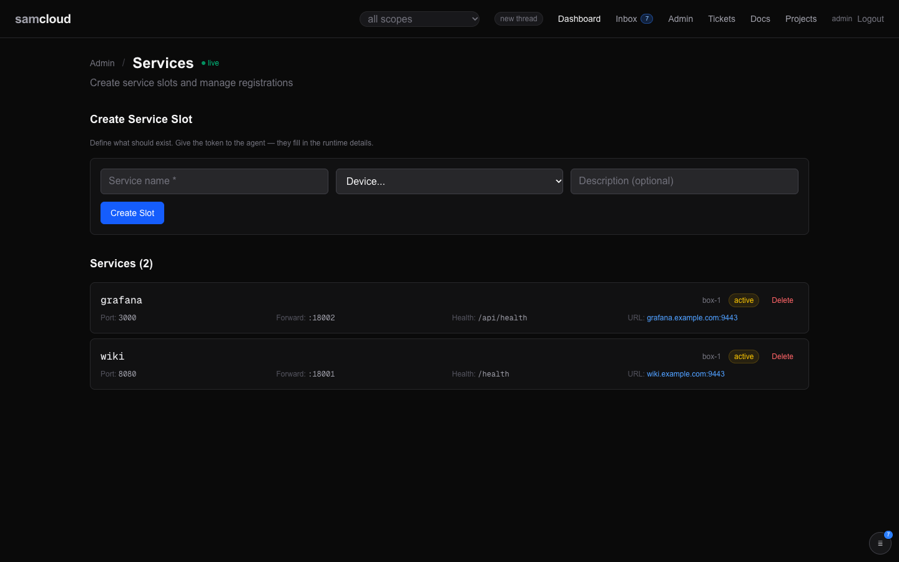
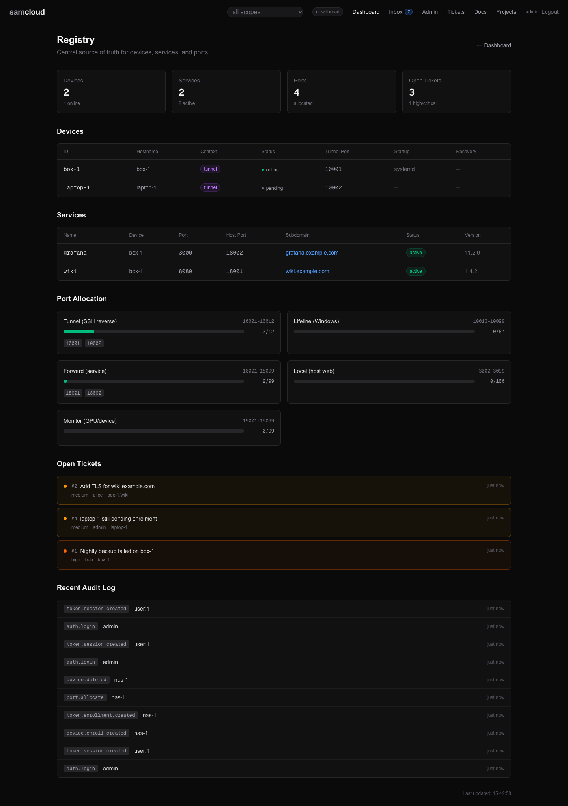

# Services and Routes

A service is something that runs on a device and listens on a port: a web app, an API, a model server. Registering it tells the plane where it runs and what it does. With a subdomain, the plane also gives it a route: a forward through the device's tunnel when it has one, a Caddy site, and a DNS record when the DNS module is on. The registry does each step itself.

## In the dashboard

**Admin → Services** (`/admin/services`) lists the services you can see, each with its device, port, forward port, health endpoint and external URL, and a **Delete** button. It updates live.



- **Create Service Slot** (admin): a service name, a device, and an optional description. It answers the slot's token and briefing, under "Give this to the agent (briefing + instructions)". See [Slot-based registration](#method-2-slot-based-registration).
- **Pending Activation** lists slots whose agent has not activated them yet.

**Registry** (`/registry`) shows devices, services and routes together.



## How it works

```
register (or activate a slot)
  → a forward port is allocated            (a device reached by reverse tunnel)
  → a forward binds through the tunnel     (inside the gateway's container)
  → a Caddy site is appended and reloaded  (with a subdomain)
  → a DNS record is added                  (with the dns-namecheap module on)
  → a service token is minted
  → the route is checked end to end
  → live at https://my-svc.example.org, or http://192.0.2.10:18101 on a bare address
```

Each step reports its own result in the answer's `route` object (`forward`, `caddy`, `dns`, `verified`), so a partial success is visible.

| step | what happens |
|---|---|
| forward port | For a device whose target is `reverse-tunnel`, the registry allocates `slice_port` from the forward range (default 18001–18099). |
| forward | Inside the gateway's sshd container, `ssh -fN -L 0.0.0.0:<slice_port>:localhost:<service_port>` runs through the device's tunnel. See [The forward module](#the-forward-module). |
| Caddy | A site block for the route is appended to the Caddyfile and Caddy reloads through its admin API, falling back to its CLI. A failed reload rolls the file back. Caddy proxies to the gateway's container at `slice_port` for a tunnelled service, or straight to the device's address and port otherwise. |
| DNS | With the `dns-namecheap` module on, an A record is added for the route. With it off, or under a bare address, the step is skipped and says so. See [DNS and TLS](DNS%20and%20TLS.md). |
| service token | An `sc_service_` token for the service to operate itself. |
| verify | The registry requests the external URL (plus the health endpoint, if any). Any HTTP answer, even 4xx or 5xx, counts as reachable. |

## Using it

There are two ways to register a service. Both take a device the caller manages ([Identity and Access](Identity%20and%20Access.md#writes-who-can-do-what)).

### Method 1: direct registration

An agent or person who manages the device registers the service in one call. This is the usual path.

```bash
curl -X POST $PLANE/services -H @"$HOME/.samcloud/token.hdr" \
  -H "Content-Type: application/json" \
  -d '{
    "name": "my-service",
    "device_id": "gpu-1",
    "port": 8080,
    "description": "What it does, for whoever reads the service list",
    "health_endpoint": "/health",
    "subdomain": "my-svc",
    "capabilities": ["inference"]
  }'
```

`name`, `device_id`, `port` and `description` are required. Optional: `health_endpoint`, `docs_endpoint`, `subdomain`, `domain`, `protocol` (`http`), `version`, `capabilities`, `slice_port`.

The answer:

```json
{
  "status": "registered",
  "service_id": "gpu-1/my-service",
  "port": 8080,
  "slice_port": 18031,
  "external_url": "https://my-svc.example.org",
  "service_token": "sc_service_...",
  "guide_url": "https://cloud.example.org/api/v1/services/gpu-1/my-service/guide",
  "route": {
    "forward": {"success": true, "message": "..."},
    "caddy": {"success": true, "message": "Route my-svc.example.org → http://sshd:18031 added and active"},
    "dns": {"success": null, "skipped": true, "message": "dns-namecheap module is off; point the name at this host with your own DNS"},
    "verified": {"reachable": true, "status_code": 200, "error": null}
  }
}
```

Keep the service token in a 0600 header file, then read the service's guide, its operating reference:

```bash
curl -s $PLANE/services/gpu-1/my-service/guide -H @"$HOME/.samcloud/service.hdr"
```

**With a device token.** A device's own token (`service:register`) registers a service on that device with `POST /services/register`: `name` and `port`, and optionally `health_endpoint`, `subdomain`, `domain`, `protocol`, `version`, `capabilities`. It records the service, its forward port and, with a subdomain, its route, and answers `service_id`, `slice_port`, `external_url` and `service_token`. It does not wire Caddy or DNS itself: activate the route afterwards with `POST /routes/{subdomain}/activate`. The forward comes up on the next [reconcile](#re-wiring-after-a-restart).

### Method 2: slot-based registration

The admin defines what should exist; an agent fills in the runtime details. Use it when the person who knows the service should exist is not the one who runs it.

**1. The admin creates a slot**, in the dashboard (Admin → Services → Create Service Slot) or with the API:

```bash
curl -X POST $PLANE/services/enroll -H @"$HOME/.samcloud/token.hdr" \
  -H "Content-Type: application/json" \
  -d '{"name":"my-service","device_id":"gpu-1","description":"ML inference API","subdomain":"my-svc"}'
```

It answers `service_id`, a single-use `sc_enroll_` `token` (one hour), the `subdomain`, and a `brief_url`. Name a `subdomain`: a slot with none takes `<name>-stg`. The slot is a service row with status `pending`.

**2. Hand the briefing to the agent.** It is self-contained markdown: what they are setting up, the activation call with their token, the fields, and debugging tips. Reading it does not spend the token, and it needs no bearer.

```
$PLANE/enroll/services/brief/<token>
```

**3. The agent activates the slot** with the service's runtime details:

```bash
curl -X POST $PLANE/services/activate -H "Content-Type: application/json" \
  -d '{"token":"sc_enroll_...","port":9000,"health_endpoint":"/health","capabilities":["inference","batch"]}'
```

`token` and `port` are required; `health_endpoint`, `protocol`, `version` and `capabilities` are optional. Activation runs the same chain as direct registration and answers `service_id`, `slice_port`, `external_url`, `service_token`, `guide_url` and `route`. `GET /enroll/services/pending` (admin) lists slots still waiting.

### Operating a service

With the service's own token, its creator's token, or a token that manages its device:

```bash
# Report health (the guide recommends every 60 seconds)
curl -X POST $PLANE/services/gpu-1/my-service/health -H @"$HOME/.samcloud/service.hdr"

# Update metadata: port, health_endpoint, docs_endpoint, description, protocol, version, capabilities, status
curl -X PATCH $PLANE/services/gpu-1/my-service -H @"$HOME/.samcloud/service.hdr" \
  -H "Content-Type: application/json" \
  -d '{"version":"2.0","capabilities":["inference","streaming"]}'

# File a ticket about it (the filer is taken from the token)
curl -X POST $PLANE/tickets -H @"$HOME/.samcloud/service.hdr" \
  -H "Content-Type: application/json" \
  -d '{"service_id":"gpu-1/my-service","type":"bug","summary":"OOM on large batch"}'
```

A health report sets the service `online` and records the time. `POST /probe` (admin) checks every service with a health endpoint and updates its status. Updates use `PATCH`; `PUT` answers 405. A service token sees its own service only. Filing a ticket needs a group the writer edits: a service token edits the groups that hold its device. See [Tickets](Tickets.md).

### Deleting a service

The admin, the service's own token, its creator, or its device's manager deletes it. Deleting reverses the chain:

```bash
curl -X DELETE $PLANE/services/gpu-1/my-service -H @"$HOME/.samcloud/token.hdr"
```

It stops the forward, removes the Caddy site (and frees its route port), removes the DNS record, and deletes the service's leases, route, ports, token and group links. A route is removed with its service; there is no call that removes a route alone.

## Validation rules

| field | rule |
|---|---|
| `name` | 1–64 characters: lowercase letters, digits and hyphens, with no leading or trailing hyphen (`^[a-z0-9][a-z0-9-]{0,62}[a-z0-9]$`, or one or two characters `^[a-z0-9]{1,2}$`) |
| `subdomain` | 1–63 characters: lowercase letters, digits and hyphens, DNS-safe (`^[a-z0-9]([a-z0-9-]{0,61}[a-z0-9])?$`). Unique per domain: a claimed subdomain answers 409. |
| `port` | 1–65535. Two services on one device cannot share a port (409). |
| `status` | one of `online`, `offline`, `maintenance`, `degraded`, `active`, `pending`, `stopped`, `unknown` (422 otherwise) |
| service id | `<device_id>/<name>`, unique (409) |

Request bodies are strict: an unknown field answers 422 rather than being dropped.

## Routed domains

A route is a subdomain under a domain, pointing at a target. Which domain, and how it is served, comes from the plane's settings:

| the plane has | a service with subdomain `my-svc` is at | DNS | TLS |
|---|---|---|---|
| `SAMCLOUD_DOMAIN=example.org` | `https://my-svc.example.org` | the module adds it, or you point the name yourself | Caddy |
| no `SAMCLOUD_DOMAIN`, `PUBLIC_URL` on a name such as `cloud.example.org` | `https://my-svc.cloud.example.org` | as above | Caddy |
| no `SAMCLOUD_DOMAIN`, `PUBLIC_URL` on an IP address | `http://192.0.2.10:18101`: its own port from the route range (default 18101–18110) | none needed | none: plain HTTP |

- **The HTTPS port** in an external URL is `PUBLIC_HTTPS_PORT`, which compose sets from `SSLH_PORT`. It is left out when it is 443.
- **A request may name its own `domain`.** With none, the plane's domain is used.
- **A TLS snippet.** If the Caddyfile defines a snippet named `(<name>-tls)`, each route imports it, for example for DNS-01 certificates. See [DNS and TLS](DNS%20and%20TLS.md).
- **Routes by hand.** `GET /routes` lists the routes for services in your scope (the admin: all). `POST /routes` records a route for a service on a device you manage; a route with no service is the admin's. Recording a route does not wire it: activate it.

```bash
curl -X POST "$PLANE/routes/my-svc/activate" -H @"$HOME/.samcloud/token.hdr"   # ?domain= for another domain
```

Activating a route binds its forward, pushes its Caddy site, and adds or retries its DNS record.

A route makes a service reachable at its URL. Scope does not guard that URL: anyone who can reach it can load the service, and the service's own login is the service's. [Security](Security.md#three-separate-boundaries) states the boundaries.

## Ports and port allocation

The registry is the ledger of ports on the plane. Every allocation is a row, so two owners never claim one port.

| type | default range | used for |
|---|---|---|
| `tunnel` | 10001–10099 | a device's reverse-tunnel landing port |
| `forward` | 18001–18099 | a tunnelled service's forward (`slice_port`) |
| `route` | 18101–18110 | a route's own port under a bare address |
| `lifeline` | 10013–10099 | a device's lifeline port |
| `local` | 3000–3099 | local services on the plane host |
| `monitor` | 19001–19099 | monitoring ports |

The tunnel, forward and route ranges are set in the env file; [Configuration](Configuration.md) lists them. The tunnel and forward ranges are not published on the host: they terminate inside the gateway's container. The route range is published on Caddy.

Check before you claim a port:

```bash
# One port: its ledger rows, and whether something listens on it
curl -s $PLANE/ports/check/18011 -H @"$HOME/.samcloud/token.hdr"

# Every allocation, or one type
curl -s "$PLANE/ports?type=forward" -H @"$HOME/.samcloud/token.hdr"

# Allocate the next free port, for a device you manage
curl -X POST $PLANE/ports/allocate -H @"$HOME/.samcloud/token.hdr" \
  -H "Content-Type: application/json" \
  -d '{"port_type": "forward", "owner_id": "gpu-1/new-service"}'
```

The allocator:

- refuses a type it doesn't know, and a preferred port outside its range;
- refuses a port already allocated, naming the current owner (409);
- skips a port something is listening on, checked with `lsof` inside the registry's own container;
- allocates inside one database transaction.

`owner_id` is a device or `<device>/<service>` you manage; any other owner is the admin's. `DELETE /ports/{port}` (admin) releases an allocation, for example an orphan left when a device moved to a shared tunnel.

## The forward module

`registry/forward.py` stands up a tunnelled service's forward. Reverse tunnels land on the loopback of the gateway's sshd container, so the forward has to run there:

1. The registry container connects to the sshd container as `samcloud` with the gateway key.
2. Inside sshd it runs `ssh -fN -L 0.0.0.0:<slice_port>:localhost:<service_port> -p <tunnel_port> <device ssh user>@localhost`.
3. Caddy proxies to `sshd:<slice_port>` over the compose network.

Both hops check host keys: the registry checks the sshd container against its published public host key, and the inner hop checks the device against its pinned key, the same pin the gateway uses. [SSH Gateway](SSH%20Gateway.md#the-hops-the-control-plane-makes-itself) has the detail.

The module checks whether a forward is listening by reading `/proc/net/tcp` inside the sshd container, and stops a forward by its `-L` bind.

## Re-wiring after a restart

Forwards die when the sshd container restarts, and reverse tunnels reconnect on their own schedule. The registry reconciles forwards in the background: after start it waits for sshd, then every `FORWARD_RECONCILE_INTERVAL` seconds (default 120) it restarts any service forward that is not listening. It logs only when the set of started or failed forwards changes.

To re-push everything at once:

```bash
curl -X POST $PLANE/routes/activate-all -H @"$HOME/.samcloud/token.hdr"   # admin
```

It re-binds every forward and pushes every Caddy site, and answers the result per route. It does not touch DNS.

## Related

- [Devices and Enrolment](Devices%20and%20Enrolment.md): the device a service runs on, and its tunnel
- [DNS and TLS](DNS%20and%20TLS.md): the DNS module, certificates, Caddy
- [Configuration](Configuration.md): `SAMCLOUD_DOMAIN`, `PUBLIC_URL`, the port ranges, `SAMCLOUD_MODULES`
- [Security](Security.md): what scope does and does not guard
- [Troubleshooting](Troubleshooting.md): a route that doesn't answer
- [API Reference](API%20Reference.md): services, slots, routes and ports

Next: [SSH Gateway](SSH%20Gateway.md)
