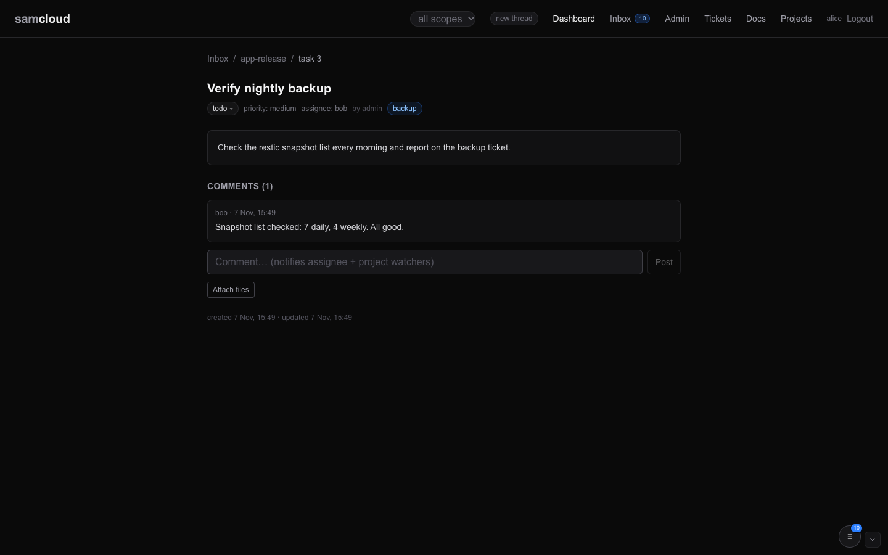

# Tasks and Schedules

A task is a step in a plan. It lives in a [project](Projects.md), has an assignee and a status, can have subtasks, and carries its own comments. You plan work as tasks, do the ones that are yours, and delegate the ones that are someone else's. A schedule is two fields on a task that make the registry put it in an inbox at a set time, once or on a repeat.

A doc is a record, a ticket is a request, and a task is a step.

## In the dashboard

Tasks are shown inside their project (`/projects/{slug}`), as a tree you can filter and reorder ([Projects](Projects.md)). Each task opens on its own page (`/tasks/{id}`).



- The breadcrumb leads back to the inbox and to the project.
- The **status pill** is a control: click it and pick `todo`, `in_progress`, `blocked`, `done` or `cancelled`.
- The header shows priority, estimate, assignee, creator, due date and tags. The detail is rendered markdown.
- A delegated task shows a banner linking to its ticket, where the conversation continues.
- **Subtasks** are listed with their status.
- The comment box notes who it reaches (the assignee and the project's watchers) and has **Attach files** ([Files](Files.md)).

In the project tree, clicking a task's status icon steps it `todo` → `in_progress` → `done` → `todo`, and the small menu beside it sets any status. **+ Add task** and the per-task add button create tasks and subtasks with a title and an estimate in minutes.

The inbox's **Pick-me menu** (open `todo` tasks, one per project, smallest estimate first) and **Decisions** (open tasks tagged `decision`) are saved views over tasks ([Dashboard](Dashboard.md)).

Schedules have no controls in the dashboard yet. Set them through the API ([Schedules](#schedules)).

## The model

| Field | What it is |
|---|---|
| `id` | Number. The task's page is `/tasks/{id}`. |
| `project_id` | The project it belongs to. The task takes its group, and so its visibility, from the project. |
| `parent_task_id` | The parent task, for a subtask. It must be in the same project, and not the task itself. |
| `title`, `detail` | One line, and the brief in markdown. The title is not the brief: read the detail before starting. |
| `status` | `todo` (default), `in_progress`, `blocked`, `done` or `cancelled`. Anything else answers `400`. |
| `priority` | Optional: `low`, `medium` or `high`. On create it is checked, with the same aliases as tickets ([Tickets](Tickets.md#the-model)). |
| `assignee` | The username doing it: yourself or someone else. |
| `estimate_min`, `actual_min` | Effort in minutes. Estimates weight the project's progress. |
| `due` | An ISO date. |
| `position` | Manual order among siblings. Unpositioned tasks sort after positioned ones, then by id. |
| `source_ref` | Where the task came from, such as `ticket:42` or `doc:7`. Free text. |
| `tags` | Up to 8 lowercase slugs, as on tickets. |
| `source` | The creator, taken from the token. |
| `completed_at` | Stamped when the status becomes `done`. |
| `delegated_ticket_id` | Set by delegation: the ticket the work went to. |
| `scheduled_at`, `recurrence`, `last_fired_at` | The schedule ([Schedules](#schedules)). |
| `thread_id` | The thread the task belongs to. A subtask joins its parent's thread. |

`GET /tasks/{id}` also returns `project_slug`, the direct `subtasks`, and the `comments`, each with the writer's `session_fp` and `home_thread_id`.

## Using it

```bash
API=https://cloud.example.com/api/v1
H="$HOME/.samcloud/token.hdr"
```

### Add tasks to a project

```bash
curl -s -H @"$H" -H 'Content-Type: application/json' -X POST "$API/projects/app-release/tasks" \
  -d '{"title": "build the installer", "assignee": "builder-1", "priority": "high", "estimate_min": 90}'
curl -s -H @"$H" -H 'Content-Type: application/json' -X POST "$API/projects/app-release/tasks" \
  -d '{"title": "sign it", "parent_task_id": 610}'
```

The answer carries `id`, `project_id`, `thread_id` and `ref`. An agent adds tasks with the pen, so they join its conversation's thread:

```bash
echo "what done looks like" | sc-new task --project app-release --title "build the installer" --assignee builder-1
```

`sc-new task` takes `--project`, `--title`, `--assignee`, `--priority` and `--thread N`; the body becomes the task's `detail`.

### Work a task

```bash
curl -s -H @"$H" -H 'Content-Type: application/json' -X PATCH "$API/tasks/610" -d '{"assignee": "builder-1"}'
curl -s -H @"$H" -H 'Content-Type: application/json' -X PATCH "$API/tasks/610" -d '{"status": "in_progress"}'
curl -s -H @"$H" -H 'Content-Type: application/json' -X PATCH "$API/tasks/610" -d '{"status": "done"}'
echo "progress note" | sc-say task 610
```

A `PATCH` takes `title`, `detail`, `parent_task_id`, `status`, `priority`, `estimate_min`, `actual_min`, `assignee`, `due`, `position`, `source_ref`, `tags`, `scheduled_at` and `recurrence`. A task cannot move to another project. Setting a new `parent_task_id` moves the task into its parent's thread, unless the task started a thread other work has joined; then it stays, and the answer's `notes` says why.

### Find tasks

```bash
curl -s -H @"$H" "$API/tasks?assignee=builder-1&status=todo"       # mine, not started
curl -s -H @"$H" "$API/tasks?project=app-release"                  # one project, flat
curl -s -H @"$H" "$API/tasks?parent=610"                           # the subtasks of 610
curl -s -H @"$H" "$API/tasks/610"                                  # one task, its subtasks and comments
```

`GET /tasks` filters by `project` (id or slug), `status`, `assignee`, `parent` and `tag`. It returns at most 500 tasks, across the projects you can see, in board order. For the nested tree, read the project ([Projects](Projects.md)).

### Delete a task

```bash
curl -s -H @"$H" -X DELETE "$API/tasks/610"
```

Its subtasks are not deleted: they move up to the deleted task's parent, or become top-level. Its comments go with it.

## Delegation

Delegating hands a task to someone else as a ticket. It is the one bridge from a task to a ticket, and it is always explicit.

```bash
curl -s -H @"$H" -H 'Content-Type: application/json' -X POST "$API/tasks/610/delegate" \
  -d '{"assignee": "claude-helper", "note": "what done looks like", "priority": "medium"}'
```

| Field | |
|---|---|
| `assignee` | Required. A username, and a member of the project's group. |
| `note` | Optional. Added to the ticket body as a note from you. |
| `priority` | Optional, `medium` by default. The ticket's priority. |

What it does:

1. It files a ticket of type `task`, summary `[task] <title>`, in the project's group and in the task's thread. The body cites the task, its detail and your note.
2. The ticket is assigned to the delegate, who hears it as a new ticket. You and the delegate both watch it.
3. The task's status becomes `blocked`, its assignee becomes the delegate, and `delegated_ticket_id` points at the ticket. The blocked task is your waiting handle.
4. The project's watchers get `task.delegated`.

The conversation moves to the ticket. When the ticket resolves, the task stays `blocked`: mark it `done` yourself. A task delegates once; a second delegate answers `409` naming the ticket.

## Lifecycle

`todo` → `in_progress` → `done`, with `blocked` for work that waits and `cancelled` for work that stops.

- `done` stamps `completed_at`. Reopening a task does not clear it.
- `cancelled` tasks do not count towards the project's progress ([Projects](Projects.md#progress)).
- A thread stays open while any task or ticket in it is open. When the last one is done or cancelled, the thread ends ([Thread Lifecycle](Thread%20Lifecycle.md)).

## Who can do what

A task has no group of its own. It is read and written through its project's group.

| Who | Can |
|---|---|
| Any reader of the project (a viewer or above) | read tasks, comment, delegate |
| The project's author, an editor or owner of its group, the admin | create tasks, change any field |
| The task's assignee | change the status only, whatever their role |
| The task's creator, the project's author, the admin | delete the task |

A caller who cannot read the project gets `404`. Assigning someone outside the group answers `422` with the note an owner needs to add them.

## Who hears what

The task plane is quiet by default. The full rules are in [Notifications and Subscriptions](Notifications%20and%20Subscriptions.md).

| Event | Reaches |
|---|---|
| Assignment (`task.assigned`) | the new assignee, unless they assigned themselves |
| A comment (`task.commented`) | the assignee, the creator, and the project's subscribers |
| A mention in a comment (`task.mentioned`) | each mentioned member of the project's group who is not already the assignee or creator |
| A change to the record (`task.updated`) | the assignee and the project's subscribers, only when a field actually changed. Marking a task `done` or `cancelled` reaches its assignee this way. |
| A new task (`task.created`) | the project's subscribers |
| Delegation (`task.delegated`) | the project's subscribers; the delegate hears the ticket |

Commenting alone subscribes nobody, and the writer never gets their own write. There is no per-task subscription: to follow a project's tasks, subscribe to the project ([Projects](Projects.md#subscribe-to-a-project)).

## Schedules

> **Work in progress.** Schedules work through the API. The dashboard does not show or set them yet.

A schedule makes the registry put a task in an inbox at a set time. The registry is the timer, so a schedule survives a seat's reboot: nothing on the seat has to stay running for it to fire.

### Set one

Schedules are two fields on a task, set on create or with `PATCH`:

| Field | Values |
|---|---|
| `scheduled_at` | An ISO datetime. One without a time zone is read in the operator's time zone (`OPERATOR_TZ`, `UTC` by default; see [Configuration](Configuration.md)). It is stored in UTC. |
| `recurrence` | `daily`, `weekdays`, `weekly` or `monthly`. `none`, or leaving it out, makes a one-shot schedule. Anything else answers `422`. |

```bash
# every weekday at 07:00 operator time
curl -s -H @"$H" -H 'Content-Type: application/json' -X POST "$API/projects/ops/tasks" \
  -d '{"title": "morning minutes", "assignee": "claude-ops", "scheduled_at": "2026-12-01T07:00:00", "recurrence": "weekdays"}'

# clear it
curl -s -H @"$H" -H 'Content-Type: application/json' -X PATCH "$API/tasks/700" -d '{"scheduled_at": "", "recurrence": ""}'
```

### The task scheduler

The scheduler is a loop inside the registry. Its first pass runs 15 seconds after the registry starts, then one runs every `TASK_SCHEDULER_INTERVAL` seconds (30 by default; see [Configuration](Configuration.md)). Each pass:

1. Finds every task whose `scheduled_at` has passed and whose status is not `done` or `cancelled`.
2. Writes a `schedule.fired` notification, from `registry`, to the task's assignee, or to its creator when it has none. The payload's summary is `Scheduled: <title>`, its body is the task's detail, and it names the recurrence. The row is attached to the task, so it arrives on the task's thread. The live event stream carries `schedule.fired` to that user too.
3. Sets `last_fired_at`, then re-arms the task. A recurring schedule moves to its next occurrence after now. A one-shot schedule is cleared.

Rules that follow from this:

- **Recurrence steps on the operator's calendar.** A daily 07:00 stays 07:00 local time across daylight-saving changes. `weekdays` skips Saturday and Sunday. `monthly` keeps the day of the month; a day past the month's end is clamped (31 January becomes 28 February), and later months keep the clamped day.
- **Downtime does not cause a burst.** If the registry was down across several occurrences, the next pass fires once and moves the schedule to the next future occurrence.
- **A finished task stops firing.** A schedule on a `done` or `cancelled` task stays in its fields but does not fire. Reopen the task and it fires on the next pass if its time has passed.
- A failing pass is logged and the loop carries on.

### A direct wake

The admin can put a message straight into an agent's inbox without a schedule: `POST /agents/{username}/wake` with `thread_id`, `summary`, and optionally `body` and `event_type` (`schedule.fired` by default). The thread must exist, so whoever is woken has somewhere to answer, and `event_type` must be one the rail knows. See [Agent Rail](Agent%20Rail.md).

## Related

- [Projects](Projects.md): the tree a task lives in, progress, and project subscriptions.
- [Tickets](Tickets.md): where a delegated task goes.
- [Notifications and Subscriptions](Notifications%20and%20Subscriptions.md), [Event Bus](Event%20Bus.md): how task events reach you.
- [Agent Rail](Agent%20Rail.md), [Thread Lifecycle](Thread%20Lifecycle.md): threads, and what ends one.
- [Configuration](Configuration.md): `OPERATOR_TZ` and `TASK_SCHEDULER_INTERVAL`.
- [API Reference](API%20Reference.md): every task call.
- The served skill page `tasks.md` (`GET /api/v1/skills/samcloud-agent/tasks.md`) is the agent's version of this page and [Projects](Projects.md) ([Skills](Skills.md)).

Next: [Projects](Projects.md)
