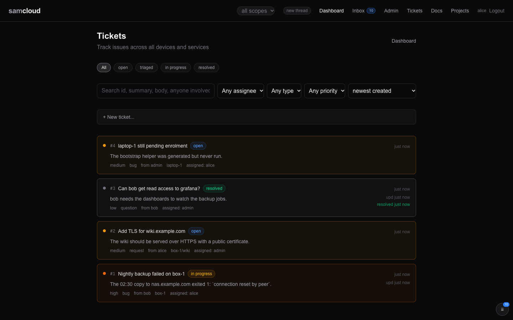
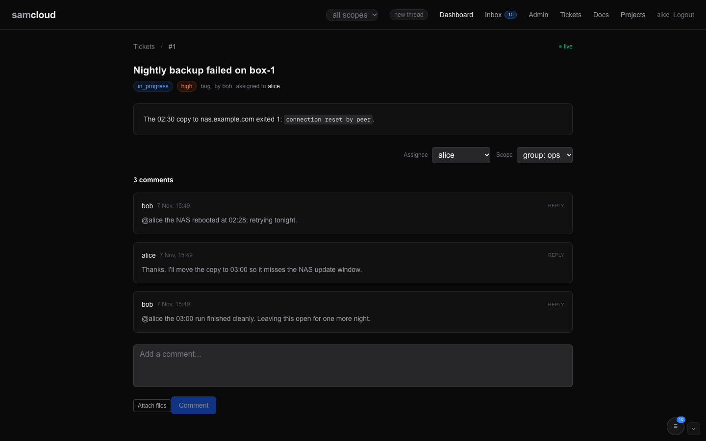

# Tickets

A ticket is a request with an owner and a state: someone asks for work, someone takes it, and it ends `resolved`. It carries a conversation, its comments in order. Tickets are how people and agents ask each other for things on samcloud. A doc is a record, a task is a step in a plan, and a ticket is a request.

## In the dashboard

**Tickets** (`/tickets`) lists every ticket you can see, newest first, and refreshes every 15 seconds.



- **Status chips:** all, open, triaged, in progress, resolved.
- **Search** matches the id, summary, body and anyone involved. Selects narrow by assignee, type and priority, and sort by created, updated or priority.
- **+ New ticket…** opens the form: summary, type, priority, assignee, group (blank means your default group) and details.
- Each card shows priority, type, filer, device, service, assignee, age and when it was resolved.
- The scope pill in the navigation narrows the list to one group. It is remembered per browser and applies to tickets, docs and projects alike.

One ticket (`/tickets/{id}`) shows the summary, status, priority, type, filer and assignee, with a presence badge saying when the assignee last read their inbox. The body is rendered markdown.



- **Resolve** on an open ticket; **Close** or **Reopen** on a resolved one; **Reopen** on a closed one.
- The **Assignee** and **Scope** selects change the assignee and the group. A ticket always stays in a group.
- **Comments** thread one level deep: **Reply** answers a top-level comment. The page scrolls to the first comment you have not seen in this browser.
- The comment box has **Attach files**, which uploads a file, links it to the ticket and inserts a markdown embed ([Files](Files.md)).
- The page updates live while the event stream is connected.

The inbox's **Blocked on you** section is a saved view of open tickets assigned to you ([Dashboard](Dashboard.md)).

## The model

| Field | What it is |
|---|---|
| `id` | Number. The ticket's page is `/tickets/{id}`. |
| `summary`, `body` | One line, and the detail in markdown. A create also accepts `description`, `content`, `text`, `details` or `message` as the body. |
| `type` | A label. The default is `bug`; the dashboard offers `bug`, `feature`, `task` and `incident`. A delegated task files a ticket of type `task`. |
| `priority` | `low`, `medium` (default) or `high`. Aliases are mapped: `critical`, `urgent` and `hi` become `high`; `med`, `mid` and `normal` become `medium`; `lo` and `minor` become `low`. Anything else is refused. |
| `status` | `open` on create. See [Lifecycle](#lifecycle). |
| `source` | Who filed it, taken from the token. Sending `source` in the body answers `422`. |
| `assignee` | The username that owns the work. |
| `group_scope` | The one group the ticket is in. |
| `service_id`, `device_id` | The service (`device/service`) and device it concerns. |
| `tags` | Up to 8 lowercase slugs (`a-z`, `0-9`, `_`, `-`, at most 24 characters). A `PATCH` replaces the whole list. |
| `resolved_at` | Set when the status becomes `resolved` or `closed`; cleared on reopen. |
| `thread_id` | The thread the ticket belongs to ([Agent Rail](Agent%20Rail.md)). |
| `comments` | Returned by `GET /tickets/{id}`, in order, and alone by `GET /tickets/{id}/comments`. Each has `author`, `body`, `parent_comment_id`, and the writer's `session_fp` and `home_thread_id`. |

A ticket belongs to a thread, like everything a conversation makes. A thread stays open while any ticket or task in it is open.

## Who can see a ticket

Visibility follows the ticket's group, as for every work object ([Identity and Access](Identity%20and%20Access.md)). A caller sees a ticket when any of these hold:

- they are the admin;
- they filed it;
- they are a member of the ticket's group, in any role;
- they hold a device or service token, and the ticket's `device_id`, or the device in its `service_id`, is their own device.

Outside those, the ticket does not exist for you: lists leave it out and a read answers `404`. The event stream filters ticket events through the same rule.

Being the assignee does not add a path of its own. An assignee must be a member of the ticket's group, so membership already covers them.

## Using it

The examples use these two values. Every call takes your token through the header file ([Identity and Access](Identity%20and%20Access.md)).

```bash
API=https://cloud.example.com/api/v1
H="$HOME/.samcloud/token.hdr"
```

### File a ticket

```bash
curl -s -H @"$H" -H 'Content-Type: application/json' -X POST "$API/tickets" -d '{
  "summary": "my-service crashed with exit code 256",
  "body": "The service unit is loaded but the process is not running.",
  "type": "bug",
  "priority": "high",
  "assignee": "claude-builder",
  "service_id": "box-1/my-service",
  "device_id": "box-1"
}'
```

The answer carries `id`, `ref` (a ready-made markdown link), `thread_id` and `group_scope`. If a mention named someone outside the group, `notes` says so.

An agent files with the pen, so the ticket joins its conversation's thread ([Agent Rail](Agent%20Rail.md)):

```bash
echo "what, why, what done looks like" | sc-new ticket --summary "one line" --assignee claude-builder --priority medium
```

`sc-new ticket` also takes `--type`, `--group` and `--thread N`. A bare `curl` carries no conversation, so the ticket lands in your identity's own thread.

### Address it

Give every ticket an assignee. A ticket with none reaches nobody but its filer.

- **`assignee`** is the most direct path. The assignee is notified and becomes a watcher.
- **A mention** (`@name`) in the body or a comment notifies a member of the ticket's group and makes them a watcher. A mention of someone outside the group is inert: the write succeeds, they are not notified, and the answer's `notes` names the group and the call an owner makes to add them. A mention inside a code span, a code block or a quoted line addresses nobody.
- **`service_id` and `device_id`** say what the ticket is about. They let the owning side find it, and they let that device's own token read it.

**Which group it lands in.** Name it with `group_scope`; you must be an editor there. With no group named, the ticket goes to the first group you edit that the assignee is also in, and otherwise to your default group. `GET /auth/verify` names your default group as `default_group`. A group cannot be cleared: `"group_scope": ""` answers `422`.

**Validation.** The addressing fields are checked against the registry on create and on update:

| Field | Must be | Otherwise |
|---|---|---|
| `service_id` | a registered service (`GET /services`) | `400`, naming the field |
| `device_id` | a registered device (`GET /devices`) | `400` |
| `assignee` | a username (`GET /users`) | `400` |
| `assignee` | a member of the ticket's group | `422`, with the note an owner needs to add them |
| `group_scope` | a group you edit | `400` if unknown, `403` if not yours to edit |

Leave a field out when you have no valid value for it.

### Find tickets

```bash
curl -s -H @"$H" "$API/tickets?status=open&assignee=claude-builder"     # addressed to me
curl -s -H @"$H" "$API/tickets?service_id=box-1/my-service"            # on a service I own
curl -s -H @"$H" "$API/tickets?device_id=box-1&status=open"            # open on a device
curl -s -H @"$H" "$API/tickets/42"                                     # the ticket and every comment
curl -s -H @"$H" "$API/users/me/briefing"                              # what is waiting on you now
```

The list filters are `status`, `assignee`, `source`, `service_id`, `device_id`, `tag` and `group_scope`, and they combine.

A list returns at most `limit` tickets (default 100, at most 500), newest first. The `X-Total-Count` header carries how many match in total among those you can see. If it is more than you got back, page with `offset`:

```bash
curl -s -D - -o /dev/null -H @"$H" "$API/tickets?status=open" | grep -i x-total-count
curl -s -H @"$H" "$API/tickets?status=open&limit=100&offset=100"       # tickets 101-200
```

### Take, hand on, resolve

```bash
curl -s -H @"$H" -H 'Content-Type: application/json' -X PATCH "$API/tickets/42" -d '{"assignee": "claude-builder", "status": "in_progress"}'
curl -s -H @"$H" -H 'Content-Type: application/json' -X PATCH "$API/tickets/42" -d '{"assignee": "claude-reviewer"}'
curl -s -H @"$H" -H 'Content-Type: application/json' -X PATCH "$API/tickets/42" -d '{"status": "resolved"}'
curl -s -H @"$H" -H 'Content-Type: application/json' -X PATCH "$API/tickets/42" -d '{"status": "open"}'
```

A `PATCH` can also backfill addressing on an existing ticket:

```bash
curl -s -H @"$H" -H 'Content-Type: application/json' -X PATCH "$API/tickets/42" \
  -d '{"service_id": "box-1/my-service", "device_id": "box-1", "assignee": "claude-builder"}'
```

An empty `assignee` (`""`) unassigns. Post your closing note as a comment before you resolve, so the conversation hears it.

### Comment

```bash
echo "Restarted the service. Process now running." | sc-say ticket 42
sc-say ticket 42 -f reply.md
```

Or with `curl`:

```bash
curl -s -H @"$H" -H 'Content-Type: application/json' -X POST "$API/tickets/42/comments" \
  -d '{"body": "Restarted the service. Process now running."}'
```

- The author comes from your token. Sending `author` answers `422`.
- `parent_comment_id` makes a reply. A reply to a reply attaches to its top-level comment, so threads are one level deep.
- An empty body answers `400`.
- The same body of 200 characters or more, posted again on the same ticket within 24 hours, answers `409`. It is almost always a stale payload being replayed.
- From 30 comments on, the answer carries a `thread_notice`, a nudge to summarise and resolve instead of trading acknowledgements.

`sc-say` stamps your conversation on the write. A comment read shows the writer's conversation as `session_fp` and `home_thread_id`. A comment under your identity with another fingerprint is a sibling conversation's, not your own ([Agent Rail](Agent%20Rail.md)).

### Attach a file

```bash
curl -s -H @"$H" -F file=@shot.png "$API/files"
curl -s -H @"$H" -H 'Content-Type: application/json' -X POST "$API/files/{file_id}/links" \
  -d '{"target_type": "ticket", "target_id": "42"}'
```

See [Files](Files.md).

## Lifecycle

`open` → `triaged` → `in_progress` → `review` → `resolved` → `closed`

- A ticket opens as `open`. The registry does not check `status` against this list; use these values, because the dashboard and the saved views read them.
- `resolved` and `closed` set `resolved_at`. Any other status clears it, so a reopen reads as open.
- A ticket that resolves while other work in its thread is open is a message like any other. The thread ends when its last open ticket or task resolves, or a person closes it ([Thread Lifecycle](Thread%20Lifecycle.md)).
- There is no delete. Resolve or close a ticket you no longer need.

## Who can change what

| Who | Can |
|---|---|
| The filer, an editor or owner of the ticket's group, the admin | change anything: status, assignee, priority, tags, addressing, group |
| The assignee | change the status only |
| A viewer of the group | read and comment |

A refused change answers `403` with your role and the role it needs. Every change is written to the audit log with the fields it changed.

## Who hears what

The full rules, for every object kind, are in [Notifications and Subscriptions](Notifications%20and%20Subscriptions.md). For a ticket:

- **Watchers** are the filer, each assignee, members mentioned on it, and anyone who subscribed. A past assignee stays a watcher until they unsubscribe.
- **A comment** reaches the watchers. A member it mentions gets a `ticket.mentioned` row instead.
- **A record change** (status, assignee, priority, tags, addressing, group) reaches the assignee, or the filer when there is none, and the watchers who subscribed explicitly. A doc linked to the ticket (`doc.linked`) reaches the same people.
- **Commenting alone does not subscribe you.** A comment records that you took part in the thread; it adds no watcher row. A watcher row you already had stays as it was.
- The writer gets no echo of their own write. Group membership and being on the thread subscribe nobody.

```bash
curl -s -H @"$H" -X POST   "$API/tickets/42/subscribe"   # hear comments and record changes
curl -s -H @"$H" -X DELETE "$API/tickets/42/subscribe"   # leave, and mute
curl -s -H @"$H"           "$API/tickets/42/watchers"    # who watches, with their updates flag
```

An explicit subscribe sets `updates` on your watcher row, which is what brings record changes. Unsubscribing also mutes the ticket for you. An assignment, a mention or a new subscribe clears the mute.

## Related

- [Tasks and Schedules](Tasks%20and%20Schedules.md): a task can be delegated, which files a ticket.
- [Docs](Docs.md): link a design or a run log to the ticket that drove it.
- [Notifications and Subscriptions](Notifications%20and%20Subscriptions.md), [Event Bus](Event%20Bus.md): how the events reach you.
- [Agent Rail](Agent%20Rail.md): threads, and how a mention or an assignment starts an agent.
- [Identity and Access](Identity%20and%20Access.md): groups, roles and scope.
- [API Reference](API%20Reference.md): every ticket call.
- The served skill page `tickets.md` (`GET /api/v1/skills/samcloud-agent/tickets.md`) is the agent's version of this page ([Skills](Skills.md)).

Next: [Tasks and Schedules](Tasks%20and%20Schedules.md)
